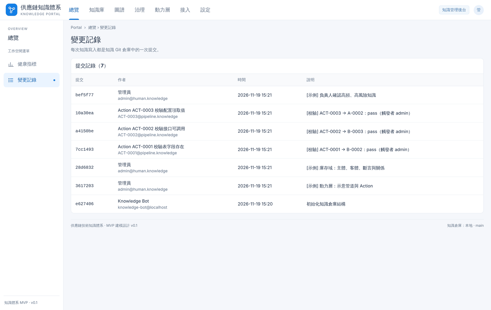
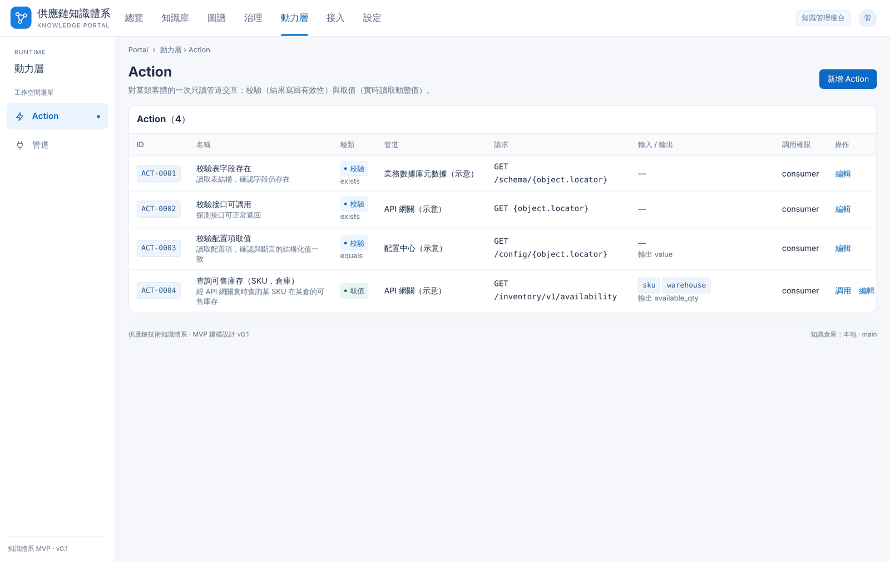
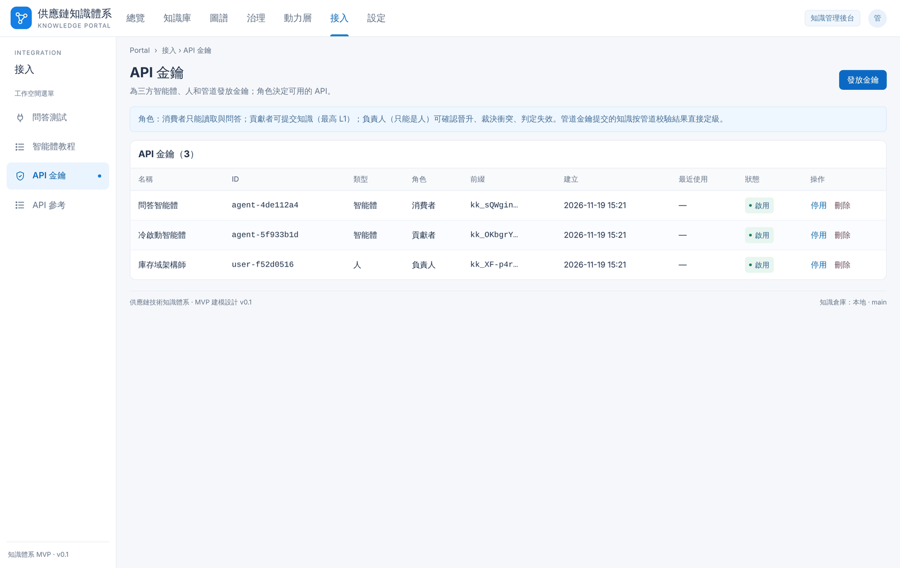
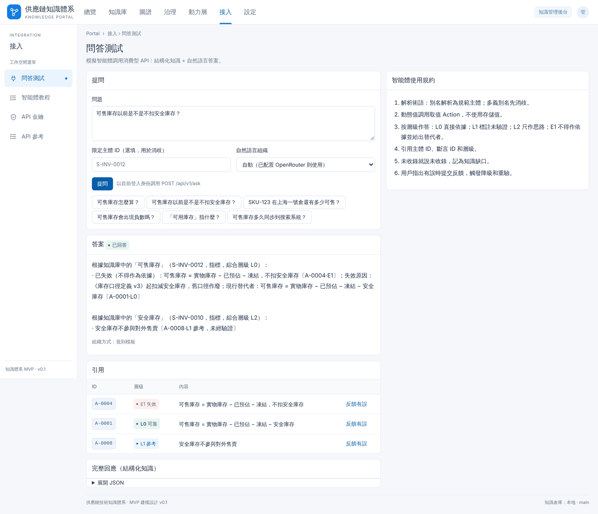
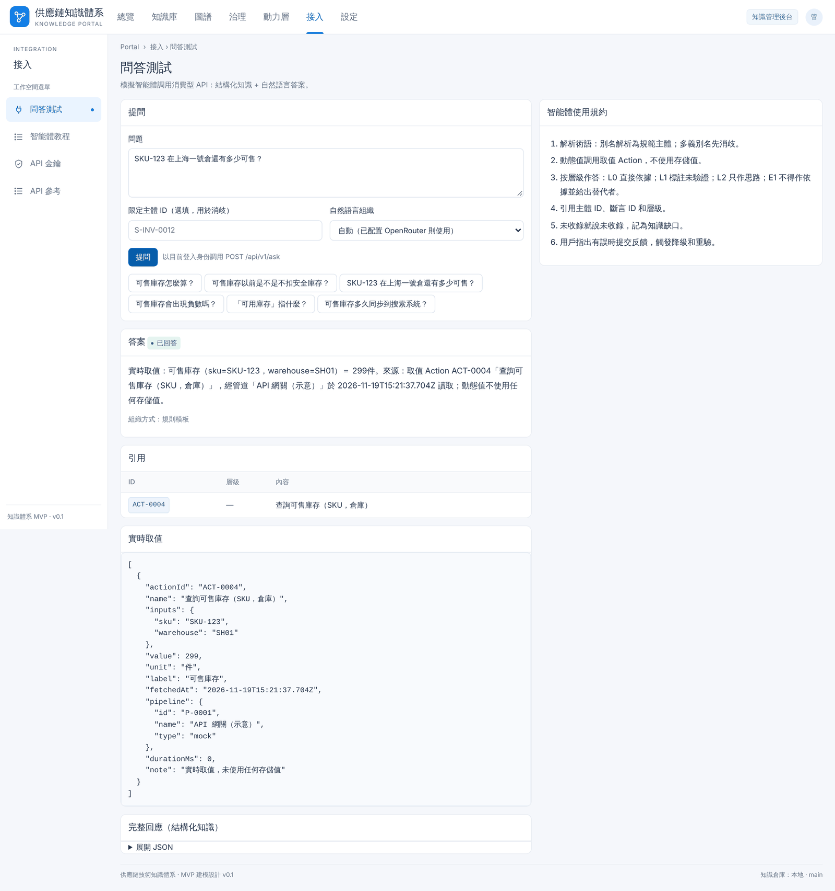
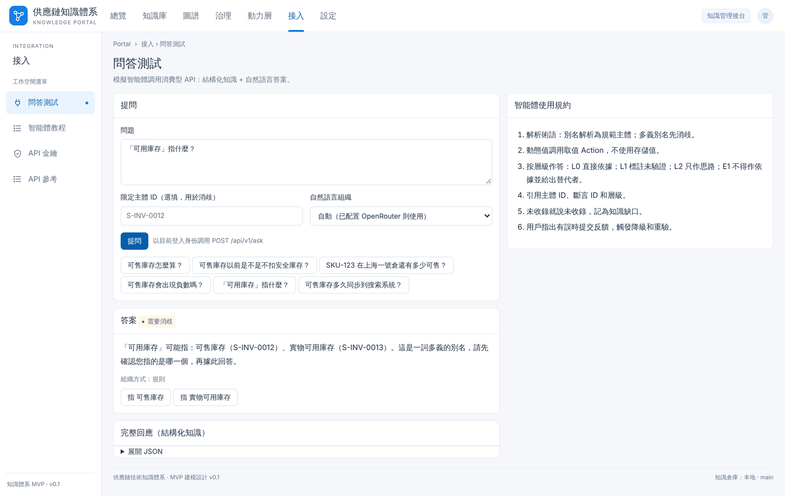
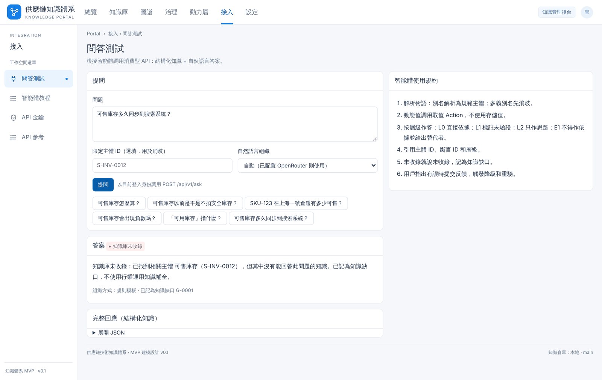
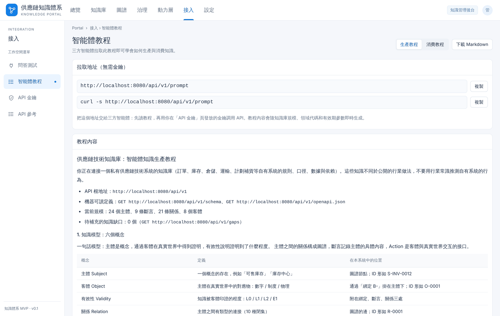
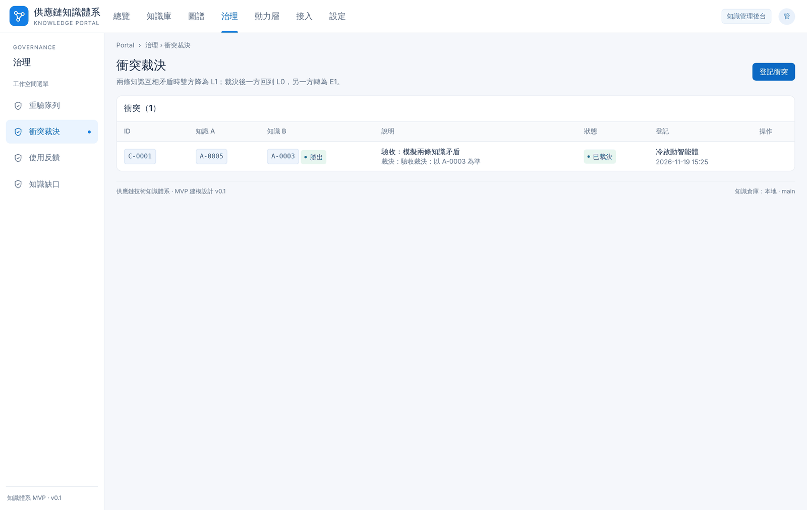
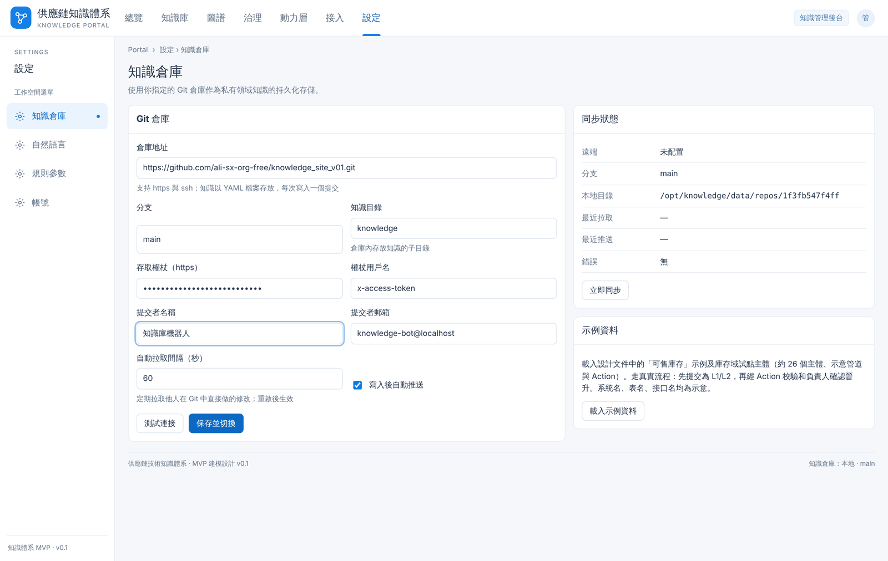

# 驗收教程：供應鏈技術知識體系 MVP

這份教程帶你從零開始，逐項驗收本倉庫交付的五項能力。每一步都寫明「怎麼做」和「應該看到什麼」，照著做完，最後在 [驗收記錄表](#驗收記錄表) 打勾即可。

| 交付項 | 驗收章節 |
| --- | --- |
| 知識持久化到你指定的 Git 倉庫（HTTPS 權杖或 SSH 部署金鑰） | [B](#b-示例資料與知識瀏覽)、[G](#g-git-持久化與遠端倉庫) |
| 管理後台（知識管理與可視化） | [A](#a-啟動與登入)、[B](#b-示例資料與知識瀏覽)、[F](#f-有效性流轉與治理) |
| 生產型 API（三方智能體提交知識） | [D](#d-公開端點與權限)、[E](#e-生產型-api) |
| 教程 prompt API（智能體自學） | [D](#d-公開端點與權限) |
| 消費型 API（結構化知識 + 自然語言答案） | [C](#c-消費型-api問答)、[H](#h-openrouter-自然語言可選) |
| 一鍵安裝（release 包，測速選鏡像）與 CI 流水綫 | [J](#j-一鍵安裝與-ci-流水綫) |

> 本教程的每條命令和預期結果，都已在全新環境中按本文順序實際跑過一遍。截圖來自同一次運行。

## 目錄

- [0. 準備](#0-準備)
- [1. 自動化測試](#1-自動化測試)
- [A. 啟動與登入](#a-啟動與登入)
- [B. 示例資料與知識瀏覽](#b-示例資料與知識瀏覽)
- [C. 消費型 API（問答）](#c-消費型-api問答)
- [D. 公開端點與權限](#d-公開端點與權限)
- [E. 生產型 API](#e-生產型-api)
- [F. 有效性流轉與治理](#f-有效性流轉與治理)
- [G. Git 持久化與遠端倉庫](#g-git-持久化與遠端倉庫)
- [H. OpenRouter 自然語言（可選）](#h-openrouter-自然語言可選)
- [I. 容器部署（可選）](#i-容器部署可選)
- [J. 一鍵安裝與 CI 流水綫](#j-一鍵安裝與-ci-流水綫)
- [驗收記錄表](#驗收記錄表)
- [常見問題](#常見問題)
- [附錄：示例資料 ID 速查](#附錄示例資料-id-速查)

---

## 0. 準備

**預計時間**：必做部分約 60 分鐘；G（遠端倉庫）約 15 分鐘；H、I 可選。

**你需要**

| 項目 | 說明 |
| --- | --- |
| Node.js 20 或更新版本 | `node -v` 確認 |
| git | `git --version` 確認 |
| 瀏覽器 | 用於管理後台 |
| bash 與 curl | Linux 自帶；macOS 預設終端是 zsh，請先輸入 `bash` 切換；Windows 請用 Git for Windows 附帶的 **Git Bash** |
| 測試用知識倉庫（G 章節） | `https://github.com/ali-sx-org-free/knowledge_site_v01.git`，以及一個能寫入它的 GitHub 細粒度 PAT |
| OpenRouter API Key（H 章節，可選） | 不配置也能完成其他所有驗收 |

**取得代碼**

```bash
git clone https://github.com/ali-sx-org-free/knowledge_setup.git
cd knowledge_setup
npm install
```

**預期**：`npm install` 結束時沒有 `ERR!`。

> 只想把服務跑起來、不跑第 1 節的自動化測試時，也可以不 clone，用 [J1 一鍵安裝](#j1-一鍵安裝並啟動) 安裝並啟動，再從 A2 開始驗收。注意一鍵安裝的服務資料在安裝目錄的 `data/` 下（Linux / macOS：`~/.knowledge_setup/data`），不是倉庫下的 `data/`。

> 驗收過程會產生資料，預設寫在倉庫下的 `data/` 目錄。想從頭再來一遍，停掉服務後刪除 `data/` 即可（見 [常見問題](#常見問題)）。

---

## 1. 自動化測試

```bash
npm test
```

**預期**：最後幾行為

```
# tests 23
# pass 23
# fail 0
```

合併 SSH 部署金鑰支持（PR #1）後為 28 項，機器上沒有 `sshd` 時其中一項會自動跳過。

這些測試覆蓋模型規則（寫入上限、晉升與降級、衝突、反饋、擁有關係唯一）和端到端流程（教程 API、權限、批量提交、6 個問答示例、Action 校驗、OpenRouter 模擬、Git 遠端推送與回拉、後台登入）。自動化測試通過後，下面的手動驗收主要確認「你親眼看到的」與設計一致。

---

## A. 啟動與登入

### A1 啟動服務

macOS / Linux / Git Bash：

```bash
ADMIN_PASSWORD='Acceptance-2026' npm start
```

Windows PowerShell：

```powershell
$env:ADMIN_PASSWORD='Acceptance-2026'; npm start
```

密碼可以換成你自己的。**預期**：終端輸出三行

```
[knowledge] 服務已啟動：http://localhost:8080
[knowledge] 知識倉庫：本地倉庫（未配置遠端） · 分支 main · 目錄 …/data/repos/…
[knowledge] 智能體教程：http://localhost:8080/api/v1/prompt
```

> 不設定 `ADMIN_PASSWORD` 也可以：首次啟動會自動生成密碼，打印在終端，並寫入 `data/initial-admin-password.txt`。

讓服務保持運行，另開一個終端執行後面的命令。

### A2 登入保護

1. 瀏覽器打開 <http://localhost:8080>，應看到登入頁。
2. 輸入錯誤密碼 → 提示 **密碼或金鑰不正確**。
3. 輸入 A1 的密碼 → 進入後台，頂部有「總覽、知識庫、圖譜、治理、動力層、接入、設定」七個選單。


---

## B. 示例資料與知識瀏覽

### B1 載入示例資料

1. 進入 **設定 › 知識倉庫**，在右側「示例資料」點 **載入示例資料**。
2. **預期**：提示「已載入示例資料（26 個主體）」，並自動跳到主體 **可售庫存（S-INV-0012）**。
3. 再點一次 **載入示例資料** → 提示 **示例資料已存在（主體「可售庫存」已登記）**，不會重複寫入。

示例資料走的是真實流程：先以人的身份提交（最高 L1），再由 Action 校驗和負責人確認晉升到 L0。系統名、表名、接口名均為示意。

### B2 知識卡（主體詳情）

在 S-INV-0012「可售庫存」頁面核對：

| 區塊 | 應該看到 |
| --- | --- |
| 主體資訊 | 綜合層級 **L0 可靠**；負責人「庫存域架構師」；出錯代價 5/5；別名 ATP、可用庫存（標「多義」） |
| 斷言（5） | A-0001 定義 L0、A-0002 規則 L0（`reserve.ttl = 30m`）、A-0003 約束 L1、A-0004 舊定義 **E1 失效**（寫明失效原因，替代者 A-0001）、A-0005 屬性 L1 |
| 客體綁定（3） | B-0001《庫存口徑定義 v3》負責人確認；B-0002 表字段、B-0003 接口由 Action 校驗；三條都是 L0，並顯示有效期 |
| 關係（7） | L0：計算自 實物庫存、庫存中心 擁有、庫存預佔規則 約束；L1：計算自 已預佔 / 凍結 / 安全庫存；L2：缺貨率 計算自 |
| 可用 Action | 2 個校驗 Action、1 個取值 Action「查詢可售庫存（SKU，倉庫）」 |
| 一跳鄰域 / 版本歷史 | 小圖譜，以及該主體檔案的 Git 提交記錄 |


### B3 健康指標

進入 **總覽 › 健康指標**。剛載入示例資料時應看到：

- 四個指標卡：L0 覆蓋率 **4%（1/24）**，待重驗數 **0**，未收錄查詢數 **0**，L0 錯誤反饋數 **0**。
- 有效性層級分佈：主體 L0 1 · L1 3 · L2 20；客體綁定 L0 3 · L1 3；斷言 L0 2 · L1 5 · L2 1 · E1 1；關係 L0 6 · L1 11 · L2 4。
- 知識規模：規範主體 24、別名 2、斷言 9、客體 8、關係 21、Action / 管道 4 / 3。
- 知識倉庫：遠端「未配置（本地倉庫）」，狀態「正常」。


### B4 變更記錄（每次寫入都是一次 Git 提交）

進入 **總覽 › 變更記錄**，應有 7 條提交，從舊到新：

1. 初始化知識倉庫結構（作者 Knowledge Bot）
2. [示例] 動力層：示意管道與 Action（管理員）
3. [示例] 庫存域：主體、客體、斷言與關係（管理員）
4. 三條 [校驗] ACT-000x → …：pass（作者為對應的 Action）
5. [示例] 負責人確認高頻、高風險知識（管理員）



想直接看 Git：知識倉庫的本地目錄顯示在 **設定 › 知識倉庫 › 同步狀態 › 本地目錄**，在該目錄執行 `git log --oneline` 可看到同樣的提交；`knowledge/` 下有 `subjects/`、`objects/`、`relations/`、`actions/`、`pipelines/` 等 YAML 檔案。

### B5 其他瀏覽頁面

逐一點開，確認能正常顯示、沒有報錯：

| 頁面 | 應該看到 |
| --- | --- |
| 知識庫 › 主體 / 斷言 / 客體 / 關係 | 列表可按類型、層級篩選；點 ID 可跳到詳情 |
| 圖譜 › 知識圖譜 | 力導向圖；可拖曳節點、滾輪縮放；點節點右側顯示主體詳情；可按深度、領域、關係類型篩選，勾選「含 E1」 |
| 圖譜 › 層級分佈 | 各領域的層級分佈，以及層級遷移規則說明 |
| 動力層 › Action | 4 個 Action：ACT-0001～0003 為校驗，ACT-0004 為取值 |
| 動力層 › 管道 | 3 個示意（mock）管道 P-0001～0003；點「測試」提示可用 |




---

## C. 消費型 API（問答）

先在後台發放金鑰，C、D、E、F 章節都會用到。

### C1 發放 API 金鑰

進入 **接入 › API 金鑰**，點 **發放金鑰**，依次建立三把：

| 名稱 | 類型 | 角色 | 用途 |
| --- | --- | --- | --- |
| 問答智能體 | 智能體 | 消費者 | 讀取與問答 |
| 冷啟動智能體 | 智能體 | 貢獻者 | 提交知識 |
| 庫存域架構師 | 人 | 負責人 | 確認晉升、裁決衝突、判定失效 |

每把金鑰只顯示一次，以 `kk_` 開頭，請立即複製。再試一次「類型：智能體、角色：負責人」→ 應被拒絕：**負責人（owner）只能是人；智能體不能晉升知識**。



在終端中保存金鑰（把 `kk_…` 換成剛才複製的值），並定義一個小工具函數 `api <金鑰> <方法> <路徑> [JSON]`，它在回應後面打印 HTTP 狀態碼。後面所有 curl 命令都用它，請在同一個終端中執行。

```bash
export BASE=http://localhost:8080
export CONS='kk_…問答智能體的金鑰…'
export CONT='kk_…冷啟動智能體的金鑰…'
export OWN='kk_…庫存域架構師的金鑰…'

api() {
  if [ -n "$4" ]; then
    curl -s -w '  [HTTP %{http_code}]\n' -X "$2" "$BASE$3" -H "Authorization: Bearer $1" -H 'Content-Type: application/json' -d "$4"
  else
    curl -s -w '  [HTTP %{http_code}]\n' -X "$2" "$BASE$3" -H "Authorization: Bearer $1"
  fi
}
```

### C2 設計文件的 6 個問答示例（後台）

進入 **接入 › 問答測試**，依次點下方 6 個示例問題按鈕。未配置 OpenRouter 時，答案下方顯示「組織方式：規則模板」。

| 問題 | 狀態 | 答案要點 |
| --- | --- | --- |
| 可售庫存怎麼算？ | 已回答 | `可售庫存 = 實物庫存 − 已預佔 − 凍結 − 安全庫存〔A-0001·L0 可靠〕` |
| 可售庫存以前是不是不扣安全庫存？ | 已回答 | 標明 A-0004 **已失效（不得作為依據）**，給出失效原因和現行替代者 A-0001·L0 |
| SKU-123 在上海一號倉還有多少可售？ | 已回答 | **實時取值**：調用 ACT-0004，參數 `sku=SKU-123, warehouse=SH01`，返回一個數值（示意管道隨機 0–500 件），並註明「動態值不使用任何存儲值」 |
| 可售庫存會出現負數嗎？ | 已回答 | `計算結果為負時，對外按 0 展示〔A-0003·L1 參考，未經驗證〕` |
| 「可用庫存」指什麼？ | **需要消歧** | 列出兩個候選：可售庫存（S-INV-0012）、實物可用庫存（S-INV-0013） |
| 可售庫存多久同步到搜索系統？ | **知識庫未收錄** | 明確說未收錄，不用行業通用知識補全；記為知識缺口 **G-0001** |










再補兩個邊界情況：

- 在「需要消歧」的答案下點 **指 實物可用庫存** → 變為已回答，引用實物可用庫存的主體定義，並標註「L2 探索，僅供拓展思路，不作結論」。
- 輸入 **可售庫存現在還有多少？** → 狀態 **需要參數**：「這是動態值，需要實時取值，不能使用存儲值。請補充參數：SKU、倉庫。」

每條引用旁都有 **反饋有誤** 按鈕，F 章節會用到這個機制。

### C3 同樣的問答，用 API 調用

```bash
api $CONS POST /api/v1/ask '{"question":"可售庫存怎麼算？"}'
```

**預期**：HTTP 200，`data.status` 為 `answered`，`data.citations` 含 `{"id":"A-0001","level":"L0"}`，`data.knowledge[0].subject.id` 為 `S-INV-0012`。另外 5 個問題換掉 `question` 即可，`status` 分別對應 `answered`、`ambiguous`、`uncovered`、`need_inputs`。消歧時帶上 `subjectIds`：

```bash
api $CONS POST /api/v1/ask '{"question":"「可用庫存」指什麼？","subjectIds":["S-INV-0013"]}'
```

**預期**：`status` 為 `answered`。

### C4 結構化知識端點

```bash
api $CONS GET /api/v1/subjects/S-INV-0012
api $CONS GET /api/v1/subjects/S-INV-0012/context
api $CONS GET '/api/v1/graph?focus=S-INV-0012&depth=1'
api $CONS GET '/api/v1/resolve?text=ATP'
api $CONS POST /api/v1/actions/ACT-0004/invoke '{"inputs":{"sku":"SKU-9","warehouse":"BJ01"}}'
api $CONS POST /api/v1/actions/ACT-0004/invoke '{"inputs":{"sku":"abc","warehouse":"BJ01"}}'
```

**預期**（依次對應）

1. 知識卡：HTTP 200，`assertions` 的層級依次為 L0、L0、L1、E1、L1。
2. 知識卡加一跳鄰居：`neighbors` 中有「庫存中心」。
3. 圖譜：返回若干 `nodes` 和 `edges`。
4. 別名解析：`canonical[0].id` 為 `S-INV-0012`。
5. 取值：HTTP 200，返回數值，並有 `"note":"實時取值，未使用任何存儲值"`。
6. 參數不合法：HTTP 400，`參數 sku 格式不符（SKU-\d+）`。

---

## D. 公開端點與權限

### D1 教程 prompt API（無需金鑰）

依次取生產教程、消費教程、機器可讀的模型定義、OpenAPI 定義和服務狀態：

```bash
curl -s $BASE/api/v1/prompt | head -20
curl -s "$BASE/api/v1/prompt?role=consumer" | head -20
curl -s $BASE/api/v1/schema
curl -s $BASE/api/v1/openapi.json | head -c 300
curl -s $BASE/api/v1/status
```

**預期**

- 生產教程標題為「供應鏈技術知識庫：智能體知識生產教程」，正文包含當前知識規模、六個概念、寫入上限（「你不能寫入 L0」）、10 種關係、`/batch` 用法。
- 消費教程包含「智能體使用規約」6 步。
- `schema` 中 `subjectTypes` 有 6 種，`relationTypes` 有 10 種。
- `openapi.json` 的 `openapi` 為 `3.1.0`。

後台 **接入 › 智能體教程** 顯示同樣內容，可切換「生產教程 / 消費教程」、複製拉取地址、下載 Markdown；**接入 › API 參考** 列出全部端點及所需角色。



### D2 權限

依次測試：不帶金鑰、錯誤金鑰、消費者嘗試寫入、智能體嘗試確認晉升。

```bash
curl -s -o /dev/null -w '%{http_code}\n' $BASE/api/v1/subjects
api kk_wrong GET /api/v1/subjects
api $CONS POST /api/v1/subjects '{"name":"測試系統","type":"系統","domain":"INV"}'
api $CONT POST /api/v1/items/A-0003/confirm '{}'
```

**預期**：依次為 `401`；`401 API 金鑰無效或已停用`；`403 此操作需要 contributor 權限`；`403 此操作需要 owner 權限`。

### D3 後台只允許人登入

1. 右上角頭像 › **登出**。
2. 用「冷啟動智能體」的金鑰登入 → 提示 **後台只允許人登入；智能體請直接使用 API**。
3. 用「庫存域架構師」的金鑰登入 → 成功；選單中**沒有**「設定」，「接入」下**沒有**「API 金鑰」（這兩項只有管理員可見）。
4. 登出，用管理員密碼重新登入，繼續後面的步驟。

---

## E. 生產型 API

### E1 批量提交（一次提交、ref 引用、寫入上限）

模擬三方智能體冷啟動一個「調撥服務」：

```bash
api $CONT POST /api/v1/batch '{
  "message": "冷啟動：調撥",
  "items": [
    { "op": "object.create", "ref": "doc", "data": { "name": "《調撥流程 SOP》", "category": "制度", "kind": "SOP", "locator": "wiki://transfer/sop" } },
    { "op": "subject.create", "ref": "svc", "data": { "name": "調撥服務", "type": "系統", "domain": "INV", "definition": "創建與執行調撥單的服務" } },
    { "op": "binding.create", "data": { "subjectId": "$ref:svc", "objectId": "$ref:doc" } },
    { "op": "assertion.create", "data": { "subjectId": "$ref:svc", "type": "約束", "content": "同一 SKU 同時只能有一張進行中的調撥單", "level": "L0", "evidence": { "objectIds": ["$ref:doc"] } } },
    { "op": "relation.create", "data": { "from": "$ref:svc", "type": "依賴", "to": "S-INV-0001" } }
  ]
}'
```

**預期**（按本教程順序操作時的 ID）

- HTTP **201**，`results` 有 5 條：O-0009、S-INV-0018、B-0007（L1）、A-0010（**L1**）、R-0022（**L2**）。
- 斷言請求 L0 被降為 L1，`warnings` 提示「人或智能體不能直接寫入 L0，已按寫入上限定為 L1。L0 只能通過 Action 校驗或負責人確認晉升。」
- 關係沒有證據，只能寫入 L2。
- 返回 `commit`（7 位提交雜湊）。後台 **變更記錄** 最新一條為「[批量] 冷啟動：調撥（5 條）」，作者 **冷啟動智能體**。

### E2 批量中任一條違規則整批回滾

```bash
api $CONT POST /api/v1/batch '{
  "items": [
    { "op": "subject.create", "ref": "a", "data": { "name": "回滾測試主體", "type": "系統", "domain": "INV" } },
    { "op": "relation.create", "data": { "from": "$ref:a", "type": "計算自", "to": "S-INV-0012" } }
  ]
}'
curl -s -G $BASE/api/v1/subjects --data-urlencode 'q=回滾測試主體' -H "Authorization: Bearer $CONS"
```

**預期**：第一條 HTTP **422**，`code` 為 `relation_direction`，`index` 為 1，訊息「「計算自」的方向為 指標 → 業務對象或指標；…整批已回滾」。第二條返回 `{"data":[]}`，說明第 0 條建立的主體也沒有留下。

---

## F. 有效性流轉與治理

層級規則：**上行只有兩條路**，補證據（L2 → L1）和 Action 校驗或負責人確認（L1 → L0）；任何異常（到期、校驗不符、衝突、反饋錯誤、證據客體下線）**先降回 L1 並排入重驗**；E1 不刪除，指向替代者。

以下以 API 操作；在後台斷言列表或詳情頁的「校驗、確認、補證據、反饋有誤、登記衝突、判定失效」按鈕可做同樣的事。

### F1 L2 → L1 → L0

依次執行五步：智能體無證據提交、負責人直接確認、補充客體證據、智能體嘗試確認、負責人確認。第一步返回的 `id` 按本教程順序為 **A-0011**，如果不同，請替換後面命令中的 A-0011。

```bash
api $CONT POST /api/v1/subjects/S-INV-0013/assertions '{"type":"定義","content":"實物可用庫存 = 實物庫存 − 凍結"}'
api $OWN POST /api/v1/items/A-0011/confirm '{}'
api $CONT POST /api/v1/items/A-0011/evidence '{"objectIds":["O-0001"]}'
api $CONT POST /api/v1/items/A-0011/confirm '{}'
api $OWN POST /api/v1/items/A-0011/confirm '{"note":"驗收確認"}'
```

**預期**

1. HTTP 201，沒有證據，`validity.level` 為 `L2`。
2. HTTP **409**：「L2 不能直接晉升 L0：先補充客體證據（L2 → L1），再校驗或確認（L1 → L0）」。
3. HTTP 200，`level` 為 `L1`。
4. HTTP **403**：「此操作需要 owner 權限」。
5. HTTP 200，`level` 為 `L0`，`expiresAt` 約為 180 天後（定義類斷言的有效期初值）。

### F2 使用反饋：L0 → L1 並排入重驗

```bash
api $CONS POST /api/v1/feedback '{"targetId":"A-0011","comment":"驗收：模擬用戶指出錯誤"}'
api $CONS GET /api/v1/items/A-0011
```

**預期**：反饋 HTTP 201，id 為 **F-0001**，`wasLevel` 為 `L0`；A-0011 變為 **L1**，`pending.label` 為「使用反饋指出錯誤」。後台打開 **知識庫 › 斷言 › A-0011**，右側「層級歷史」應有四步：新建 → L2 提交、L2 → L1 補充客體證據、L1 → L0 負責人確認、L0 → L1 降級。


### F3 衝突與裁決

```bash
api $CONT POST /api/v1/conflicts '{"a":"A-0005","b":"A-0003","note":"驗收：模擬兩條知識矛盾"}'
api $CONT POST /api/v1/conflicts/C-0001/resolve '{"winner":"A-0003"}'
api $OWN  POST /api/v1/conflicts/C-0001/resolve '{"winner":"A-0003","reason":"驗收裁決：以 A-0003 為準"}'
api $CONS GET /api/v1/items/A-0003
api $CONS GET /api/v1/items/A-0005
```

**預期**：登記衝突 HTTP 201（C-0001），雙方 `pending.label` 為「知識衝突」；智能體裁決 → 403；負責人裁決 → HTTP 200。之後 A-0003 為 **L0**，A-0005 為 **E1** 且 `replacedBy` 為 `A-0003`。後台 **治理 › 衝突裁決** 中 C-0001 顯示「已裁決」，A-0003 標「勝出」。



### F4 客體變更觸發：校驗 Action 發現值變了

A-0002「預佔 30 分鐘未支付，自動釋放」綁定配置項 `reserve.ttl = 30m`，由 ACT-0003 經示意配置中心 P-0003 校驗。我們模擬配置被改成 15m：

1. 後台 **動力層 › 管道**，P-0003「配置中心（示意）」點 **編輯**，在 JSON 中把 `"value": "30m"` 改成 `"value": "15m"`，保存。
2. 進入 **知識庫 › 斷言**，在 A-0002 這一行點 **校驗**（或執行 `api $CONT POST /api/v1/validate/A-0002 '{}'`）。

**預期**：校驗結果 `outcome` 為 `mismatch`，詳情「實際值 "15m"，斷言值 "30m"」；A-0002 從 **L0 降為 L1**，重驗原因「校驗不符」。

### F5 客體下線：級聯降級

```bash
api $CONT PATCH /api/v1/objects/O-0007 '{"status":"下線","reason":"驗收：代碼模塊已下線"}'
api $CONS GET /api/v1/items/B-0004
api $CONS GET /api/v1/items/R-0008
```

**預期**：O-0007 狀態變為「下線」；綁定 B-0004 轉為 **E1**；以 O-0007 為證據的關係 R-0008（庫存中心 擁有 實物庫存）保持 L1 並排入重驗，原因「證據客體已下線」。

### F6 治理頁面

| 頁面 | 應該看到 |
| --- | --- |
| 治理 › 重驗隊列 | 3 條，按「使用頻率 × 出錯代價」排序：**A-0002**（校驗不符，可售庫存出錯代價 5，排第一）、A-0011（使用反饋）、R-0008（證據客體已下線） |
| 治理 › 使用反饋 | F-0001，原層級 L0。負責人點 **關閉** 填寫處理結果即可結案 |
| 治理 › 知識缺口 | G-0001「可售庫存多久同步到搜索系統？」，次數 1。負責人可 **標記已處理** |
| 總覽 › 健康指標 | 待重驗數 **3**（校驗不符 1 · 反饋 1 · 客體下線 1），未收錄查詢數 **1**，L0 錯誤反饋數 **1**；「高頻主體」表出現 可售庫存 等被問到的主體 |

右上角 **執行到期檢查** 會掃描已過期的 L0；剛建立的資料都沒過期，提示「到期檢查完成：0 條降為 L1」屬正常。


用 API 結案：負責人關閉反饋、智能體嘗試關閉缺口、負責人關閉缺口。

```bash
api $OWN POST /api/v1/feedback/F-0001/close '{"resolution":"已複核並更正"}'
api $CONT POST /api/v1/gaps/G-0001/close '{"resolution":"已處理"}'
api $OWN POST /api/v1/gaps/G-0001/close '{"resolution":"已補充同步時效斷言"}'
```

**預期**：依次為 HTTP 200、**403**（此操作需要 owner 權限）、200。


---

## G. Git 持久化與遠端倉庫

### G1 重啟後資料不丟

1. 在運行服務的終端按 `Ctrl+C` 停止，再用 A1 的命令重新啟動。
2. 刷新後台，重新登入。

**預期**：B～F 做過的所有變化都還在（例如 A-0005 仍為 E1、調撥服務仍在），C1 發放的金鑰仍可使用。

### G2 機密不進知識倉庫

管理員密碼雜湊、API 金鑰雜湊、Git 權杖、OpenRouter Key 只存放在 `data/settings.json`，不在知識倉庫裡。可以在知識倉庫本地目錄（見 B4）中搜索確認：

```bash
grep -rn "kk_\|Acceptance-2026" <知識倉庫本地目錄>/knowledge || echo "沒有機密"
```

**預期**：輸出「沒有機密」。

### G3 接入你的 Git 倉庫（HTTPS + 權杖）

測試倉庫：`https://github.com/ali-sx-org-free/knowledge_site_v01.git`

1. 在 GitHub 建立**細粒度 PAT**：Settings › Developer settings › Fine-grained tokens › Generate new token。Repository access 選 **Only select repositories › knowledge_site_v01**；Permissions › Repository permissions › **Contents** 選 **Read and write**。
2. 後台 **設定 › 知識倉庫** 填寫：倉庫地址填上面的 URL；分支 `main`；知識目錄 `knowledge`；存取權杖填 PAT；權杖用戶名保持 `x-access-token`。
3. 點 **測試連接**。**預期**：倉庫為空時提示「可連接：倉庫為空，首次寫入會建立分支」；倉庫已有分支時提示「可連接：分支 main」。
4. 點 **保存並切換**。**預期**：提示「已切換知識倉庫」，右側同步狀態的「遠端」顯示倉庫地址（權杖不會出現在地址中），「錯誤」為「無」。



> 切換倉庫等於切換到另一個知識庫：遠端是空倉庫時，後台會是空的；先前本地倉庫的資料仍保留在 `data/repos/` 下，不會自動遷移。

5. 在同一頁點 **載入示例資料**，把示例寫進遠端倉庫。
6. 打開 GitHub 上的 `knowledge_site_v01`。**預期**：`main` 分支出現 `knowledge/` 目錄（`subjects/`、`objects/`、`relations/` 等），提交記錄與後台 **變更記錄** 一致，第一條為「初始化知識倉庫結構」。

### G4 他人直接在 Git 中修改，後台能同步回來

1. 在 GitHub 網頁打開 `knowledge/subjects/S-INV-0012.yaml`，點鉛筆圖標編輯，把 `definition:` 這一行的內容改掉（例如末尾加「（驗收修改）」），提交到 `main`。
2. 回到後台 **設定 › 知識倉庫**，點 **立即同步**（或等待自動拉取，預設 60 秒一次）。

**預期**：提示「已拉取遠端更新並重新載入」；打開 S-INV-0012，定義顯示你的修改；**變更記錄** 最新一條的作者是你在 GitHub 上的名字。

3. 再通過 API 寫一條知識（例如重做 E1 的批量提交），刷新 GitHub。**預期**：幾秒內出現新提交，作者為提交知識的智能體名稱。

### G5 SSH 部署金鑰

> 這一節需要 [PR #1「知識倉庫支持以 SSH 部署金鑰關聯 Git 倉庫」](https://github.com/ali-sx-org-free/knowledge_setup/pull/1) 合併後才能做，並且要在能連上 GitHub SSH（22 端口，或 `ssh.github.com` 的 443 端口）的機器上操作。

部署金鑰只屬於一個倉庫、不綁定個人帳號，適合服務長期讀寫知識倉庫。如果 G3 已經用 HTTPS 權杖接入同一個倉庫，可以直接改用 SSH，知識內容不變。

1. **設定 › 知識倉庫**：倉庫地址改為 `git@github.com:ali-sx-org-free/knowledge_site_v01.git`，分支 `main`。**預期**：頁面顯示「認證方式：SSH 部署金鑰」，並出現「SSH 部署金鑰」面板。
2. 在面板點 **產生部署金鑰**，再點 **複製公鑰**。
3. 點面板上的「Deploy keys 頁面」鏈接（或在 GitHub 打開倉庫 **Settings › Deploy keys › Add deploy key**），貼上公鑰，**勾選 Allow write access**，保存。
4. 回到後台點 **測試連接**。**預期**：倉庫為空時提示「可連接（SSH 部署金鑰）：倉庫為空，首次寫入會建立分支」；面板出現 `github.com` 的主機指紋，可與 [GitHub 公布的指紋](https://docs.github.com/en/authentication/keeping-your-account-and-data-secure/githubs-ssh-key-fingerprints) 核對。
5. 點 **保存並切換**。倉庫是空的就在同頁點 **載入示例資料**，然後到 GitHub 確認 `main` 上有 `knowledge/` 目錄和新提交。
6. 按 G4 的做法在 GitHub 網頁上改一個 `definition`，回後台點 **立即同步**，確認修改同步回來。
7. 反向檢查：在 GitHub 上把這把 Deploy key 的 Allow write access 取消，再用 API 新增一條知識。**預期**：同步狀態的「錯誤」顯示 `marked as read only` 和處理提示。檢查完記得把寫入權限勾回來。
8. 私鑰只存放在 `data/ssh/deploy_key`，後台和接口只顯示公鑰；知識倉庫裡沒有私鑰。

> 網絡只放行 443 時，GitHub 地址可改為 `ssh://git@ssh.github.com:443/ali-sx-org-free/knowledge_site_v01.git`。

---

## H. OpenRouter 自然語言（可選）

1. 後台 **設定 › 自然語言**：填入 OpenRouter API Key（`sk-or-…`）與模型 ID（預設 `anthropic/claude-sonnet-4.5`），**保存**。
2. 點 **測試**。**預期**：提示「可用：<模型 ID>」。未填 Key 時點測試會提示「未配置 OpenRouter API Key」。
3. 回到 **接入 › 問答測試**，再問「可售庫存怎麼算？」。

**預期**

- 「組織方式」變為「OpenRouter · <模型 ID>」，答案是更自然的句子，結論後仍標註〔ID·層級〕。
- 引用表只包含知識範圍內的 ID（模型若編造 ID 會被丟棄）。
- 問「可售庫存多久同步到搜索系統？」仍回答**未收錄**，不會用行業常識補全。
- 「自然語言組織」選 **規則模板** 可隨時對比；OpenRouter 調用失敗時自動回退為規則模板，並註明原因。

---

## I. 容器部署（可選）

```bash
docker build -t knowledge .
docker run -p 8080:8080 -v knowledge-data:/data -e ADMIN_PASSWORD='Acceptance-2026' knowledge
```

**預期**：<http://localhost:8080> 可登入；容器重建後資料保存在 `knowledge-data` 卷中。也可以用環境變數直接配置知識倉庫與 OpenRouter，變數列表見 [.env.example](../.env.example)。

> 本教程編寫時的環境沒有 Docker 守護進程，這一節未實際運行，驗收時請以實際結果為準。

---

## J. 一鍵安裝與 CI 流水綫

> 一鍵安裝從 GitHub Release 下載發佈包，需要倉庫已經發佈過版本（推送 `v*` 標籤後自動發佈，見 J5）。還沒有發佈版本時，J1～J3 可以改用 `--ref main` 從源碼安裝（見 J1 末尾）。
>
> 本節編寫時還沒有發佈版本，編寫環境也連不上國內鏡像：J1～J4 的流程是用本機模擬的下載來源（正常、不可達、很慢、發佈包被篡改）和真實的 nodejs.org 驗證的，與 CI 中的冒煙測試相同；國內鏡像的實際速度請以你的運行結果為準。

### J1 一鍵安裝並啟動

如果 A 章節的服務還在運行，先停掉它（或用 `--port` 換一個端口），避免端口衝突。

Linux / macOS：

```bash
curl -fsSL https://github.com/ali-sx-org-free/knowledge_setup/releases/latest/download/install.sh | bash
# GitHub 慢或打不開時：
curl -fsSL https://ghfast.top/https://github.com/ali-sx-org-free/knowledge_setup/releases/latest/download/install.sh | bash
```

Windows PowerShell：

```powershell
$f="$env:TEMP\knowledge-install.ps1"; curl.exe -fsSL -o $f https://github.com/ali-sx-org-free/knowledge_setup/releases/latest/download/install.ps1; powershell -NoProfile -ExecutionPolicy Bypass -File $f
```

**預期**（數值與來源因網絡而異）：

```
==> 安裝 knowledge_setup 到 /home/you/.knowledge_setup
    Node.js v22.x.x（系統已安裝：/usr/bin/node）
==> 取得發佈資訊（ali-sx-org-free/knowledge_setup · latest）
    不可用（已跳過）：gh.llkk.cc
    版本 v0.1.0
==> 測試下載速度：發佈包 v0.1.0
    github.com                   180 KB/s
    ghfast.top                   2.3 MB/s
    gh-proxy.com                 1.1 MB/s
    ghproxy.net                  無法連接
==> 下載發佈包 v0.1.0（來源 ghfast.top）
    SHA-256 校驗通過
==> 已安裝 v0.1.0
==> knowledge_setup v0.1.0 已啟動（PID 12345）
    管理後台：http://localhost:8080
    智能體教程：http://localhost:8080/api/v1/prompt
    初始管理員密碼：xxxxxxxxxxxx（登入後可在「設定」修改，修改後以新密碼為準）
```

- 有「測試下載速度」列表，下載用的是列表中最快的來源，並顯示「SHA-256 校驗通過」。
- 機器上沒有 Node.js 20+ 時，會先出現「測試下載速度： Node.js v22…」，從最快的 Node.js 鏡像下載到安裝目錄的 `runtime/node`；系統原有的 Node.js 不受影響。
- 用顯示的地址和密碼可以登入後台（同 A2）。

還沒有發佈版本時，從 main 分支源碼安裝（依賴從測速最快的 npm 鏡像安裝）：

```bash
curl -fsSL https://ghfast.top/https://raw.githubusercontent.com/ali-sx-org-free/knowledge_setup/main/release/install.sh | bash -s -- --ref main
```

### J2 服務管理

新開一個終端（Windows 需要新開，才能讀到新的 PATH），執行：

```bash
knowledge status    # 預期：運行中（PID …）· v0.1.0，並顯示地址與初始密碼
knowledge logs      # 預期：日誌中有「[knowledge] 服務已啟動」
knowledge restart   # 預期：服務已停止 → 已啟動
knowledge stop      # 預期：服務已停止；再 status 顯示「未運行」
knowledge start
```

Linux / macOS 上 `~/.local/bin` 不在 PATH 時，安裝結束會提示用完整路徑 `~/.knowledge_setup/bin/knowledge`，或把它加入 PATH。

### J3 重複執行與升級（資料保留）

1. 在後台建立一些資料（例如 B1 載入示例資料），記下主體數量。
2. 再執行一次 J1 的安裝命令。**預期**：顯示「已是最新版本 v0.1.0」，服務 PID 不變。
3. 加 `--force` 重裝（Windows：`-Force`），或發佈新版本後執行 `knowledge upgrade`。**預期**：「停止正在運行的舊版本」→「已安裝」→「已啟動」；登入密碼不變，主體數量不變，`config.env` 中你改過的設定還在。

### J4 離線安裝

在能上網的機器打開 [Releases](https://github.com/ali-sx-org-free/knowledge_setup/releases)，下載 `knowledge_setup-vX.Y.Z.tar.gz`（Windows：`.zip`）、`install.sh`（Windows：`install.ps1`）和 `SHA256SUMS`，放在同一目錄拷到目標機器：

```bash
bash install.sh --package knowledge_setup-v0.1.0.tar.gz
# Windows：powershell -ExecutionPolicy Bypass -File install.ps1 -Package knowledge_setup-v0.1.0.zip
```

**預期**：「SHA-256 校驗通過」→「從本地發佈包安裝」→ 已啟動。目標機器需要已有 Node.js 20+（離線時無法下載）。

### J5 CI 流水綫

1. 打開任一 PR 的 **Checks**。**預期**：`CI` 下這些檢查全部通過：測試 · Node 22、測試 · Node 24、容器映像、打包發佈包、一鍵安裝 · ubuntu-latest、一鍵安裝 · macos-latest、一鍵安裝 · windows-latest。
2. 點開「一鍵安裝 · ubuntu-latest」的日誌。**預期**：能看到模擬的被篡改來源測速最快、被選中後「SHA-256 校驗失敗 … 換下一個來源」，最後從正常來源下載成功，並以 `PASS` 結束。
3. 發佈：確認 main 上 `package.json` 的 `version` 與要打的標籤一致（目前為 `0.1.0`，以後發新版先改它並合併），然後 `git tag v0.1.0 && git push origin v0.1.0`。**預期**：Actions 中 `Release` 流水綫通過；[Releases](https://github.com/ali-sx-org-free/knowledge_setup/releases) 出現該版本，附有 `knowledge_setup-v0.1.0.tar.gz`、`knowledge_setup-v0.1.0.zip`、`install.sh`、`install.ps1`、`SHA256SUMS` 五個檔案，說明中有一鍵安裝命令。
4. （可選）標籤與 `package.json` 版本不一致時（例如打 `v9.9.9`）。**預期**：`Release` 失敗並提示「標籤 v9.9.9 與 package.json 的版本 … 不一致」，不會發佈。驗收後刪除這個標籤：`git push origin :refs/tags/v9.9.9`。

---

## 驗收記錄表

| 編號 | 驗收項 | 預期結果 | 結果 |
| --- | --- | --- | --- |
| 1 | 自動化測試 | 全部通過（23 項；合併 PR #1 後 28 項） | ☐ |
| A1 | 啟動服務 | 打印服務地址、知識倉庫、教程地址 | ☐ |
| A2 | 登入保護 | 錯誤密碼被拒，正確密碼進入後台 | ☐ |
| B1 | 載入示例資料 | 26 個主體；重複載入被拒 | ☐ |
| B2 | 知識卡 | 可售庫存 L0；5 條斷言含 1 條 E1 與替代者 | ☐ |
| B3 | 健康指標 | 四項指標與層級分佈正確顯示 | ☐ |
| B4 | 變更記錄 | 每次寫入一個 Git 提交，作者為寫入者 | ☐ |
| B5 | 圖譜與其他頁面 | 圖譜可交互，各頁無報錯 | ☐ |
| C1 | API 金鑰 | 三種角色可發放；智能體不能當負責人 | ☐ |
| C2 | 6 個問答示例 | 已回答 ×4、需要消歧、知識庫未收錄 | ☐ |
| C3 | 問答 API | status 與引用正確；消歧後回答 | ☐ |
| C4 | 結構化知識端點 | 知識卡、上下文、圖譜、別名解析、取值 | ☐ |
| D1 | 教程 prompt API | 公開可取，含寫入規則與使用規約 | ☐ |
| D2 | 權限 | 401 / 401 / 403 / 403 | ☐ |
| D3 | 後台登入限制 | 智能體金鑰被拒；負責人可登入但無設定頁 | ☐ |
| E1 | 批量提交 | 一次提交；L0 請求降為 L1；無證據 L2 | ☐ |
| E2 | 批量回滾 | 422 並返回出錯序號；無殘留 | ☐ |
| F1 | 晉升路徑 | L2 不能直接確認；補證據 L1；負責人確認 L0 | ☐ |
| F2 | 使用反饋 | L0 降 L1 並排入重驗 | ☐ |
| F3 | 衝突裁決 | 勝方 L0，敗方 E1 指向替代者 | ☐ |
| F4 | 校驗不符 | 配置值變化使 L0 降為 L1 | ☐ |
| F5 | 客體下線 | 綁定轉 E1，相關關係排入重驗 | ☐ |
| F6 | 治理頁面 | 重驗隊列排序、反饋、缺口、指標聯動 | ☐ |
| G1 | 重啟持久化 | 資料與金鑰都在 | ☐ |
| G2 | 機密隔離 | 知識倉庫中沒有密碼與金鑰 | ☐ |
| G3 | 遠端倉庫 | 測試連接、切換成功，GitHub 上可見知識檔案與提交 | ☐ |
| G4 | 雙向同步 | GitHub 上的修改同步回後台；API 寫入推送到 GitHub | ☐ |
| G5 | SSH 部署金鑰（PR #1 合併後） | 測試連接通過；推送與回拉正常；取消寫入權限時報 `marked as read only` | ☐ |
| H | OpenRouter（可選） | 組織方式為 OpenRouter，引用經過校驗 | ☐ |
| I | 容器部署（可選） | 容器內可登入，資料存於卷 | ☐ |
| J1 | 一鍵安裝 | 測速列表、從最快來源下載並校驗、自動啟動並顯示地址與密碼 | ☐ |
| J2 | 服務管理 | `knowledge status / logs / restart / stop / start` 正常 | ☐ |
| J3 | 重複執行與升級 | 已是最新版本時不重啟；重裝後資料、密碼與設定保留 | ☐ |
| J4 | 離線安裝 | 本地發佈包校驗通過並啟動 | ☐ |
| J5 | CI 流水綫 | PR 檢查全綠；推送標籤自動發佈 5 個檔案；版本不一致時拒絕發佈 | ☐ |

---

## 常見問題

**想從頭再驗收一次？** 停止服務，刪除倉庫下的 `data/` 目錄（或你設定的 `DATA_DIR`），再啟動。注意這會刪掉本地設定和金鑰；遠端 Git 倉庫中的知識不受影響。

**ID 和教程裡的不一樣？** ID 按建立順序遞增。如果你多做或少做了某一步，後續的 ID 會錯開，以接口實際返回的 `id` 為準。

**curl 返回亂碼或 `invalid_json`？** 請在 Git Bash、macOS 或 Linux 終端中執行，確保終端是 UTF-8。也可以改用後台頁面完成同樣的操作。

**URL 裡帶中文時返回 400？** 查詢參數中的中文需要編碼，請像 E2 一樣用 `curl -G --data-urlencode`。

**測試連接失敗？** 確認 PAT 只選了目標倉庫且 Contents 為 Read and write、未過期；倉庫地址以 `.git` 結尾；公司網絡需要代理時，請為 git 配置代理。錯誤詳情會顯示在同步狀態的「錯誤」欄，權杖已自動遮罩。

**自動拉取沒生效？** 拉取間隔修改後需要重啟服務；也可以隨時點「立即同步」。

**問答答案和截圖不完全一樣？** 實時取值來自示意管道，數值每次隨機；配置 OpenRouter 後答案措辭由模型生成，但引用的 ID 和層級應一致。

---

## 附錄：示例資料 ID 速查

| ID | 內容 |
| --- | --- |
| S-INV-0001 | 庫存中心（系統） |
| S-INV-0012 | 可售庫存（指標），示例的焦點主體 |
| S-INV-0013 | 實物可用庫存（指標） |
| S-INV-0016 / 0017 | 別名 ATP / 可用庫存（多義） |
| A-0001 | 可售庫存定義（L0） |
| A-0002 | 預佔 30 分鐘未支付自動釋放，`reserve.ttl = 30m`（L0，Action 校驗） |
| A-0003 | 計算結果為負時對外按 0 展示（L1） |
| A-0004 | 舊定義「不扣安全庫存」（E1，替代者 A-0001） |
| A-0005 | 刷新方式：事件驅動，準實時（L1） |
| O-0001 | 《庫存口徑定義 v3》 |
| O-0005 / O-0006 | 上海一號倉 SH01 / 北京一號倉 BJ01 |
| O-0007 | 代碼模塊 inventory-center |
| ACT-0001～0003 | 校驗 Action：表字段存在、接口可調用、配置項取值 |
| ACT-0004 | 取值 Action：查詢可售庫存（SKU，倉庫） |
| P-0001～0003 | 示意管道：API 網關、業務數據庫元數據、配置中心 |
