# 驗收教程：供應鏈技術知識體系 MVP

這份教程帶你從零開始，逐項驗收本倉庫交付的五項能力。每一步都寫明「怎麼做」和「應該看到什麼」，照著做完，最後在 [驗收記錄表](#驗收記錄表) 打勾即可。

| 交付項 | 驗收章節 |
| --- | --- |
| 知識持久化到你指定的 Git 倉庫（HTTPS 權杖或 SSH 部署金鑰） | [B](#b-示例資料與知識瀏覽)、[G](#g-git-持久化與遠端倉庫) |
| 管理後台（知識管理與可視化） | [A](#a-啟動與登入)、[B](#b-示例資料與知識瀏覽)、[F](#f-有效性流轉與治理) |
| 生產型 API（三方智能體提交知識） | [D](#d-公開端點與權限)、[E](#e-生產型-api) |
| 教程 prompt API（智能體自學） | [D](#d-公開端點與權限) |
| 消費型 API（結構化知識 + 自然語言答案） | [C](#c-消費型-api問答)、[H](#h-openrouter-自然語言可選) |
| 一鍵安裝（release 包，測速選鏡像）與 CI 流水綫 | [J](#j-一鍵安裝與-ci-流水綫) |
| 多語言：管理後台與 API 支持繁體中文、簡體中文、英文 | [K](#k-多語言繁中--簡中--english) |
| 文檔庫：人或 API 生成與查看文檔、存放在知識 Git 倉庫、綁定客體、文件夾與標籤管理 | [L](#l-文檔庫) |
| 文檔庫第二期：導入 Word/PDF、AI 起草、從知識生成手冊、從文檔提取斷言、問答引用文檔、按章節預選受影響的知識、四眼審閱、內置校驗 Action、廢止時遷移依據、全局搜索、導出 Markdown 壓縮包 | [M](#m-文檔庫第二期) |
| 主體管理：導航欄一鍵篩選與聯動計數、批量導入與查重、批量整理與撤銷、矩陣、我的視圖、列表上下文、命令面板與快捷鍵、窄屏適配 | [N](#n-主體管理) |

> 本教程的每條命令和預期結果，都已在全新環境中按本文順序實際跑過一遍。截圖來自同一次運行。

## 目錄

- [0. 準備](#0-準備)
- [1. 自動化測試](#1-自動化測試)
- [A. 啟動與登入](#a-啟動與登入)
- [B. 示例資料與知識瀏覽](#b-示例資料與知識瀏覽)
- [C. 消費型 API（問答）](#c-消費型-api問答)
- [D. 公開端點與權限](#d-公開端點與權限)
- [E. 生產型 API](#e-生產型-api)
- [F. 有效性流轉與治理](#f-有效性流轉與治理)
- [G. Git 持久化與遠端倉庫](#g-git-持久化與遠端倉庫)
- [H. OpenRouter 自然語言（可選）](#h-openrouter-自然語言可選)
- [I. 容器部署（可選）](#i-容器部署可選)
- [J. 一鍵安裝與 CI 流水綫](#j-一鍵安裝與-ci-流水綫)
- [K. 多語言（繁中 / 簡中 / English）](#k-多語言繁中--簡中--english)
- [L. 文檔庫](#l-文檔庫)
- [M. 文檔庫第二期](#m-文檔庫第二期)
- [N. 主體管理](#n-主體管理)
- [O. 授權金鑰確認斷言](#o-授權金鑰確認斷言)
- [驗收記錄表](#驗收記錄表)
- [常見問題](#常見問題)
- [附錄：示例資料 ID 速查](#附錄示例資料-id-速查)

---

## 0. 準備

**預計時間**：必做部分約 60 分鐘；G（遠端倉庫）約 15 分鐘；L（文檔庫）約 30 分鐘；M（文檔庫第二期）約 40 分鐘；N（主體管理）約 30 分鐘；H、I 可選。

**你需要**

| 項目 | 說明 |
| --- | --- |
| Node.js 20 或更新版本 | `node -v` 確認 |
| git | `git --version` 確認 |
| 瀏覽器 | 用於管理後台 |
| bash 與 curl | Linux 自帶；macOS 預設終端是 zsh，請先輸入 `bash` 切換；Windows 請用 Git for Windows 附帶的 **Git Bash** |
| 測試用知識倉庫（G 章節） | `https://github.com/ali-sx-org-free/knowledge_site_v01.git`，以及一個能寫入它的 GitHub 細粒度 PAT |
| OpenRouter API Key（H 章節，可選） | 不配置也能完成其他所有驗收 |

**取得代碼**

```bash
git clone https://github.com/ali-sx-org-free/knowledge_setup.git
cd knowledge_setup
npm install
```

**預期**：`npm install` 結束時沒有 `ERR!`。

> 只想把服務跑起來、不跑第 1 節的自動化測試時，也可以不 clone，用 [J1 一鍵安裝](#j1-一鍵安裝並啟動) 安裝並啟動，再從 A2 開始驗收。注意一鍵安裝的服務資料在安裝目錄的 `data/` 下（Linux / macOS：`~/.knowledge_setup/data`），不是倉庫下的 `data/`。

> 驗收過程會產生資料，預設寫在倉庫下的 `data/` 目錄。想從頭再來一遍，停掉服務後刪除 `data/` 即可（見 [常見問題](#常見問題)）。

---

## 1. 自動化測試

```bash
npm test
```

**預期**：最後幾行為

```
# tests 114
# pass 114
# fail 0
```

其中 SSH 部署金鑰相關的 3 項需要本機有 OpenSSH（端到端一項還需要 `sshd`），沒有時會自動跳過（例如顯示為 `# skipped 3`，`# pass 111`）。

這些測試覆蓋模型規則（寫入上限、晉升與降級、衝突、反饋、擁有關係唯一）、端到端流程（教程 API、權限、批量提交、6 個問答示例、Action 校驗、OpenRouter 模擬、Git 遠端推送與回拉、後台登入）、多語言（字典完整、錯誤與教程按語言返回、倉庫內容保持繁體）和文檔庫（生命週期與權限、修訂與降級、草稿衝突、文件夾與標籤、體檢、接管與廢止、Git 直接修改、段級搜索、Markdown 渲染安全），文檔庫第二期（Word 與 PDF 轉換、手冊、四眼審閱、內置校驗 Action、按章節預選、提取斷言、問答引用文檔、全局搜索、壓縮包導出、AI 起草），以及主體管理（多值篩選與排除、聯動計數、分頁、批量整理的權限與撤銷、批量校驗與確認、導入查重、批量關係、標籤共用、我的視圖，和 5000 個主體時的查詢耗時），以及授權金鑰確認斷言（`assertions:confirm` 的權限、審閱版本、越權與整批回滾、審計記錄）。自動化測試通過後，下面的手動驗收主要確認「你親眼看到的」與設計一致。

---

## A. 啟動與登入

### A1 啟動服務

macOS / Linux / Git Bash：

```bash
ADMIN_PASSWORD='Acceptance-2026' npm start
```

Windows PowerShell：

```powershell
$env:ADMIN_PASSWORD='Acceptance-2026'; npm start
```

密碼可以換成你自己的。**預期**：終端輸出三行

```
[knowledge] 服務已啟動：http://localhost:8080
[knowledge] 知識倉庫：本地倉庫（未配置遠端） · 分支 main · 目錄 …/data/repos/…
[knowledge] 智能體教程：http://localhost:8080/api/v1/prompt
```

> 不設定 `ADMIN_PASSWORD` 也可以：首次啟動會自動生成密碼，打印在終端，並寫入 `data/initial-admin-password.txt`。

讓服務保持運行，另開一個終端執行後面的命令。

### A2 登入保護

1. 瀏覽器打開 <http://localhost:8080>，應看到登入頁。
2. 輸入錯誤密碼 → 提示 **密碼或金鑰不正確**。
3. 輸入 A1 的密碼 → 進入後台，頂部有「總覽、知識庫、文檔庫、圖譜、治理、動力層、接入、設定」八個選單。

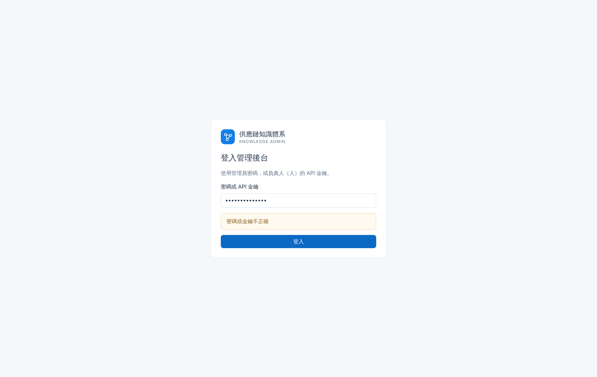

---

## B. 示例資料與知識瀏覽

### B1 載入示例資料

1. 進入 **設定 › 知識倉庫**，在右側「示例資料」點 **載入示例資料**。
2. **預期**：提示「已載入示例資料（26 個主體）」，並自動跳到主體 **可售庫存（S-INV-0012）**。
3. 再點一次 **載入示例資料** → 提示 **示例資料已存在（主體「可售庫存」已登記）**，不會重複寫入。

示例資料走的是真實流程：先以人的身份提交（最高 L1），再由 Action 校驗和負責人確認晉升到 L0。系統名、表名、接口名均為示意。

### B2 知識卡（主體詳情）

在 S-INV-0012「可售庫存」頁面核對。左欄依次是客體綁定、關係、相關文檔、斷言；右欄是主體資訊、可用 Action、一跳鄰域、版本歷史。

| 區塊 | 應該看到 |
| --- | --- |
| 主體資訊 | 綜合層級 **L0 可靠**；負責人「庫存域架構師」；出錯代價 5/5；別名 ATP、可用庫存（標「多義」） |
| 客體綁定（3） | B-0001《庫存口徑定義》負責人確認（這個客體由文檔庫的 DOC-0001 管理，見 [L2](#l2-閱讀文檔與它的客體)）；B-0002 表字段、B-0003 接口由 Action 校驗；三條都是 L0，並顯示有效期 |
| 關係（7） | L0：計算自 實物庫存、庫存中心 擁有、庫存預佔規則 約束；L1：計算自 已預佔 / 凍結 / 安全庫存；L2：缺貨率 計算自 |
| 斷言（4） | 預設只列有效斷言：A-0001 定義 L0、A-0002 規則 L0（`reserve.ttl = 30m`）、A-0003 約束 L1、A-0005 屬性 L1。右上角 **層級** 選「全部斷言」後變為 **斷言（5）**，多出 A-0004 舊定義 **E1 失效**（寫明失效原因，替代者 A-0001）。超過 10 條時底部出現分頁 |
| 可用 Action | 3 個校驗 Action（其中 ACT-0005「文檔已發布」是文檔庫內置的，見 [M8](#m8-內置校驗-action文檔已發布)）、1 個取值 Action「查詢可售庫存（SKU，倉庫）」 |
| 一跳鄰域 / 版本歷史 | 小圖譜，以及該主體檔案的 Git 提交記錄（預設列最近 3 組；同一操作者、同一原因且五分鐘內的連續確認或失效操作合併為一組，可展開查看完整提交；其餘點「更早記錄」展開） |

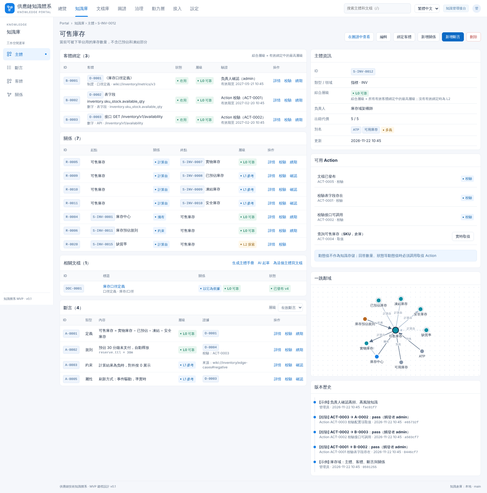

### B3 健康指標

進入 **總覽 › 健康指標**。剛載入示例資料時應看到：

- 四個指標卡：L0 覆蓋率 **4%（1/24）**，待重驗數 **0**，未收錄查詢數 **0**，L0 錯誤反饋數 **0**。
- 有效性層級分佈：主體 L0 1 · L1 3 · L2 20；客體綁定 L0 3 · L1 3；斷言 L0 2 · L1 5 · L2 1 · E1 1；關係 L0 6 · L1 11 · L2 4。
- 知識規模：規範主體 24、別名 2、斷言 9、客體 9、關係 21、Action / 管道 5 / 4。（客體中有 1 個是文檔 DOC-0003 發布時登記的；Action 和管道各有 1 個是文檔庫內置的，示例文檔首次發布時由系統建立，截圖拍於這之前，顯示為 4 / 3。）
- 文檔：已發布 2、待審 0、草稿 1、引用了失效知識 1、未關聯 1。
- 知識倉庫：遠端「未配置（本地倉庫）」，狀態「正常」。

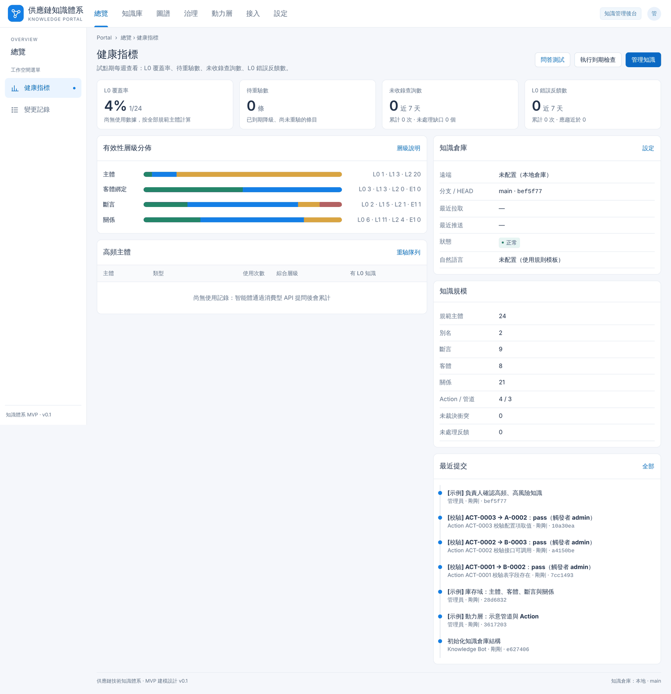

### B4 變更記錄（每次寫入都是一次 Git 提交）

進入 **總覽 › 變更記錄**，應有 16 條提交，從舊到新：

1. 初始化知識倉庫結構、初始化文檔模板（作者 Knowledge Bot）
2. [示例] 動力層：示意管道與 Action（管理員）
3. [示例] 庫存域：主體、客體、斷言與關係（管理員）
4. 三條 [校驗] ACT-000x → …：pass（作者為對應的 Action）
5. [示例] 負責人確認高頻、高風險知識（管理員）
6. [示例] 文檔庫：初始文件夾與標籤，以及 7 條 [文檔] 提交：DOC-0001 新建草稿、發布 v3（接管 O-0001）、保存草稿、發布 v4（小修），DOC-0002 新建草稿，DOC-0003 新建草稿、發布 v1（管理員）

表格上方的 **顯示** 可以切換「只看文檔」或「不含文檔」。


想直接看 Git：知識倉庫的本地目錄顯示在 **設定 › 知識倉庫 › 同步狀態 › 本地目錄**，在該目錄執行 `git log --oneline` 可看到同樣的提交；`knowledge/` 下有 `subjects/`、`objects/`、`relations/`、`actions/`、`pipelines/` 等 YAML 檔案。

### B5 其他瀏覽頁面

逐一點開，確認能正常顯示、沒有報錯：

| 頁面 | 應該看到 |
| --- | --- |
| 知識庫 › 主體 / 斷言 / 客體 / 關係 | 使用同一套工作台，可按類型、層級等條件篩選；點 ID 可跳到詳情。列表每批載入 100 條，向下捲動繼續載入；返回列表保留篩選與焦點。主體詳情中的斷言獨立分頁，支援每頁 10 / 20 / 50 條。工作台的批量操作與導航欄見 N 節 |
| 圖譜 › 知識圖譜 | 力導向圖；可拖曳節點、滾輪縮放；點節點右側顯示主體詳情；可按深度、領域、關係類型篩選，勾選「含 E1」 |
| 圖譜 › 層級分佈 | 各領域的層級分佈，以及層級遷移規則說明 |
| 動力層 › Action | 5 個 Action：ACT-0001～0003 為校驗，ACT-0004 為取值，ACT-0005「文檔已發布」是文檔庫內置的校驗 |
| 動力層 › 管道 | 3 個示意（mock）管道 P-0001～0003，以及內置的 P-0004「文檔庫（內置）」；點「測試」提示可用 |

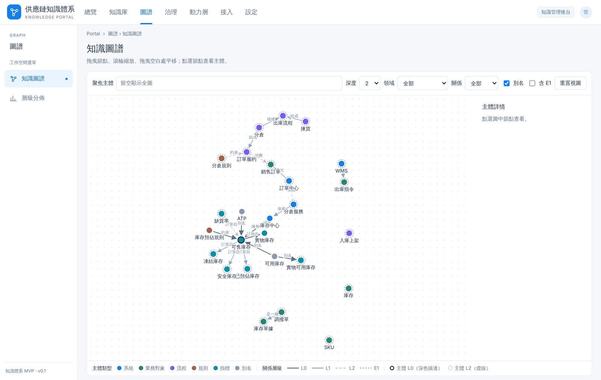


---

## C. 消費型 API（問答）

先在後台發放金鑰，C、D、E、F 章節都會用到。

### C1 發放 API 金鑰

進入 **接入 › API 金鑰**，點 **發放金鑰**，依次建立三把：

| 名稱 | 類型 | 角色 | 用途 |
| --- | --- | --- | --- |
| 問答智能體 | 智能體 | 消費者 | 讀取與問答 |
| 冷啟動智能體 | 智能體 | 貢獻者 | 提交知識 |
| 庫存域架構師 | 人 | 負責人 | 確認晉升、裁決衝突、判定失效 |

每把金鑰只顯示一次，以 `kk_` 開頭，請立即複製。再試一次「類型：智能體、角色：負責人」→ 應被拒絕：**負責人（owner）只能是人；智能體不能晉升知識**。


在終端中保存金鑰（把 `kk_…` 換成剛才複製的值），並定義一個小工具函數 `api <金鑰> <方法> <路徑> [JSON]`，它在回應後面打印 HTTP 狀態碼。後面所有 curl 命令都用它，請在同一個終端中執行。

```bash
export BASE=http://localhost:8080
export CONS='kk_…問答智能體的金鑰…'
export CONT='kk_…冷啟動智能體的金鑰…'
export OWN='kk_…庫存域架構師的金鑰…'

api() {
  if [ -n "$4" ]; then
    curl -s -w '  [HTTP %{http_code}]\n' -X "$2" "$BASE$3" -H "Authorization: Bearer $1" -H 'Content-Type: application/json' -d "$4"
  else
    curl -s -w '  [HTTP %{http_code}]\n' -X "$2" "$BASE$3" -H "Authorization: Bearer $1"
  fi
}
```

### C2 設計文件的 6 個問答示例（後台）

進入 **接入 › 問答測試**，依次點下方 6 個示例問題按鈕。未配置 OpenRouter 時，答案下方顯示「組織方式：規則模板」。

| 問題 | 狀態 | 答案要點 |
| --- | --- | --- |
| 可售庫存怎麼算？ | 已回答 | `可售庫存 = 實物庫存 − 已預佔 − 凍結 − 安全庫存〔A-0001·L0 可靠〕` |
| 可售庫存以前是不是不扣安全庫存？ | 已回答 | 標明 A-0004 **已失效（不得作為依據）**，給出失效原因和現行替代者 A-0001·L0 |
| SKU-123 在上海一號倉還有多少可售？ | 已回答 | **實時取值**：調用 ACT-0004，參數 `sku=SKU-123, warehouse=SH01`，返回一個數值（示意管道隨機 0–500 件），並註明「動態值不使用任何存儲值」 |
| 可售庫存會出現負數嗎？ | 已回答 | `計算結果為負時，對外按 0 展示〔A-0003·L1 參考，未經驗證〕` |
| 「可用庫存」指什麼？ | **需要消歧** | 列出兩個候選：可售庫存（S-INV-0012）、實物可用庫存（S-INV-0013） |
| 可售庫存多久同步到搜索系統？ | **知識庫未收錄** | 明確說未收錄，不用行業通用知識補全；記為知識缺口 **G-0001** |

> 第二期起，第一個問題的答案最後還附有一段「文檔原文（補充，不屬於結構化知識，沒有層級）」，引用 `〔DOC-0001§計算公式·v4〕`，與知識的引用分開列出（見 [M5](#m5-問答引用文檔原文)）。下面的截圖拍於第一期，沒有這一段。

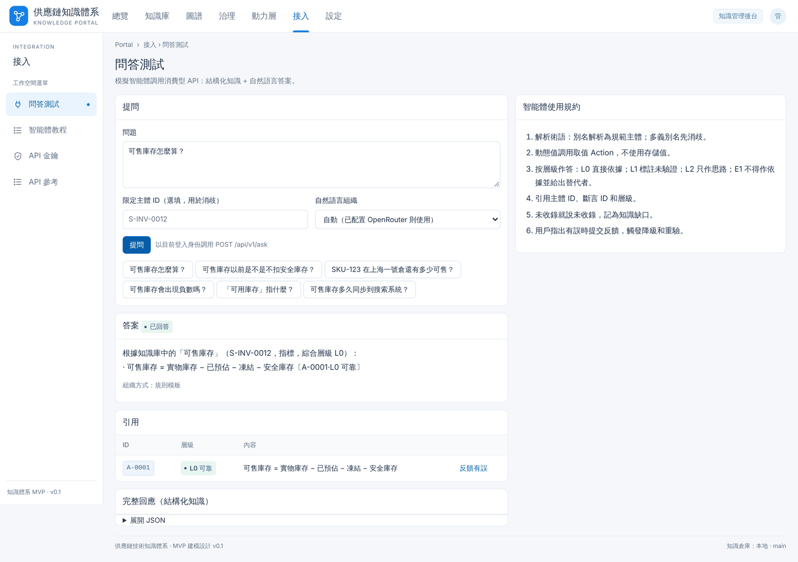


再補兩個邊界情況：

- 在「需要消歧」的答案下點 **指 實物可用庫存** → 變為已回答，引用實物可用庫存的主體定義，並標註「L2 探索，僅供拓展思路，不作結論」。
- 輸入 **可售庫存現在還有多少？** → 狀態 **需要參數**：「這是動態值，需要實時取值，不能使用存儲值。請補充參數：SKU、倉庫。」

每條引用旁都有 **反饋有誤** 按鈕，F 章節會用到這個機制。

### C3 同樣的問答，用 API 調用

```bash
api $CONS POST /api/v1/ask '{"question":"可售庫存怎麼算？"}'
```

**預期**：HTTP 200，`data.status` 為 `answered`，`data.citations` 含 `{"id":"A-0001","level":"L0"}`，`data.knowledge[0].subject.id` 為 `S-INV-0012`。另外 5 個問題換掉 `question` 即可，`status` 分別對應 `answered`、`ambiguous`、`uncovered`、`need_inputs`。消歧時帶上 `subjectIds`：

```bash
api $CONS POST /api/v1/ask '{"question":"「可用庫存」指什麼？","subjectIds":["S-INV-0013"]}'
```

**預期**：`status` 為 `answered`。

### C4 結構化知識端點

```bash
api $CONS GET /api/v1/subjects/S-INV-0012
api $CONS GET /api/v1/subjects/S-INV-0012/context
api $CONS GET '/api/v1/graph?focus=S-INV-0012&depth=1'
api $CONS GET '/api/v1/resolve?text=ATP'
api $CONS POST /api/v1/actions/ACT-0004/invoke '{"inputs":{"sku":"SKU-9","warehouse":"BJ01"}}'
api $CONS POST /api/v1/actions/ACT-0004/invoke '{"inputs":{"sku":"abc","warehouse":"BJ01"}}'
```

**預期**（依次對應）

1. 知識卡：HTTP 200，`assertions` 的層級依次為 L0、L0、L1、E1、L1。
2. 知識卡加一跳鄰居：`neighbors` 中有「庫存中心」。
3. 圖譜：返回若干 `nodes` 和 `edges`。
4. 別名解析：`canonical[0].id` 為 `S-INV-0012`。
5. 取值：HTTP 200，返回數值，並有 `"note":"實時取值，未使用任何存儲值"`。
6. 參數不合法：HTTP 400，`參數 sku 格式不符（SKU-\d+）`。

---

## D. 公開端點與權限

### D1 教程 prompt API（無需金鑰）

依次取生產教程、消費教程、機器可讀的模型定義、OpenAPI 定義和服務狀態：

```bash
curl -s $BASE/api/v1/prompt | head -20
curl -s "$BASE/api/v1/prompt?role=consumer" | head -20
curl -s $BASE/api/v1/schema
curl -s $BASE/api/v1/openapi.json | head -c 300
curl -s $BASE/api/v1/status
```

**預期**

- 生產教程標題為「供應鏈技術知識庫：智能體知識生產教程」，正文包含當前知識規模、六個概念、寫入上限（「你不能寫入 L0」）、10 種關係、`/batch` 用法。
- 消費教程包含「智能體使用規約」6 步。
- `schema` 中 `subjectTypes` 有 6 種，`relationTypes` 有 10 種。
- `openapi.json` 的 `openapi` 為 `3.1.0`。

後台 **接入 › 智能體教程** 顯示同樣內容，可切換「生產教程 / 消費教程」、複製拉取地址、下載 Markdown；**接入 › API 參考** 列出全部端點及所需角色。


### D2 權限

依次測試：不帶金鑰、錯誤金鑰、消費者嘗試寫入、智能體嘗試確認晉升。

```bash
curl -s -o /dev/null -w '%{http_code}\n' $BASE/api/v1/subjects
api kk_wrong GET /api/v1/subjects
api $CONS POST /api/v1/subjects '{"name":"測試系統","type":"系統","domain":"INV"}'
api $CONT POST /api/v1/items/A-0003/confirm '{}'
```

**預期**：依次為 `401`；`401 API 金鑰無效或已停用`；`403 此操作需要 contributor 權限`；`403 此操作需要 owner 權限`。

### D3 後台只允許人登入

1. 右上角頭像 › **登出**。
2. 用「冷啟動智能體」的金鑰登入 → 提示 **後台只允許人登入；智能體請直接使用 API**。
3. 用「庫存域架構師」的金鑰登入 → 成功；選單中**沒有**「設定」，「接入」下**沒有**「API 金鑰」（這兩項只有管理員可見）。
4. 登出，用管理員密碼重新登入，繼續後面的步驟。

---

## E. 生產型 API

### E1 批量提交（一次提交、ref 引用、寫入上限）

模擬三方智能體冷啟動一個「調撥服務」：

```bash
api $CONT POST /api/v1/batch '{
  "message": "冷啟動：調撥",
  "items": [
    { "op": "object.create", "ref": "doc", "data": { "name": "《調撥流程 SOP》", "category": "制度", "kind": "SOP", "locator": "wiki://transfer/sop" } },
    { "op": "subject.create", "ref": "svc", "data": { "name": "調撥服務", "type": "系統", "domain": "INV", "definition": "創建與執行調撥單的服務" } },
    { "op": "binding.create", "data": { "subjectId": "$ref:svc", "objectId": "$ref:doc" } },
    { "op": "assertion.create", "data": { "subjectId": "$ref:svc", "type": "約束", "content": "同一 SKU 同時只能有一張進行中的調撥單", "level": "L0", "evidence": { "objectIds": ["$ref:doc"] } } },
    { "op": "relation.create", "data": { "from": "$ref:svc", "type": "依賴", "to": "S-INV-0001" } }
  ]
}'
```

**預期**（按本教程順序操作時的 ID）

- HTTP **201**，`results` 有 5 條：O-0010、S-INV-0018、B-0007（L1）、A-0010（**L1**）、R-0022（**L2**）。（O-0009 是示例文檔 DOC-0003 的客體。）
- 斷言請求 L0 被降為 L1，`warnings` 提示「人或智能體不能直接寫入 L0，已按寫入上限定為 L1。L0 只能通過 Action 校驗或負責人確認晉升。」
- 關係沒有證據，只能寫入 L2。
- 返回 `commit`（7 位提交雜湊）。後台 **變更記錄** 最新一條為「[批量] 冷啟動：調撥（5 條）」，作者 **冷啟動智能體**。

### E2 批量中任一條違規則整批回滾

```bash
api $CONT POST /api/v1/batch '{
  "items": [
    { "op": "subject.create", "ref": "a", "data": { "name": "回滾測試主體", "type": "系統", "domain": "INV" } },
    { "op": "relation.create", "data": { "from": "$ref:a", "type": "計算自", "to": "S-INV-0012" } }
  ]
}'
curl -s -G $BASE/api/v1/subjects --data-urlencode 'q=回滾測試主體' -H "Authorization: Bearer $CONS"
```

**預期**：第一條 HTTP **422**，`code` 為 `relation_direction`，`index` 為 1，訊息「「計算自」的方向為 指標 → 業務對象或指標；…整批已回滾」。第二條返回 `{"data":[]}`，說明第 0 條建立的主體也沒有留下。

---

## F. 有效性流轉與治理

層級規則：**上行只有兩條路**，補證據（L2 → L1）和 Action 校驗或負責人確認（L1 → L0）；任何異常（到期、校驗不符、衝突、反饋錯誤、證據客體下線）**先降回 L1 並排入重驗**；E1 不刪除，指向替代者。

以下以 API 操作；在後台斷言列表或詳情頁的「校驗、確認、補證據、反饋有誤、登記衝突、判定失效」按鈕可做同樣的事。

### F1 L2 → L1 → L0

依次執行五步：智能體無證據提交、負責人直接確認、補充客體證據、智能體嘗試確認、負責人確認。第一步返回的 `id` 按本教程順序為 **A-0011**，如果不同，請替換後面命令中的 A-0011。

```bash
api $CONT POST /api/v1/subjects/S-INV-0013/assertions '{"type":"定義","content":"實物可用庫存 = 實物庫存 − 凍結"}'
api $OWN POST /api/v1/items/A-0011/confirm '{}'
api $CONT POST /api/v1/items/A-0011/evidence '{"objectIds":["O-0001"]}'
api $CONT POST /api/v1/items/A-0011/confirm '{}'
api $OWN POST /api/v1/items/A-0011/confirm '{"note":"驗收確認"}'
```

**預期**

1. HTTP 201，沒有證據，`validity.level` 為 `L2`。
2. HTTP **409**，`missing_evidence`：「晉升 L0 需要客體證據或明確來源：確認時在 evidence 中附 objectIds 或 sourceRef，或先補充證據」（L2 可以直接確認為 L0，但 L0 必須有證據）。
3. HTTP 200，`level` 為 `L1`。
4. HTTP **403**：「此操作需要 owner 權限，或金鑰權限 assertions:confirm（只能確認斷言）」。
5. HTTP 200，`level` 為 `L0`，`expiresAt` 約為 180 天後（定義類斷言的有效期初值）。

### F2 使用反饋：L0 → L1 並排入重驗

```bash
api $CONS POST /api/v1/feedback '{"targetId":"A-0011","comment":"驗收：模擬用戶指出錯誤"}'
api $CONS GET /api/v1/items/A-0011
```

**預期**：反饋 HTTP 201，id 為 **F-0001**，`wasLevel` 為 `L0`；A-0011 變為 **L1**，`pending.label` 為「使用反饋指出錯誤」。後台打開 **知識庫 › 斷言 › A-0011**，右側「層級歷史」應有四步：新建 → L2 提交、L2 → L1 補充客體證據、L1 → L0 負責人確認、L0 → L1 降級。

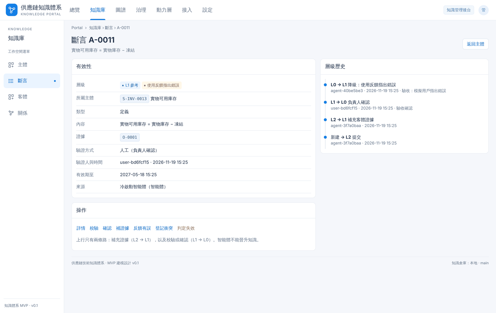

### F3 衝突與裁決

```bash
api $CONT POST /api/v1/conflicts '{"a":"A-0005","b":"A-0003","note":"驗收：模擬兩條知識矛盾"}'
api $CONT POST /api/v1/conflicts/C-0001/resolve '{"winner":"A-0003"}'
api $OWN  POST /api/v1/conflicts/C-0001/resolve '{"winner":"A-0003","reason":"驗收裁決：以 A-0003 為準"}'
api $CONS GET /api/v1/items/A-0003
api $CONS GET /api/v1/items/A-0005
```

**預期**：登記衝突 HTTP 201（C-0001），雙方 `pending.label` 為「知識衝突」；智能體裁決 → 403；負責人裁決 → HTTP 200。之後 A-0003 為 **L0**，A-0005 為 **E1** 且 `replacedBy` 為 `A-0003`。後台 **治理 › 衝突裁決** 中 C-0001 顯示「已裁決」，A-0003 標「勝出」。


### F4 客體變更觸發：校驗 Action 發現值變了

A-0002「預佔 30 分鐘未支付，自動釋放」綁定配置項 `reserve.ttl = 30m`，由 ACT-0003 經示意配置中心 P-0003 校驗。我們模擬配置被改成 15m：

1. 後台 **動力層 › 管道**，P-0003「配置中心（示意）」點 **編輯**，在 JSON 中把 `"value": "30m"` 改成 `"value": "15m"`，保存。
2. 進入 **知識庫 › 斷言**，在 A-0002 這一行點 **校驗**（或執行 `api $CONT POST /api/v1/validate/A-0002 '{}'`）。

**預期**：校驗結果 `outcome` 為 `mismatch`，詳情「實際值 "15m"，斷言值 "30m"」；A-0002 從 **L0 降為 L1**，重驗原因「校驗不符」。

### F5 客體下線：級聯降級

```bash
api $CONT PATCH /api/v1/objects/O-0007 '{"status":"下線","reason":"驗收：代碼模塊已下線"}'
api $CONS GET /api/v1/items/B-0004
api $CONS GET /api/v1/items/R-0008
```

**預期**：O-0007 狀態變為「下線」；綁定 B-0004 轉為 **E1**；以 O-0007 為證據的關係 R-0008（庫存中心 擁有 實物庫存）保持 L1 並排入重驗，原因「證據客體已下線」。

### F6 治理頁面

| 頁面 | 應該看到 |
| --- | --- |
| 治理 › 重驗隊列 | 3 條，按「使用頻率 × 出錯代價」排序：**A-0002**（校驗不符，可售庫存出錯代價 5，排第一）、A-0011（使用反饋）、R-0008（證據客體已下線） |
| 治理 › 使用反饋 | F-0001，原層級 L0。負責人點 **關閉** 填寫處理結果即可結案 |
| 治理 › 知識缺口 | G-0001「可售庫存多久同步到搜索系統？」，次數 1。負責人可 **標記已處理** |
| 總覽 › 健康指標 | 待重驗數 **3**（校驗不符 1 · 反饋 1 · 客體下線 1），未收錄查詢數 **1**，L0 錯誤反饋數 **1**；「高頻主體」表出現 可售庫存 等被問到的主體 |

右上角 **執行到期檢查** 會掃描已過期的 L0；剛建立的資料都沒過期，提示「到期檢查完成：0 條降為 L1」屬正常。

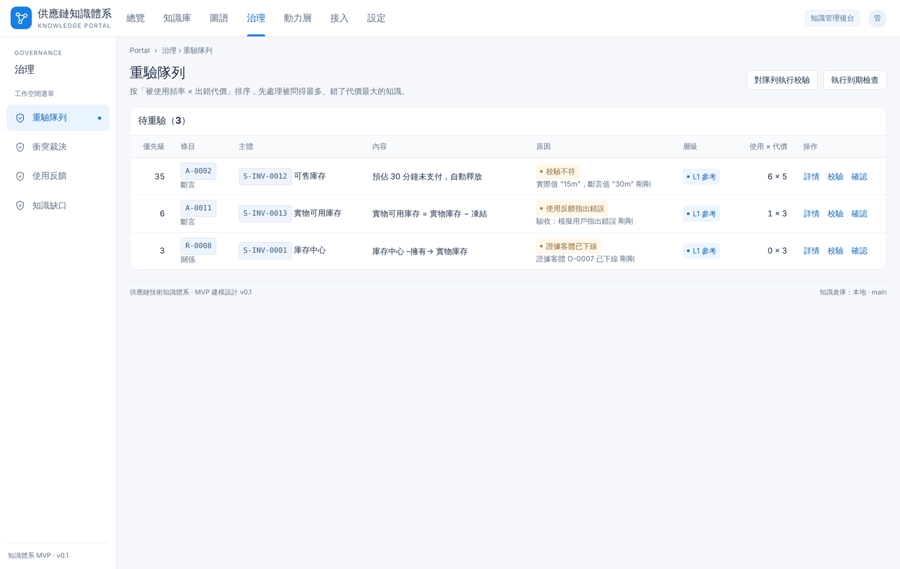

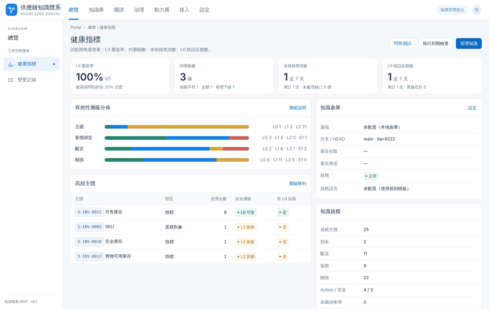

用 API 結案：負責人關閉反饋、智能體嘗試關閉缺口、負責人關閉缺口。

```bash
api $OWN POST /api/v1/feedback/F-0001/close '{"resolution":"已複核並更正"}'
api $CONT POST /api/v1/gaps/G-0001/close '{"resolution":"已處理"}'
api $OWN POST /api/v1/gaps/G-0001/close '{"resolution":"已補充同步時效斷言"}'
```

**預期**：依次為 HTTP 200、**403**（此操作需要 owner 權限）、200。

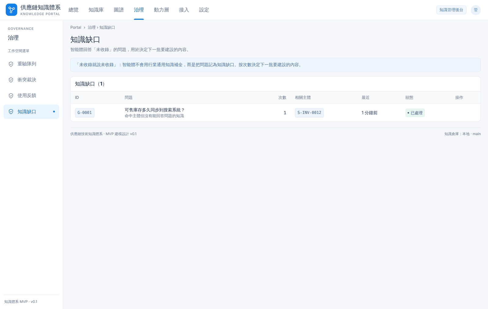

---

## G. Git 持久化與遠端倉庫

### G1 重啟後資料不丟

1. 在運行服務的終端按 `Ctrl+C` 停止，再用 A1 的命令重新啟動。
2. 刷新後台，重新登入。

**預期**：B～F 做過的所有變化都還在（例如 A-0005 仍為 E1、調撥服務仍在），C1 發放的金鑰仍可使用。

### G2 機密不進知識倉庫

管理員密碼雜湊、API 金鑰雜湊、Git 權杖、OpenRouter Key 只存放在 `data/settings.json`，不在知識倉庫裡。可以在知識倉庫本地目錄（見 B4）中搜索確認：

```bash
grep -rn "kk_\|Acceptance-2026" <知識倉庫本地目錄>/knowledge || echo "沒有機密"
```

**預期**：輸出「沒有機密」。

### G3 接入你的 Git 倉庫（HTTPS + 權杖）

測試倉庫：`https://github.com/ali-sx-org-free/knowledge_site_v01.git`

1. 在 GitHub 建立**細粒度 PAT**：Settings › Developer settings › Fine-grained tokens › Generate new token。Repository access 選 **Only select repositories › knowledge_site_v01**；Permissions › Repository permissions › **Contents** 選 **Read and write**。
2. 後台 **設定 › 知識倉庫** 填寫：倉庫地址填上面的 URL；分支 `main`；知識目錄 `knowledge`；存取權杖填 PAT；權杖用戶名保持 `x-access-token`。
3. 點 **測試連接**。**預期**：倉庫為空時提示「可連接：倉庫為空，首次寫入會建立分支」；倉庫已有分支時提示「可連接：分支 main」。
4. 點 **保存並切換**。**預期**：提示「已切換知識倉庫」，右側同步狀態的「遠端」顯示倉庫地址（權杖不會出現在地址中），「錯誤」為「無」。


> 切換倉庫等於切換到另一個知識庫：遠端是空倉庫時，後台會是空的；先前本地倉庫的資料仍保留在 `data/repos/` 下，不會自動遷移。

5. 在同一頁點 **載入示例資料**，把示例寫進遠端倉庫。
6. 打開 GitHub 上的 `knowledge_site_v01`。**預期**：`main` 分支出現 `knowledge/` 目錄（`subjects/`、`objects/`、`relations/` 等），提交記錄與後台 **變更記錄** 一致，第一條為「初始化知識倉庫結構」。

### G4 他人直接在 Git 中修改，後台能同步回來

1. 在 GitHub 網頁打開 `knowledge/subjects/S-INV-0012.yaml`，點鉛筆圖標編輯，把 `definition:` 這一行的內容改掉（例如末尾加「（驗收修改）」），提交到 `main`。
2. 回到後台 **設定 › 知識倉庫**，點 **立即同步**（或等待自動拉取，預設 60 秒一次）。

**預期**：提示「已拉取遠端更新並重新載入」；打開 S-INV-0012，定義顯示你的修改；**變更記錄** 最新一條的作者是你在 GitHub 上的名字。

3. 再通過 API 寫一條知識（例如重做 E1 的批量提交），刷新 GitHub。**預期**：幾秒內出現新提交，作者為提交知識的智能體名稱。

### G5 SSH 部署金鑰

> 這一節要在能連上 GitHub SSH（22 端口，或 `ssh.github.com` 的 443 端口）的機器上操作。

部署金鑰只屬於一個倉庫、不綁定個人帳號，適合服務長期讀寫知識倉庫。如果 G3 已經用 HTTPS 權杖接入同一個倉庫，可以直接改用 SSH，知識內容不變。

1. **設定 › 知識倉庫**：倉庫地址改為 `git@github.com:ali-sx-org-free/knowledge_site_v01.git`，分支 `main`。**預期**：頁面顯示「認證方式：SSH 部署金鑰」，並出現「SSH 部署金鑰」面板。
2. 在面板點 **產生部署金鑰**，再點 **複製公鑰**。
3. 點面板上的「Deploy keys 頁面」鏈接（或在 GitHub 打開倉庫 **Settings › Deploy keys › Add deploy key**），貼上公鑰，**勾選 Allow write access**，保存。
4. 回到後台點 **測試連接**。**預期**：倉庫為空時提示「可連接（SSH 部署金鑰）：倉庫為空，首次寫入會建立分支」；面板出現 `github.com` 的主機指紋，可與 [GitHub 公布的指紋](https://docs.github.com/en/authentication/keeping-your-account-and-data-secure/githubs-ssh-key-fingerprints) 核對。
5. 點 **保存並切換**。倉庫是空的就在同頁點 **載入示例資料**，然後到 GitHub 確認 `main` 上有 `knowledge/` 目錄和新提交。
6. 按 G4 的做法在 GitHub 網頁上改一個 `definition`，回後台點 **立即同步**，確認修改同步回來。
7. 反向檢查：在 GitHub 上把這把 Deploy key 的 Allow write access 取消，再用 API 新增一條知識。**預期**：同步狀態的「錯誤」顯示 `marked as read only` 和處理提示。檢查完記得把寫入權限勾回來。
8. 私鑰只存放在 `data/ssh/deploy_key`，後台和接口只顯示公鑰；知識倉庫裡沒有私鑰。

> 網絡只放行 443 時，GitHub 地址可改為 `ssh://git@ssh.github.com:443/ali-sx-org-free/knowledge_site_v01.git`。

---

## H. OpenRouter 自然語言（可選）

1. 後台 **設定 › 自然語言**：填入 OpenRouter API Key（`sk-or-…`）與模型 ID（預設 `anthropic/claude-sonnet-4.5`），**保存**。
2. 點 **測試**。**預期**：提示「可用：<模型 ID>」。未填 Key 時點測試會提示「未配置 OpenRouter API Key」。
3. 回到 **接入 › 問答測試**，再問「可售庫存怎麼算？」。

**預期**

- 「組織方式」變為「OpenRouter · <模型 ID>」，答案是更自然的句子，結論後仍標註〔ID·層級〕。
- 引用表只包含知識範圍內的 ID（模型若編造 ID 會被丟棄）。
- 問「可售庫存多久同步到搜索系統？」仍回答**未收錄**，不會用行業常識補全。
- 「自然語言組織」選 **規則模板** 可隨時對比；OpenRouter 調用失敗時自動回退為規則模板，並註明原因。

---

## I. 容器部署（可選）

```bash
docker build -t knowledge .
docker run -p 8080:8080 -v knowledge-data:/data -e ADMIN_PASSWORD='Acceptance-2026' knowledge
```

**預期**：<http://localhost:8080> 可登入；容器重建後資料保存在 `knowledge-data` 卷中。也可以用環境變數直接配置知識倉庫與 OpenRouter，變數列表見 [.env.example](../.env.example)。

> 本教程編寫時的環境沒有 Docker 守護進程，這一節未實際運行，驗收時請以實際結果為準。

---

## J. 一鍵安裝與 CI 流水綫

> 一鍵安裝從 GitHub Release 下載發佈包，需要倉庫已經發佈過版本（推送 `v*` 標籤後自動發佈，見 J5）。還沒有發佈版本時，J1～J3 可以改用 `--ref main` 從源碼安裝（見 J1 末尾）。
>
> 本節編寫時還沒有發佈版本，編寫環境也連不上國內鏡像：J1～J4 的流程是用本機模擬的下載來源（正常、不可達、很慢、發佈包被篡改）和真實的 nodejs.org 驗證的，與 CI 中的冒煙測試相同；國內鏡像的實際速度請以你的運行結果為準。

### J1 一鍵安裝並啟動

如果 A 章節的服務還在運行，先停掉它（或用 `--port` 換一個端口），避免端口衝突。

Linux / macOS：

```bash
curl -fsSL https://github.com/ali-sx-org-free/knowledge_setup/releases/latest/download/install.sh | bash
# GitHub 慢或打不開時：
curl -fsSL https://ghfast.top/https://github.com/ali-sx-org-free/knowledge_setup/releases/latest/download/install.sh | bash
```

Windows PowerShell：

```powershell
$f="$env:TEMP\knowledge-install.ps1"; curl.exe -fsSL -o $f https://github.com/ali-sx-org-free/knowledge_setup/releases/latest/download/install.ps1; powershell -NoProfile -ExecutionPolicy Bypass -File $f
```

**預期**（數值與來源因網絡而異）：

```
==> 安裝 knowledge_setup 到 /home/you/.knowledge_setup
    Node.js v22.x.x（系統已安裝：/usr/bin/node）
==> 取得發佈資訊（ali-sx-org-free/knowledge_setup · latest）
    不可用（已跳過）：gh.llkk.cc
    版本 v0.1.0
==> 測試下載速度：發佈包 v0.1.0
    github.com                   180 KB/s
    ghfast.top                   2.3 MB/s
    gh-proxy.com                 1.1 MB/s
    ghproxy.net                  無法連接
==> 下載發佈包 v0.1.0（來源 ghfast.top）
    SHA-256 校驗通過
==> 已安裝 v0.1.0
==> knowledge_setup v0.1.0 已啟動（PID 12345）
    管理後台：http://localhost:8080
    智能體教程：http://localhost:8080/api/v1/prompt
    初始管理員密碼：xxxxxxxxxxxx（登入後可在「設定」修改，修改後以新密碼為準）
```

- 有「測試下載速度」列表，下載用的是列表中最快的來源，並顯示「SHA-256 校驗通過」。
- 機器上沒有 Node.js 20+ 時，會先出現「測試下載速度： Node.js v22…」，從最快的 Node.js 鏡像下載到安裝目錄的 `runtime/node`；系統原有的 Node.js 不受影響。
- 用顯示的地址和密碼可以登入後台（同 A2）。

還沒有發佈版本時，從 main 分支源碼安裝（依賴從測速最快的 npm 鏡像安裝）：

```bash
curl -fsSL https://ghfast.top/https://raw.githubusercontent.com/ali-sx-org-free/knowledge_setup/main/release/install.sh | bash -s -- --ref main
```

### J2 服務管理

新開一個終端（Windows 需要新開，才能讀到新的 PATH），執行：

```bash
knowledge status    # 預期：運行中（PID …）· v0.1.0，並顯示地址與初始密碼
knowledge logs      # 預期：日誌中有「[knowledge] 服務已啟動」
knowledge restart   # 預期：服務已停止 → 已啟動
knowledge stop      # 預期：服務已停止；再 status 顯示「未運行」
knowledge start
```

Linux / macOS 上 `~/.local/bin` 不在 PATH 時，安裝結束會提示用完整路徑 `~/.knowledge_setup/bin/knowledge`，或把它加入 PATH。

### J3 重複執行與升級（資料保留）

1. 在後台建立一些資料（例如 B1 載入示例資料），記下主體數量。
2. 再執行一次 J1 的安裝命令。**預期**：顯示「已是最新版本 v0.1.0」，服務 PID 不變。
3. 加 `--force` 重裝（Windows：`-Force`），或發佈新版本後執行 `knowledge upgrade`。**預期**：「停止正在運行的舊版本」→「已安裝」→「已啟動」；登入密碼不變，主體數量不變，`config.env` 中你改過的設定還在。

### J4 離線安裝

在能上網的機器打開 [Releases](https://github.com/ali-sx-org-free/knowledge_setup/releases)，下載 `knowledge_setup-vX.Y.Z.tar.gz`（Windows：`.zip`）、`install.sh`（Windows：`install.ps1`）和 `SHA256SUMS`，放在同一目錄拷到目標機器：

```bash
bash install.sh --package knowledge_setup-v0.1.0.tar.gz
# Windows：powershell -ExecutionPolicy Bypass -File install.ps1 -Package knowledge_setup-v0.1.0.zip
```

**預期**：「SHA-256 校驗通過」→「從本地發佈包安裝」→ 已啟動。目標機器需要已有 Node.js 20+（離線時無法下載）。

### J5 CI 流水綫

1. 打開任一 PR 的 **Checks**。**預期**：`CI` 下這些檢查全部通過：測試 · Node 22、測試 · Node 24、容器映像、打包發佈包、一鍵安裝 · ubuntu-latest、一鍵安裝 · macos-latest、一鍵安裝 · windows-latest。
2. 點開「一鍵安裝 · ubuntu-latest」的日誌。**預期**：能看到模擬的被篡改來源測速最快、被選中後「SHA-256 校驗失敗 … 換下一個來源」，最後從正常來源下載成功，並以 `PASS` 結束。
3. 發佈：確認 main 上 `package.json` 的 `version` 與要打的標籤一致（目前為 `0.1.0`，以後發新版先改它並合併），然後 `git tag v0.1.0 && git push origin v0.1.0`。**預期**：Actions 中 `Release` 流水綫通過；[Releases](https://github.com/ali-sx-org-free/knowledge_setup/releases) 出現該版本，附有 `knowledge_setup-v0.1.0.tar.gz`、`knowledge_setup-v0.1.0.zip`、`install.sh`、`install.ps1`、`SHA256SUMS` 五個檔案，說明中有一鍵安裝命令。
4. （可選）標籤與 `package.json` 版本不一致時（例如打 `v9.9.9`）。**預期**：`Release` 失敗並提示「標籤 v9.9.9 與 package.json 的版本 … 不一致」，不會發佈。驗收後刪除這個標籤：`git push origin :refs/tags/v9.9.9`。

---

## K. 多語言（繁中 / 簡中 / English）

管理後台和 API 支持繁體中文、簡體中文和英文。介面文字、錯誤訊息、提示、教程按語言切換；**知識內容（名稱、定義、斷言）按提交時的原文保存，不翻譯**；主體類型、關係類型等**枚舉值是 API 的值，所有語言下都用繁體原文**。

### K1 後台切換語言

1. 退出登入，打開 `http://localhost:8080/?lang=en`。**預期**：登入頁為英文（**Sign in to the admin console**），右上角語言選單顯示 **English**。不帶 `?lang` 時按瀏覽器語言選擇：`zh-TW`、`zh-HK` 用繁體，其他中文用簡體，其他語言用英文。
2. 登入，打開 **Overview › Health metrics**。**預期**：選單、標題、指標名稱、表頭全部為英文。

   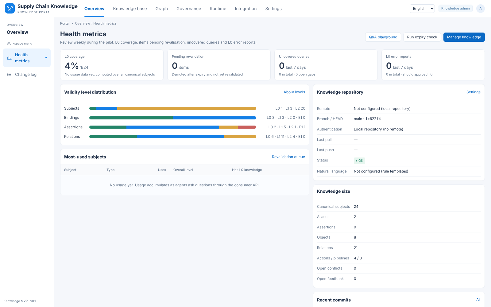

3. 在頂欄語言選單選 **简体中文**。**預期**：頁面重新載入為簡體（選單為「总览 知识库 文档库 图谱 治理 动力层 接入 设置」）；刷新頁面、重新登入後仍是簡體。**設定 › 帳號** 中也可以切換。
4. 打開可售庫存的知識卡（`#subject/S-INV-0012`）。**預期**：類型顯示「指标」，層級徽章「L0 可靠」「L1 参考」，有效期、校驗方式等說明為簡體；主體名稱、定義和斷言內容保持原文（繁體）。

   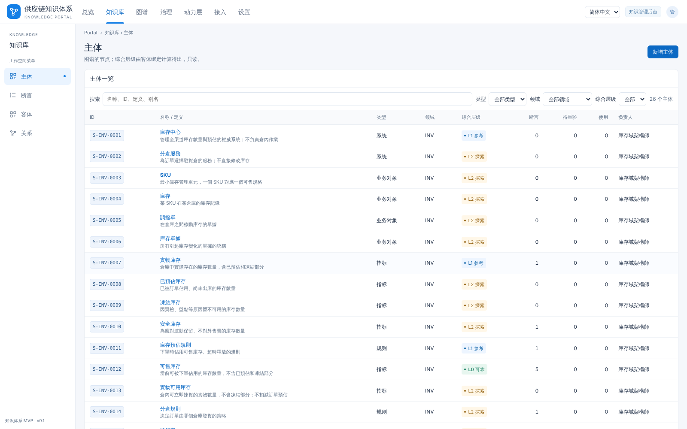

5. 切回 **繁體中文**，後續章節的截圖與文字以繁體為準。

### K2 API 按語言返回

```bash
curl -s "$BASE/api/v1/subjects?lang=en"; echo
curl -s -H 'Accept-Language: zh-CN' "$BASE/api/v1/subjects"; echo
```

**預期**：兩次都是 401，`error.code` 都是 `unauthorized`，訊息分別為

```
Authentication required: send Authorization: Bearer <API key>
需要身份验证：请带 Authorization: Bearer <API 密钥>
```

`?lang=` 優先於 `Accept-Language`；都沒有時用環境變數 `KNOWLEDGE_LANG`（預設繁體中文）。回應頭 `Content-Language` 標明實際使用的語言。

```bash
api $CONS POST '/api/v1/ask?lang=en' '{"question":"可售庫存怎麼算？","compose":"template"}'
```

**預期**：`status` 為 `answered`，`answer` 為

```
According to "可售庫存" in the knowledge base (S-INV-0012, Metric, overall level L0):
· 可售庫存 = 實物庫存 − 已預佔 − 凍結 − 安全庫存 〔A-0001·L0 reliable〕
```

答案框架和層級說明是英文，引用的知識內容是原文。配置了 OpenRouter 時，模型用問題的語言作答；問題語言無法判斷時用請求的語言。

```bash
curl -s "$BASE/api/v1/prompt?lang=en" | head -3
curl -s -H 'Accept-Language: zh-CN' "$BASE/api/v1/schema" | grep -o '"指標":{[^}]*}'
api $CONT POST '/api/v1/subjects?lang=en' '{"name":"X","type":"metric","domain":"INV"}'
```

**預期**：

- 教程第一行為 `# Supply chain technical knowledge base: agent knowledge production guide`；表格中的枚舉值寫成「指標 (Metric)」，示例請求中仍是 `"type": "指標"`。後台 **接入 › 教程** 的拉取地址會帶上目前介面的 `?lang=`。
- Schema 的鍵仍是「指標」，說明為簡體：`"desc":"有计算口径的度量"`，`"label":"指标"`。
- 用英文類型名提交被拒：HTTP 400，`Subject type must be one of: 系統, 業務對象, 流程, 規則, 指標, 別名`。枚舉值不翻譯，必須用繁體原文。

### K3 寫入倉庫的內容不隨語言變化

```bash
api $CONT POST '/api/v1/subjects?lang=en' '{"name":"多語言驗收主體","type":"指標","domain":"INV"}'
```

**預期**：HTTP 201，`warnings` 為英文（`Consider adding a definition: …`）。打開 **總覽 › 變更記錄**，最新一條提交說明仍是繁體「[生產] 新增主體 S-INV-… 多語言驗收主體（指標）」；切換到英文介面時，提交說明照原樣顯示，作者「管理員」顯示為 Administrator。驗收後可在主體詳情中刪除這個主體。

最後檢查字典完整：

```bash
npm run i18n:check
```

**預期**：輸出 `字典完整`，退出碼 0。修改介面或訊息文字後漏翻時，這裡會列出缺少的條目。

---

## L. 文檔庫

文檔庫讓系統管理自己的文檔：人在後台、智能體通過 API 寫 Markdown 文檔，文檔存放在知識倉庫的 `knowledge/docs/` 下，**文件夾就是 Git 目錄**。文檔首次發布時登記為一個「制度」類客體，可以綁定到主體、作為斷言的證據；文檔修訂時，以它為依據的知識按「客體變化」降級並排入重驗。

> **關於 ID 和數量**：文檔編號（DOC-…）只受本節操作影響，按本教程順序就是下面的值。客體、綁定編號（O-…、B-…）會因為前面多做或少做的步驟錯開，以實際返回為準。截圖是剛載入示例資料時拍的。G3 切換到新倉庫後重新載入了示例資料，F 章節的變化留在原來的本地倉庫；如果你跳過了 G3，F 章節的變化會保留，個別知識的層級和數量與截圖不同（例如 A-0003 在 F3 後為 L0），下文會註明。

### L1 文檔庫首頁與搜索

打開頂部選單 **文檔庫 › 文檔**。

**預期**

- 列表有 3 篇示例文檔：DOC-0001《庫存口徑定義》已發布 v4、DOC-0002《跨倉調撥作業 SOP》草稿、DOC-0003《知識庫寫作指南》已發布 v1。標題下方是 ID、模板和文件夾，右側是標籤、關聯主體、負責人。
- 左側 **智能視圖**：我的草稿 1、最近更新 3、引用了失效知識 1（DOC-0001 引用了 E1 的 A-0004）、未關聯 1（DOC-0003 沒有關聯主體），其餘為 0。
- 左側 **文件夾**：倉儲、庫存（SOP、口徑）、訂單、計劃補貨、通用、運輸，後面是篇數。這些文件夾就是知識倉庫中 `knowledge/docs/` 下的目錄。
- 點 DOC-0001 這一行（不要點標題），右側預覽顯示摘要、模板欄位（指標 S-INV-0012、權威系統 S-INV-0001、生效日期、適用範圍、下次複審）、「以本文檔為依據」的知識條數和層級分佈、目錄。

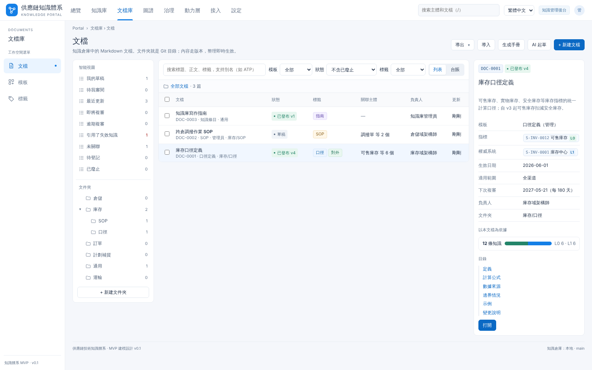

在搜索框輸入 **ATP 口徑** 並回車。**預期**：DOC-0001 排在第一位，上方提示「已把查詢中的術語解析為：可售庫存（S-INV-0012）；關聯了這些主體的文檔排在前面。」ATP 是 S-INV-0012 的別名，搜索會把別名換成主體。

再看看其他入口：**台賬** 按模板把文檔列成表格（每篇一行，模板欄位為列）；**文檔庫 › 模板** 有 7 個模板（知識條目、設計文檔、SOP、口徑定義、SLA、評審記錄，以及第二期的主體手冊），每個模板寫明欄位、章節、誰能發布、複審週期；**文檔庫 › 標籤** 是標籤字典。

### L2 閱讀文檔與它的客體

點標題打開 DOC-0001。

**預期**

- 標題下方一行：`DOC-0001 · 口徑定義 · v4 · 管理員 於 … 發布（小修）`。右上角有 **歷史與差異**、**在 Git 中查看**、**導出**、**更多**、**修訂**。
- 正文中的 `[[S-INV-0012]]` 等引用顯示為帶當前層級的標籤，點擊可跳到主體或斷言；「變更說明」中的 A-0004 顯示為刪除線和 **E1**，因為它已失效。
- 右側 **欄位**、**標籤與關聯**（本文檔的客體 O-0001 · 制度 · 口徑定義 · 由文檔庫管理）、**以本文檔為依據（12）**、**版本**（v4 小修「補充跨倉調撥示例」；v3 首次發布「從 wiki 接管《庫存口徑定義 v3》（O-0001）」）。

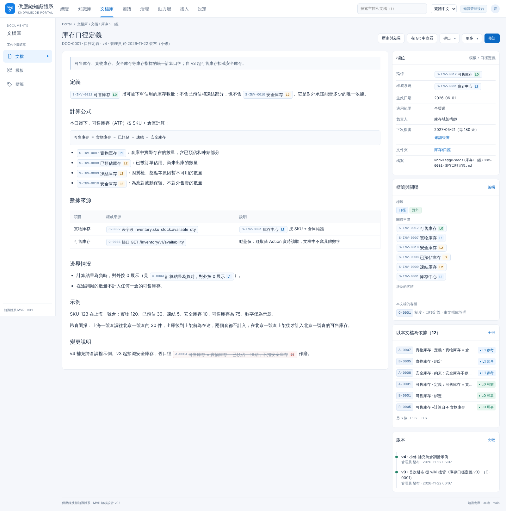

「以本文檔為依據」是 12 條知識（L0 6 · L1 6）：以 O-0001 為證據的斷言和關係，以及綁定到 O-0001 的主體。如果你跳過了 G3、一直在本地倉庫裡做，會多出 F1 補過 O-0001 證據的 A-0011，共 13 條（L0 6 · L1 7）。

點右側欄的 **O-0001** 打開客體。**預期**：客體頁顯示「由文檔庫管理」和 **打開文檔** 按鈕；定位仍是 `wiki://inventory/metrics/v3`，接管沒有改變它，原有的綁定 B-0001 也不受影響。

用 API 看同一篇文檔：

```bash
api $CONS GET /api/v1/docs/DOC-0001
curl -s "$BASE/api/v1/docs/DOC-0001?format=md" -H "Authorization: Bearer $CONS" | head -12
```

**預期**：第一條 HTTP 200，`data.version` 為 4，`data.object.id` 為 `O-0001`，`data.refs` 列出正文引用的每個 ID 及其層級。第二條返回原始 Markdown，開頭是 YAML front matter（`id: DOC-0001`、`template: TPL-0004` 等），這就是 Git 中的檔案內容。

### L3 人新建並發布一篇文檔

1. 在 **文檔庫 › 文檔** 點 **+ 新建文檔**。模板選 **知識條目**，標題填 `凍結庫存說明`，文件夾填 `庫存`，點 **建立草稿**。
   **預期**：提示「已建立草稿 DOC-0004」，進入編輯器。正文已按模板生成章節骨架，每節下有灰色提示。
2. 看右側 **體檢**。**預期**：顯示「體檢未通過」，錯誤有「發布前需要摘要」「章節「概述」還是模板提示」「章節「詳細說明」還是模板提示」，警告有兩個可選章節沒有內容、「沒有關聯任何主體或客體」。
3. 填寫：
   - **摘要**：`凍結庫存的含義、來源系統與對可售庫存的影響。`
   - **關聯主體**：輸入 `S-INV-0009`（或「凍結」再從候選中選），按回車。
   - **正文**：把「概述」「詳細說明」兩節的提示換成內容，刪掉「示例」「常見問題」「相關知識」三個可選章節，例如：

     ```markdown
     ## 概述

     凍結庫存是因質檢、盤點或爭議被鎖定、暫時不能售賣的庫存，見 [[S-INV-0009]]。

     ## 詳細說明

     凍結數量由 [[S-INV-0001]] 維護，計算 [[S-INV-0012]] 時扣除。
     ```

   **預期**：輸入時右側預覽同步渲染，`[[…]]` 變成帶層級的標籤；體檢變為 **體檢通過**，只剩幾條「正文提到「庫存中心」…尚未關聯」之類的建議（不影響發布）。工具欄的 **插入引用** 可以搜索主體、斷言、文檔並插入 `[[ID]]`。
4. 點 **保存並發布…**。**預期**：對話框「審閱並發布 DOC-0004 v1」說明「首次發布：登記或寫回制度客體，文檔從此可以作為主體的依據和斷言的證據。」，下方「關聯了、但還沒有以本文檔為依據的主體」列出「為「凍結庫存 S-INV-0009」建立綁定（L1，之後由負責人確認或校驗到 L0）」。勾選它，點 **發布 v1**。
5. **預期**：提示「已發布 DOC-0004 v1；客體 O-0011」。打開凍結庫存（`#subject/S-INV-0009`）：客體綁定多了 **B-0008**（L1，備註「文檔 DOC-0004 發布時綁定」），相關文檔列出 DOC-0004 和 DOC-0001。綁定是 L1：之後由負責人確認或 Action 校驗才能到 L0，與其他知識的晉升規則一致。
6. **總覽 › 變更記錄**：最新一條為「[文檔] 發布 DOC-0004 v1（首次發布，登記客體 O-0011，綁定 1 個主體）」。

> 誰能直接發布由模板決定：知識條目、評審記錄允許貢獻者直接發布；設計文檔、SOP、口徑定義、SLA 需要負責人審閱。智能體任何模板都不能發布（見 L7）。

### L4 編輯器與體檢：補完 SOP 草稿

1. 打開 DOC-0002《跨倉調撥作業 SOP》。**預期**：提示條「草稿，從未發布。體檢：1 個錯誤、7 個提醒。」錯誤是「章節「異常處理」還是模板提示，沒有內容」；提醒是正文提到了已登記的主體（可售庫存、揀貨、出庫指令等）但還沒關聯。
2. 點 **編輯草稿**，在「異常處理」下把提示換成內容，例如：

   ```markdown
   - 簽收數量與出庫數量不一致：在調撥單上登記差異，由調出倉核實後在庫存中心調整。
   - 調撥單遲遲未簽收：在運輸系統查詢承運狀態，並通知調入倉跟進。
   ```

3. 按 `Ctrl/⌘ + S` 保存。**預期**：右上角顯示「草稿保存於 …」，體檢錯誤數變為 0。
4. 試一下體檢規則：在正文任意處寫一行 `在途 20 件`。**預期**：出現警告「…在「在途」旁寫了具體數字：動態值不寫數字，寫明以哪個系統為準、怎麼取」。刪掉這一行。編輯器右側的「寫作提示」列出主要的寫法要求。
5. 點 **保存並發布…** → **發布 v1**。**預期**：提示「已發布 DOC-0002 v1；客體 O-0012」。

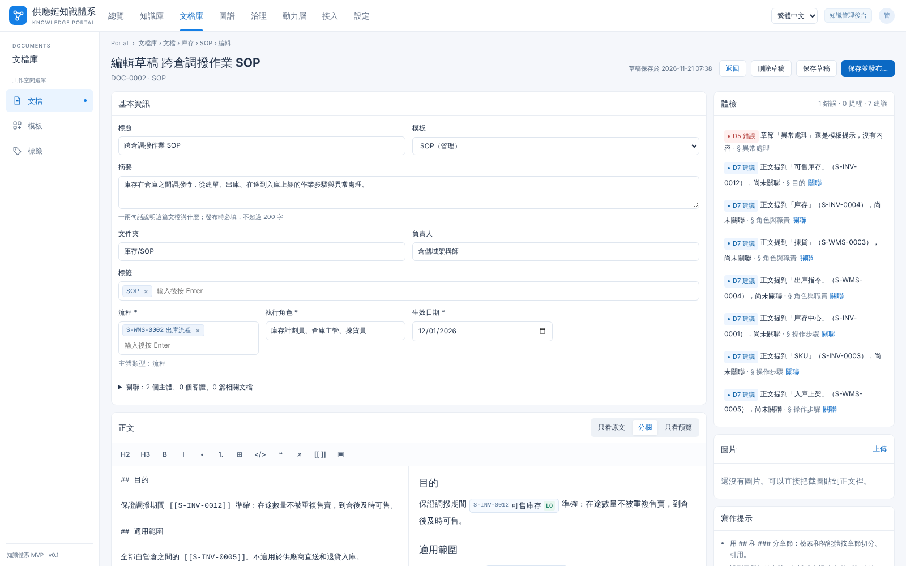

> 編輯時瀏覽器每 5 秒暫存一次；兩個人同時改同一份草稿時，後保存的人會看到「草稿已被別人修改」，可以 **以我的為準** 覆蓋，或載入對方的版本對照合併，不會靜默覆蓋。

### L5 修訂與保鮮：重大修訂讓依據它的知識降級

1. 打開 DOC-0001，點 **修訂**。在正文最後加一行 `調撥在途的數量由運輸系統維護，以運輸系統為準。`，點 **保存草稿**，再點 **返回**。
   **預期**：文檔頁頂部提示「有一份修訂正在進行：v5 草稿由 管理員 最後修改於 …」，正文仍是 v4。
2. 讀者看到的仍是已發布版本：

   ```bash
   api $CONS GET /api/v1/docs/DOC-0001 | grep -o '"version":[0-9]*' | head -1
   api $CONS GET '/api/v1/docs/DOC-0001?draft=1'
   ```

   **預期**：第一條為 `"version":4`；第二條 HTTP **403**「讀草稿和修訂需要 contributor 權限」。
3. 在提示條點 **發布**（或進編輯器點 **保存並發布…**）。對話框顯示體檢結果、**查看本次差異**、「這次修訂屬於」**小修 / 重大修訂**，以及「以本文檔為依據的知識」清單。
   - **小修**（預設）：清單不勾選，底部說明「依賴它的知識不變。」
   - **重大修訂**：清單自動全選，可以取消勾選確實不受影響的條目；底部實時算出「6 條 L0 降為 L1，12 條排入重驗（原因：客體已變化）。一次 Git 提交。」
4. 選 **重大修訂**，版本說明填 `明確在途數量的權威系統`，保持全選，點 **發布 v5**。

   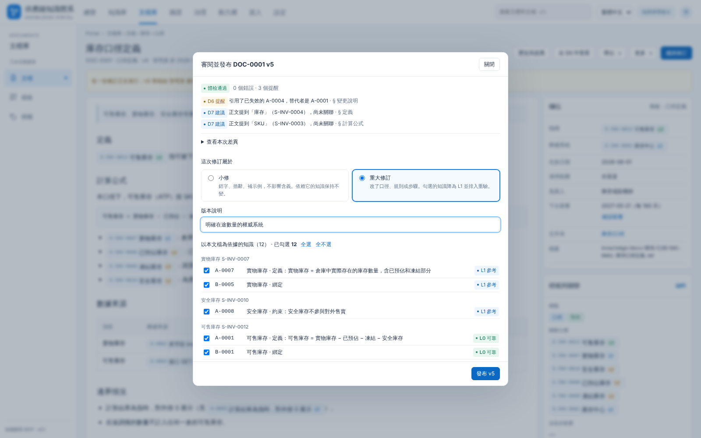

5. **預期**：提示「已發布 DOC-0001 v5：6 條 L0 降為 L1，12 條排入重驗」（跳過 G3 時為 13 條）。變更記錄中這是一次提交：「[文檔] 發布 DOC-0001 v5（重大修訂，6 條知識降為 L1，12 條排入重驗）：明確在途數量的權威系統」。
6. 打開 **治理 › 重驗隊列**。**預期**：多出這 12 條，原因「客體已變化」，說明「DOC-0001 v5 重大修訂：明確在途數量的權威系統」；可售庫存的 A-0001、B-0001 排在前面（出錯代價 5）。重驗方式與 F 章節相同：Action 校驗或負責人確認後回到 L0。

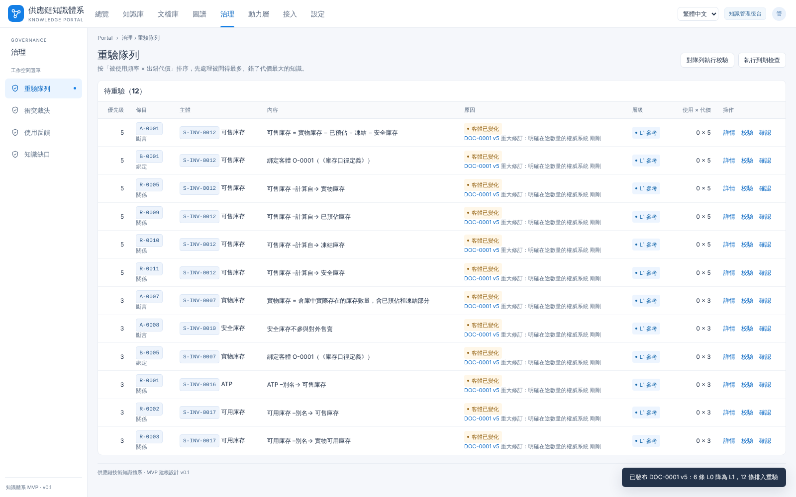

### L6 歷史與差異

在 DOC-0001 點 **歷史與差異**。

**預期**

- **時間線**：v5 重大修訂、v4 小修、v3 首次發布（從 wiki 接管），每個版本有發布者和時間，可 **查看此版本**、**與上一版比較**。從 v3 開始是因為 DOC-0001 接管 O-0001 時從 v3 起算。
- 預設比較 v4 → v5：顯示新增的那一行（綠色）和它所在的章節；欄位和摘要沒有變化，不列出。
- 把「從」改成 v3、「到」改成 v4，點 **比較**：「修改 示例」「修改 變更說明」兩個章節標記，以及 +3 −1 的行差異。
- 「從」「到」選同一個版本時提示「請選擇兩個不同的版本。」

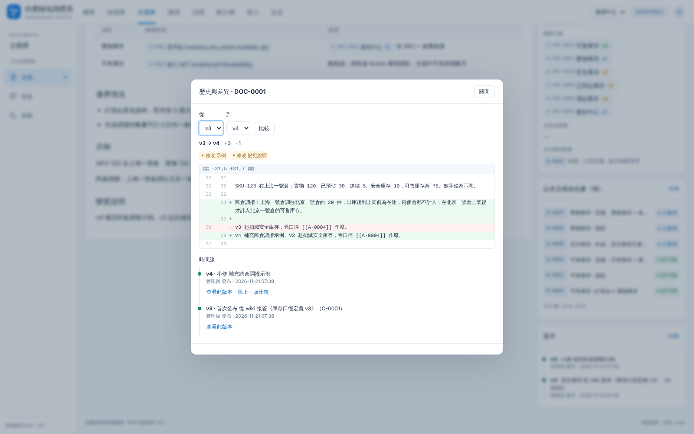

在時間線 v3 上點 **查看此版本**。**預期**：頁面頂部提示「你在看歷史版本 v3；當前版本是 v5。」，正文是 v3 的內容；點 **回到當前版本** 返回。

API 也一樣：

```bash
api $CONS GET /api/v1/docs/DOC-0001/history | grep -o '"version":[0-9]*' | head -3
api $CONT GET '/api/v1/docs/DOC-0001/diff?from=3&to=4' | head -c 300; echo
```

**預期**：第一條依次為 5、4、3；第二條 HTTP 200，返回 `from`（v3）、`to`（v4）、`sections`（每個章節是否變化）、`hunks`（行差異）和 `stats`。

### L7 智能體用 API 寫文檔

智能體可以建立和修改草稿、提交審閱，但**不能發布**；發布由人負責。

```bash
api $CONT POST /api/v1/docs '{
  "template": "TPL-0001",
  "title": "已預佔庫存說明",
  "folder": "庫存",
  "summary": "已預佔庫存的含義與釋放規則。",
  "subjects": ["S-INV-0008"],
  "body": "## 概述\n\n已預佔庫存是訂單已鎖定、尚未出庫的庫存，見 [[S-INV-0008]]。\n\n## 詳細說明\n\n預佔 30 分鐘未支付自動釋放，見 [[A-0002]]。\n"
}'
api $CONT POST /api/v1/docs/DOC-0005/publish '{}'
api $CONT POST /api/v1/docs/DOC-0005/submit '{}'
```

**預期**

1. HTTP 201，`data.id` 為 **DOC-0005**，`data.status` 為「草稿」；`problems` 只有「建議」級別的提示。寫之前也可以用 `POST /api/v1/docs/lint` 只做體檢、不保存。
2. HTTP **403**，`code` 為 `agent_cannot_publish`：「智能體和管道不能發布、審閱或廢止文檔；請提交審閱，由人發布」。
3. HTTP 200，`data.status` 為「待審」。

回到後台，**智能視圖 › 待我審閱** 出現 DOC-0005。打開它可以看到提示條「草稿待審閱，從未發布。」；負責人可以 **發布**，或在發布對話框中 **退回修改** 並寫明原因。這裡用負責人的金鑰發布：

```bash
api $OWN POST /api/v1/docs/DOC-0005/publish '{}'
```

**預期**：HTTP 200，`data.version` 為 1，`data.objectId` 為 **O-0013**。

智能體檢索文檔時，按章節取用，並帶上引用寫法：

```bash
curl -s -G "$BASE/api/v1/doc-sections" --data-urlencode "q=ATP 口徑" -H "Authorization: Bearer $CONS"; echo
curl -s "$BASE/api/v1/docs/export" -H "Authorization: Bearer $CONS" | head -2
```

**預期**

- 段級搜索：第一條是 DOC-0001 的「計算公式」一節，`cite` 為 `〔DOC-0001§計算公式·v5〕`，`terms` 為 `["atp","口徑"]`。智能體回答時引用這個寫法，讀者可以定位到具體版本的具體章節。
- 導出：每行一個 JSON（JSONL），一行是一個章節，含 `docId`、`heading`、`text`、`refs`、`cite` 和後台鏈接，適合直接灌入其他知識庫或向量庫。後台 **文檔庫 › 文檔 › 導出 › 段級 JSONL（給 RAG）** 是同一份內容。

智能體教程已包含文檔庫的寫法：`curl -s $BASE/api/v1/prompt | grep -n "## 5. 文檔"` 可以找到這一章（什麼時候寫斷言、什麼時候寫文檔，模板，體檢規則，讀寫端點）。

### L8 整理：文件夾、標籤、批量操作

整理只改文檔放在哪、帶什麼標籤，**不改版本號**，每次操作是一次 Git 提交。

1. **移動**：在列表中勾選 DOC-0003，底部出現「已選 1 篇：」，點 **移動到…**，目標文件夾填 `庫存`，確定。**預期**：提示「已移動 1 篇到「庫存」」；DOC-0003 仍是 v1。
2. **重命名文件夾**：在左側點 **口徑** 文件夾，點列表上方的 **設定**，把路徑改成 `庫存/指標口徑`，保存。**預期**：提示「已移動到 庫存/指標口徑，1 篇文檔一起移動」；DOC-0001 的文件夾變為「庫存/指標口徑」，版本仍是 v5。
3. **重命名標籤**：**文檔庫 › 標籤**，在「口徑」這一行點 **編輯**，名稱改為 `指標口徑`，保存。**預期**：提示「已重命名，改寫了 1 篇文檔」；右側「合併與重命名記錄」出現 口徑 → 指標口徑。舊名在搜索和篩選中繼續可用：

   ```bash
   curl -s -G "$BASE/api/v1/docs" --data-urlencode "tags=口徑" -H "Authorization: Bearer $CONS" | grep -o '"id":"DOC-[0-9]*"'
   ```

   返回 `"id":"DOC-0001"`，它的標籤已是「指標口徑」。
4. **總覽 › 變更記錄**，選 **顯示 › 只看文檔**。**預期**：最新三條依次為「[文檔] 重命名標籤 口徑 → 指標口徑（1 篇）」「[文檔] 重命名文件夾 庫存/口徑 → 庫存/指標口徑（1 篇）」「[文檔] 批量整理 1 篇」。

> 列表的批量操作還有 **加標籤**、**去標籤**、**改負責人**；**文檔庫 › 標籤** 可以把拼寫不一的標籤合併。只有空文件夾可以刪除。

### L9 文檔就在 Git 裡

1. 在 DOC-0001 點 **在 Git 中查看**。**預期**：做過 G 章節（遠端是 GitHub 或 GitLab）時，在新窗口打開這個檔案的網頁：`knowledge/docs/庫存/指標口徑/DOC-0001-庫存口徑定義.md`；沒有配置遠端時，彈窗顯示檔案在倉庫中的路徑。目錄結構與後台的文件夾一一對應；草稿在 `knowledge/docs/_drafts/` 下。
2. **在 Git 中直接修改**：
   - 做過 G 章節時：在 GitHub 網頁上編輯這個檔案，把「它是對外承諾能賣多少的唯一依據。」改成「…唯一依據（在 Git 中修改）。」，提交到 `main`；回後台 **設定 › 知識倉庫** 點 **立即同步**。
   - 沒有遠端時：停止服務，在知識倉庫本地目錄（見 B4）用編輯器做同樣的修改，執行 `git commit -am "直接在 Git 中修改"`，再啟動服務。

   **預期**：DOC-0001 正文顯示你的修改，頂部提示「已發布的檔案在 Git 中被直接修改過，還沒有確認為新版本。」，旁邊是 **確認為新版本**；**歷史與差異** 的時間線最上方是「在 Git 中直接修改」，作者是 Git 提交者。點 **確認為新版本** → **發布 v6**，記錄為一個新版本。
3. **待登記的檔案**：在 Git 中新增一個沒有 front matter 的檔案 `knowledge/docs/庫存/盤點說明.md`，內容為 `# 盤點說明` 和一行正文，按上一步的方式同步。**預期**：**智能視圖 › 待登記** 為 1，列出它的路徑和猜測的標題「盤點說明」；點 **登記**，提示「已登記為 DOC-0006」，它作為草稿進入流程。

### L10 廢止

1. 打開 DOC-0004《凍結庫存說明》，點 **更多 › 廢止**。對話框先說明後果：「廢止後文檔仍可閱讀，但不能再修訂。它的客體 O-0011 下線：1 個綁定轉為 E1，0 條以它為證據的知識降為 L1 並排入重驗。」
2. 廢止原因填 `已併入《庫存口徑定義》`，替代文檔選「DOC-0001 庫存口徑定義」，點 **確認廢止**。

**預期**

- 提示「DOC-0004 已廢止；1 個綁定轉為 E1，0 條知識降為 L1」。
- 文檔頁頂部顯示「已廢止（…）：已併入《庫存口徑定義》 替代文檔：DOC-0001」，不再有 **修訂** 按鈕。
- 凍結庫存的綁定 B-0008 變為 **E1**；客體 O-0011 狀態為「下線」，這是 F5 的同一套級聯規則。由文檔庫管理的客體不能直接下線：`api $CONT PATCH /api/v1/objects/O-0001 '{"status":"下線","reason":"x"}'` 返回 HTTP **409** `object_managed_by_doc`：「客體 O-0001 由文檔庫管理（文檔 DOC-0001）：定位和狀態請在文檔上操作（發布、廢止）」。
- 文檔列表預設（狀態「不含已廢止」）不再顯示 DOC-0004；狀態選 **全部（含已廢止）** 或 **智能視圖 › 已廢止** 可以看到。

---

## M. 文檔庫第二期

第二期讓文檔和知識互相生成：導入 Word、PDF，按知識起草文檔，從知識生成手冊，從文檔提取斷言；問答引用文檔原文；修訂時按章節預選受影響的知識；四眼審閱；內置的「文檔已發布」校驗 Action；廢止時遷移依據；全局搜索；導出 Markdown 壓縮包。

> **從全新資料開始**：本節的 ID（DOC-…、A-…、B-…、O-…）按全新示例資料計算，與 A–L 做過什麼無關。請先停掉服務，刪除倉庫下的 `data/` 目錄，用 [A1](#a1-啟動服務) 的命令啟動，登入後按 [B1](#b1-載入示例資料) 載入示例資料，再按 [C1](#c1-發放-api-金鑰) 重新發放三把金鑰，並在終端中更新 `CONS`、`CONT`、`OWN` 和 `api` 函數。下面的命令都在倉庫根目錄執行（要用到 `docs/samples/` 下的兩個示例檔案）。

### M1 導入 Word 和 PDF

1. **文檔庫 › 文檔**，點右上角 **導入**，**檔案** 選倉庫中的 `docs/samples/stocktake-guide.docx`。
   **預期**：對話框提示「已從 Word 轉換：3 個章節。請在編輯器中核對排版。」和「有 1 張圖片沒有導入：請在編輯器中用「插入圖片」重新上傳」；**內容** 中是轉換後的 Markdown，編號列表、表格、粗體和鏈接都保留了；**標題** 自動填為「盤點作業說明」。

   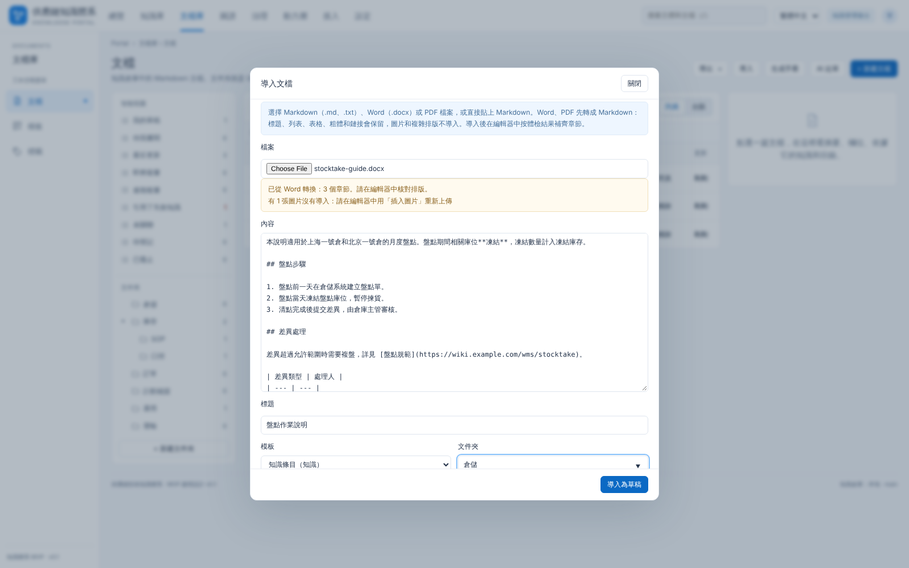

2. **文件夾** 填 `倉儲`，點 **導入為草稿**。**預期**：提示「已導入為草稿 DOC-0004」，進入編輯器。體檢提示「缺少必填章節「概述」」「缺少必填章節「詳細說明」」：導入只轉換格式，按模板補齊章節由人在編輯器裡完成。
3. 用 API 導入 PDF：請求體就是檔案本身。

   ```bash
   curl -s -w '  [HTTP %{http_code}]\n' --data-binary @docs/samples/stocktake-variance.pdf \
     -H "Authorization: Bearer $CONT" -H 'Content-Type: application/octet-stream' \
     "$BASE/api/v1/docs/import?name=stocktake-variance.pdf&folder=%E5%80%89%E5%84%B2"
   ```

   **預期**：HTTP 201，`data.id` 為 **DOC-0005**，`data.title` 為「盤點差異處理說明」，`data.status` 為「草稿」。只想看轉換結果、不建立草稿時，把路徑換成 `/api/v1/docs/convert?name=…`。

> 支持 .docx 和帶文字層的 PDF，單個檔案最大 20 MB。舊版 .doc、加密的 PDF、掃描件（沒有文字層）會被拒絕並說明原因。

### M2 AI 起草

1. **文檔庫 › 文檔**，點 **AI 起草**。**模板** 選「口徑定義」；**主體** 輸入 `ATP`，從候選中選 **S-INV-0016 ATP** 後按回車；**起草要求** 填 `寫給新入職的運營同學，先講結論，再講例外情況`；**標題** 填 `可售庫存口徑（AI 起草）`；**文件夾** 填 `庫存/口徑`。

   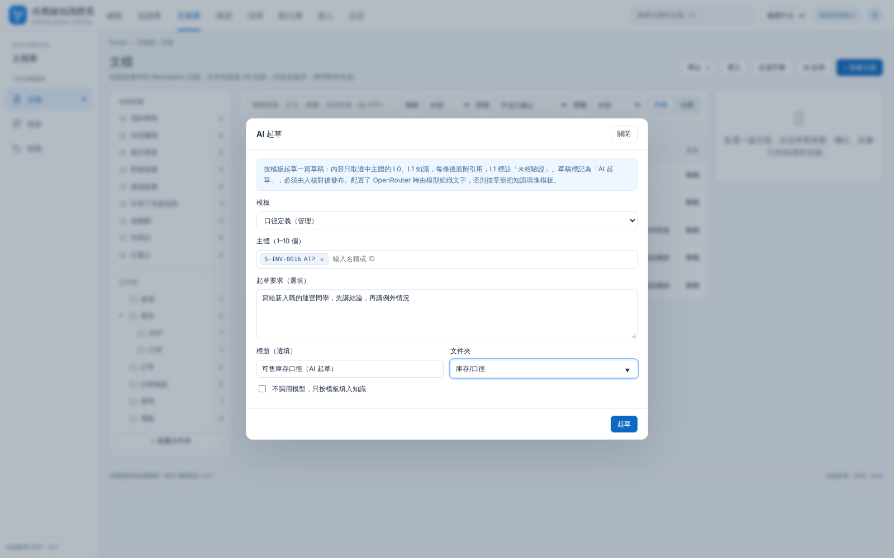

2. 點 **起草**。**預期**：提示「已起草 DOC-0006（按模板填入）：請核對後再發布」，進入編輯器。沒有配置 OpenRouter 時，系統按章節把知識填進模板；配置了（見 [H](#h-openrouter-自然語言可選)）時由模型組織文字，引用同樣經過校驗。
3. 點 **返回** 看文檔頁。**預期**
   - 頂部說明「AI 起草（按模板填入，…）：內容取自 可售庫存 的 L0、L1 知識。發布前請逐條核對引用，刪掉不需要的內容。」，下一行是起草要求。別名 ATP 已換成它指向的可售庫存。
   - 各章節的內容都附了引用：「定義」是可售庫存的主體定義，「計算公式」是 A-0001，「數據來源」是三個客體綁定 B-0001～B-0003，「邊界情況」是 A-0003 並標註「（未經驗證）」（L1）。
   - 沒有對應章節的知識（A-0002、A-0005）放在最後的「其他相關知識（請歸位或刪除）」一節；已失效的 A-0004（E1）和 L2 的關係都沒有用。
   - 草稿的體檢有 2 個錯誤：缺少必填欄位「生效日期」、管理文檔需要負責人。AI 起草只是草稿，必須由人補齊、核對後發布。

   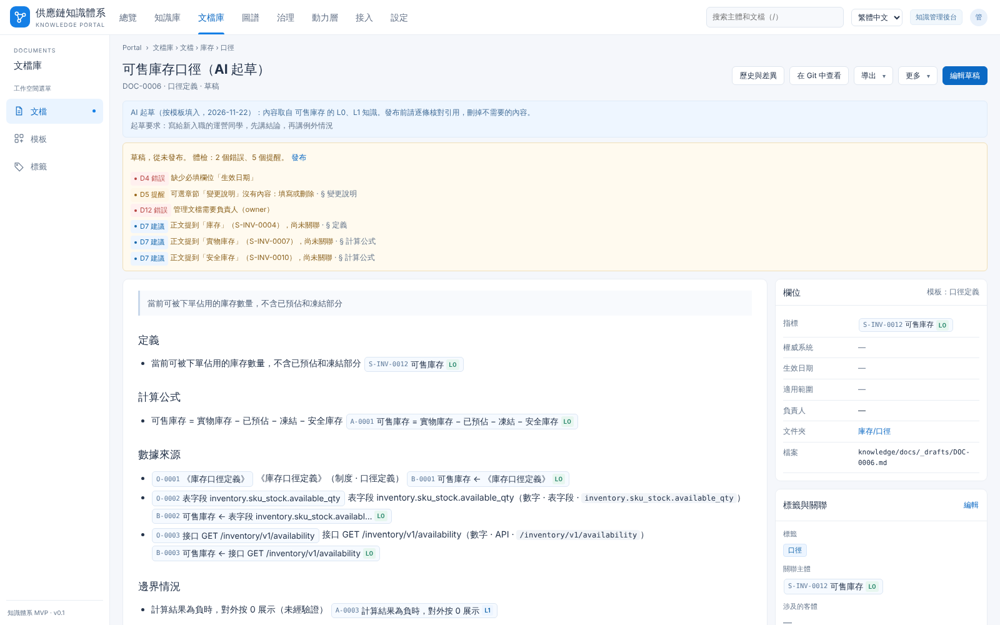

4. 用 API 預覽（`preview` 只返回內容，不建立草稿）：

   ```bash
   api $CONT POST /api/v1/docs/ai-draft '{"template":"TPL-0001","subjectIds":["S-INV-0016"],"preview":true}'
   ```

   **預期**：HTTP 200，`data.composer.type` 為 `template`，`data.subjects` 為 `["S-INV-0012"]`，`data.title` 為「可售庫存知識條目」，`data.body` 含 `[[A-0001]]` 和 `（未經驗證） [[A-0003]]`，不含 A-0004 和 R-0020。用生成類模板起草（`"template":"TPL-0007"`）返回 HTTP **422**「模板「主體手冊」由知識自動生成，不能用來起草…」。

### M3 從知識生成手冊

1. 打開可售庫存（`#subject/S-INV-0012`），在「相關文檔」一欄點 **生成主體手冊**。
   **預期**：提示「已生成 DOC-0007《可售庫存 主體手冊》」，打開這篇文檔：已發布 v1，文件夾「庫存/手冊」。正文依次是概述、斷言（按類型分組，帶層級說明；已失效的 A-0004 單獨列出並寫明替代者）、關係、客體與依據、相關文檔、可用 Action。頂部說明「由知識生成的手冊，正文只讀，不作為知識的證據。」，右上角沒有 **修訂**。
2. 回到 **文檔庫 › 文檔**，點 **生成手冊**，選 **領域手冊**，領域選 **INV**，點 **生成**。**預期**：「已生成 DOC-0008《庫存領域手冊》」，列出庫存域所有主體的定義和關鍵知識。
3. 讓知識變化一下：

   ```bash
   api $CONT POST /api/v1/subjects/S-INV-0012/assertions '{"type":"屬性","content":"對外展示時按整數向下取整","evidence":{"sourceRef":"wiki://inventory/display"}}'
   ```

   **預期**：HTTP 201，新斷言 **A-0010**（L1）。刷新 DOC-0007，頂部變為「知識在 … 之後有變化，手冊已落後。」

   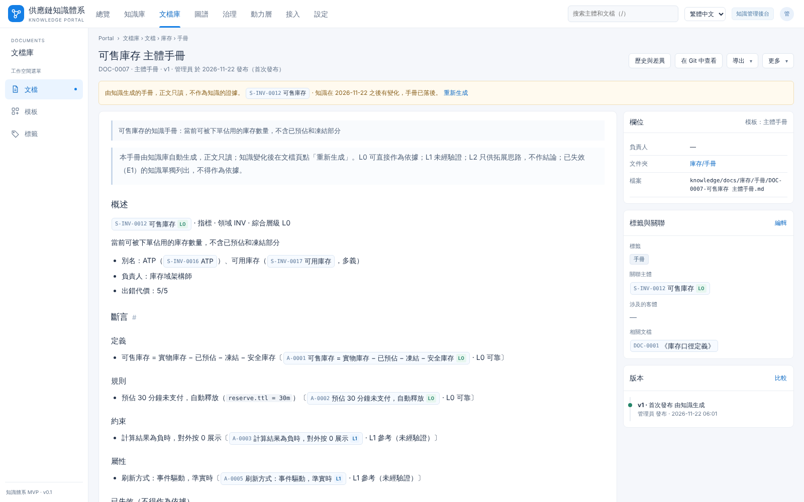

4. 點提示中的 **重新生成**。**預期**：「已重新生成 DOC-0007 v2」，正文出現 A-0010。再點一次（**更多 › 重新生成**）提示「知識沒有變化，手冊不變」，版本仍是 v2。
5. 手冊的限制：

   ```bash
   api $CONT POST /api/v1/docs/generate '{"subjectId":"S-INV-0012"}'
   api $CONT PUT /api/v1/docs/DOC-0007/draft '{"body":"x"}'
   ```

   **預期**：第一條 HTTP **403**「智能體和管道不能生成手冊；手冊直接發布，需要由人觸發」；第二條 HTTP **409**，`code` 為 `generated_doc`：「DOC-0007 由知識生成，正文只讀；知識變化後請「重新生成」」。

### M4 從文檔提取斷言

1. 打開 DOC-0001，點 **更多 › 建議斷言**。
   **預期**：對話框「建議斷言 · DOC-0001（11 條）」，說明這些陳述是「按句式規則」從 v4 正文中找出的。每條有章節、主體、類型和內容，可以逐條修改；已有相同內容的會標出並默認不勾選。點 **關閉**，這一步不寫入。

   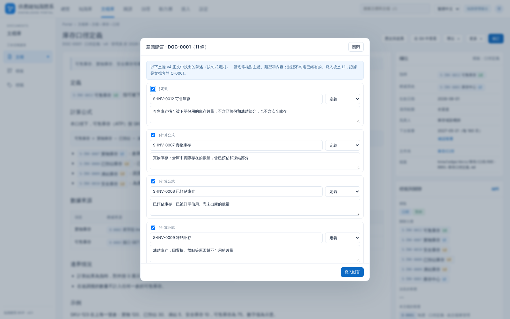

2. 在正文「邊界情況」一節中，用滑鼠選中「在途調撥的數量不計入任何一倉的可售庫存。」這一句。**預期**：選區下方浮出 **提取為斷言** 按鈕。

   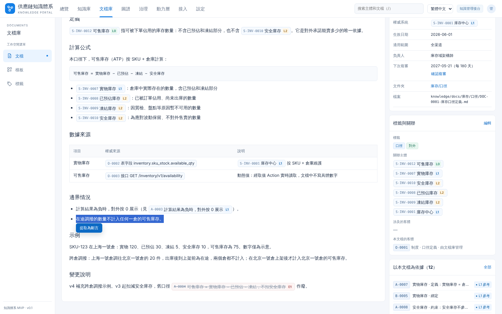

3. 點 **提取為斷言**。**預期**：對話框只有一條：§邊界情況、主體 S-INV-0012 可售庫存、類型 **約束**（按章節的知識類型猜出），內容是選中的句子。說明寫明「證據是本文檔的客體 O-0001，sourceRef 寫「DOC-0001§章節 v4」。寫入後是 L1（未經驗證）」。

   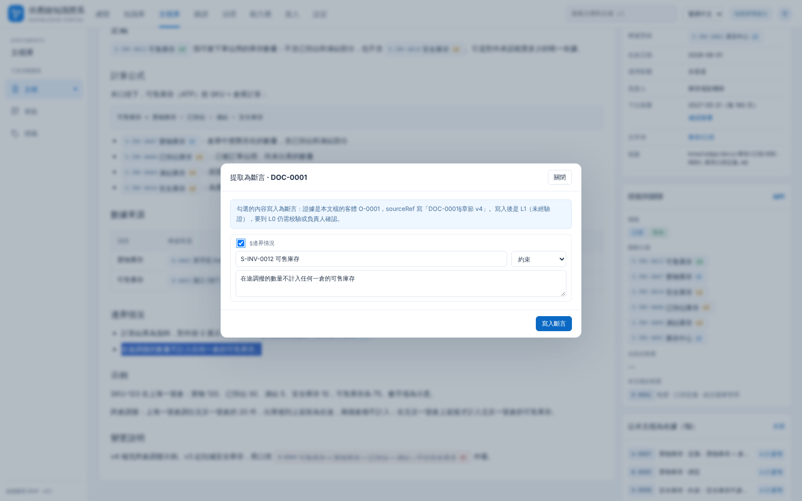

4. 點 **寫入斷言**。**預期**：提示「已寫入 1 條斷言（L1）」。可售庫存多了 **A-0011**（約束，L1），證據是 O-0001，來源「DOC-0001§邊界情況 v4」。同一句再提取一次會提示「已寫入 0 條斷言（L1），跳過 1 條重複」。手冊不能作為證據：`api $CONT POST /api/v1/docs/DOC-0007/extract-suggestions '{}'` 返回 HTTP **409**「DOC-0007 由知識生成，不能再作為知識的證據」。

### M5 問答引用文檔原文

進入 **接入 › 問答測試**，輸入 `可售庫存怎麼計算？`，點 **提問**。

**預期**

- 答案的知識部分與 C2 相同，並多了剛提取的 A-0011（L1 參考，未經驗證）。
- 答案最後多了一段「文檔原文（補充，不屬於結構化知識，沒有層級）：」，引用《庫存口徑定義》§計算公式，寫法是 `〔DOC-0001§計算公式·v4〕`。
- 下方新增 **文檔原文（補充）** 面板：與知識的「引用」分開列出，標明「關聯了命中的主體」，點標題直接跳到那一節。文檔原文只作補充，不能覆蓋 L0 知識。

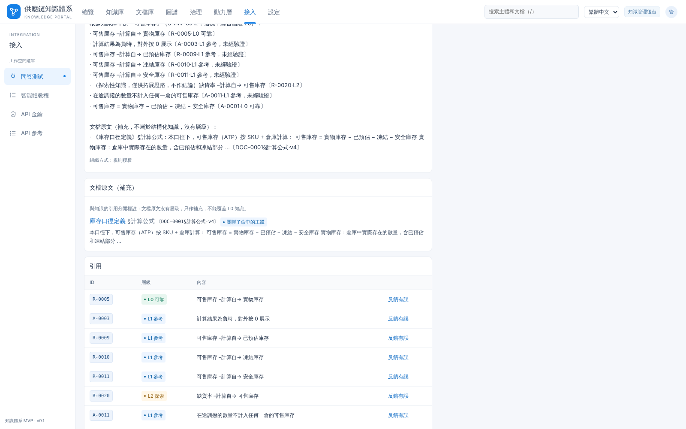

API 也一樣：

```bash
api $CONS POST /api/v1/ask '{"question":"可售庫存怎麼計算？"}' | grep -o '"cite":"[^"]*"'
api $CONS POST /api/v1/ask '{"question":"可售庫存怎麼計算？","includeDocuments":false}' | grep -o '"documents":\[\]'
```

**預期**：第一條輸出 `"cite":"〔DOC-0001§計算公式·v4〕"`；第二條輸出 `"documents":[]`。

### M6 修訂時按章節預選受影響的知識

1. 打開 DOC-0001，點 **修訂**。只改「示例」一節：在 `## 示例` 下面加一行 `補一個例子：上海一號倉。`，點 **保存草稿**，再點 **保存並發布…**，選 **重大修訂**，版本說明填 `補充上海一號倉的例子`。
2. **預期**：「以本文檔為依據的知識（13）· 已勾選 12」，下方一行「改動的章節：§示例（已修改）。知識的 sourceRef 指向沒改的章節時不預選；沒有 sourceRef 的一律預選。」
   - M4 提取的 **A-0011** 沒有勾選，旁邊標著「§邊界情況 · 未改動」：它的依據是「邊界情況」一節，這次沒改。
   - 其他 12 條沒有記錄章節，仍然預選。
   - **只選受影響的** 可以隨時恢復這個預選。

   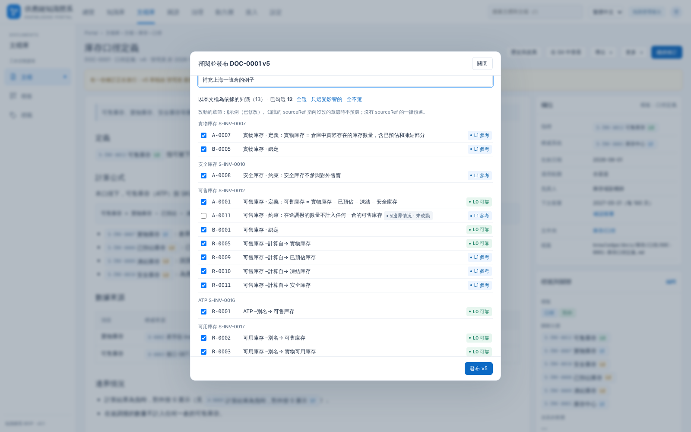

3. 點 **發布 v5**。**預期**：「已發布 DOC-0001 v5：6 條 L0 降為 L1，12 條排入重驗」；A-0011 仍是 L1，沒有排入重驗。

API 中，`GET /api/v1/docs/DOC-0001/impact` 在有修訂草稿時返回 `changedSections`（如 `[{"heading":"示例","change":"modified"}]`），每條知識帶 `suggested`（是否預選）。

### M7 四眼審閱

1. **文檔庫 › 模板**，在「口徑定義」（TPL-0004）這一行點 **編輯**，在 JSON 的第一層加一行 `"requireOtherApprover": true,`，保存。**預期**：提示「已保存模板 TPL-0004」，這一行的「發布」欄多了 **四眼審閱**。
2. 打開 DOC-0001，點 **修訂**，在「示例」下再加一行 `再補一個例子：北京一號倉。`，保存，點 **保存並發布…**。
   **預期**：對話框頂部提示「模板「口徑定義」要求四眼審閱：這一版有你參與編寫，需要另一位負責人發布。」

   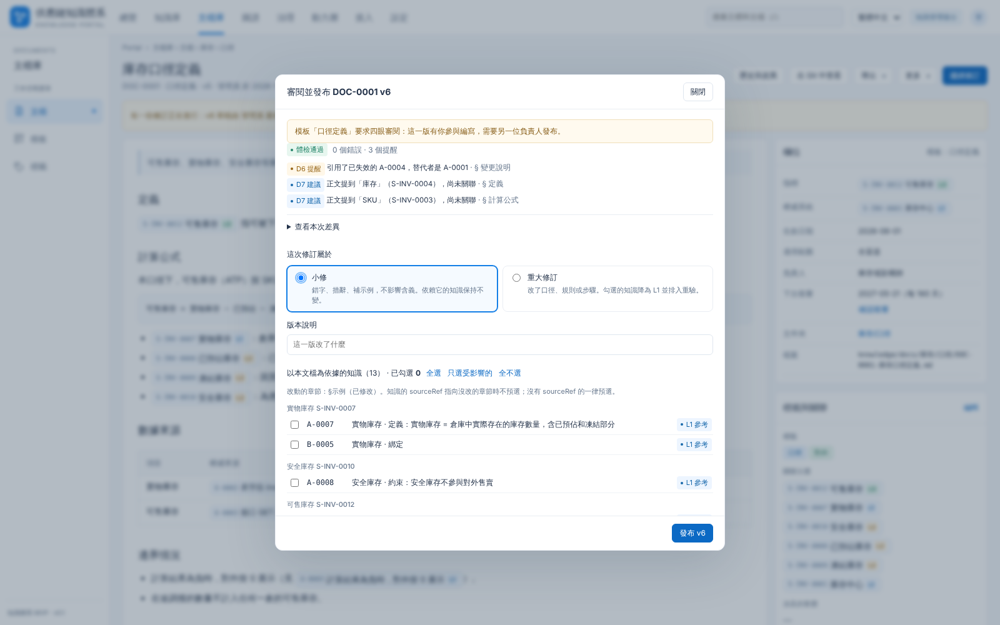

3. 仍然點 **發布 v6**。**預期**：發布被拒絕：「模板「口徑定義」要求四眼審閱：這一版有你參與編寫，需要另一位負責人審閱並發布」（HTTP 403，`code` 為 `four_eyes_required`）。關閉對話框。
4. 由另一位負責人發布：

   ```bash
   api $OWN POST /api/v1/docs/DOC-0001/publish '{}'
   api $CONS GET /api/v1/docs/DOC-0001 | grep -o '"change":{[^]]*]'
   ```

   **預期**：第一條 HTTP 200，`data.version` 為 6；第二條顯示這一版的 `publishedBy` 是「庫存域架構師」，`authors`（作者）是「管理員」。

### M8 內置校驗 Action：文檔已發布

1. **動力層 › 管道**。**預期**：多了 **P-0004 文檔庫（內置）**，類型「內置」，地址「本系統文檔庫」，只有 **測試**，沒有 **編輯**；點 **測試** 提示「內置文檔庫管道，讀本系統的文檔狀態」。**動力層 › Action** 中對應的是 **ACT-0005 文檔已發布**（校驗）。

   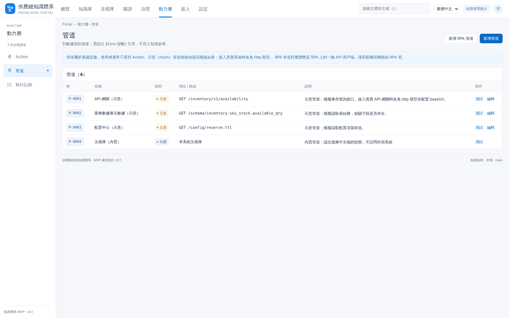

2. 內置的管道和 Action 由系統維護，不能新增或修改：

   ```bash
   api $OWN POST /api/v1/pipelines '{"name":"我的文檔庫","type":"docs"}'
   ```

   **預期**：HTTP 400，`code` 為 `builtin`：「文檔庫管道由系統建立和維護，不能手動新增或修改」。
3. 用它校驗：M6 的重大修訂讓 B-0001（可售庫存 ↔ O-0001）降為 L1 並排入重驗。在 **治理 › 重驗隊列** 中 B-0001 這一行點 **校驗**，或者：

   ```bash
   api $OWN POST /api/v1/validate/B-0001
   ```

   **預期**：HTTP 200，`outcome` 為 `pass`，`level` 為 **L0**，請求地址是 `docs://P-0004/docs/O-0001`。文檔處於已發布狀態，就證明這個制度客體存在，綁定可以回到 L0。文檔廢止後同一個校驗會失敗。

### M9 廢止時遷移依據

1. 用負責人的金鑰建立並發布兩篇文檔，第一篇發布時為 WMS（S-WMS-0001）建立綁定：

   ```bash
   api $OWN POST /api/v1/docs '{"template":"TPL-0001","title":"盤點作業說明（2025 版）","folder":"倉儲","summary":"2025 年的月度盤點做法。","subjects":["S-WMS-0001"],"body":"## 概述\n\n月度盤點由 [[S-WMS-0001]] 生成盤點單，盤點期間凍結庫位。\n\n## 詳細說明\n\n盤點差異由倉庫主管審核。\n"}'
   api $OWN POST /api/v1/docs/DOC-0009/publish '{"bindSubjects":["S-WMS-0001"]}'
   api $OWN POST /api/v1/docs '{"template":"TPL-0001","title":"盤點作業說明（2026 版）","folder":"倉儲","summary":"2026 年起的月度盤點做法：增加複盤。","subjects":["S-WMS-0001"],"body":"## 概述\n\n月度盤點由 [[S-WMS-0001]] 生成盤點單，盤點期間凍結庫位。\n\n## 詳細說明\n\n差異超過允許範圍時需要複盤，複盤結果以 [[S-WMS-0001]] 記錄為準。\n"}'
   api $OWN POST /api/v1/docs/DOC-0010/publish '{}'
   ```

   **預期**：建立的是 DOC-0009 和 DOC-0010，兩次發布都是 HTTP 200，客體分別是 **O-0010**、**O-0011**；WMS 多了綁定 **B-0007**（O-0010，L1）。
2. 在後台打開 DOC-0009，點 **更多 › 廢止**。廢止原因填 `2026 版取代`，**替代文檔** 選「DOC-0010 盤點作業說明（2026 版）」。**預期**：下方出現已勾選的「把依據遷移到替代文檔：為 1 個綁定了本文檔的主體綁定替代文檔的客體（L1，等待確認或校驗）」。

   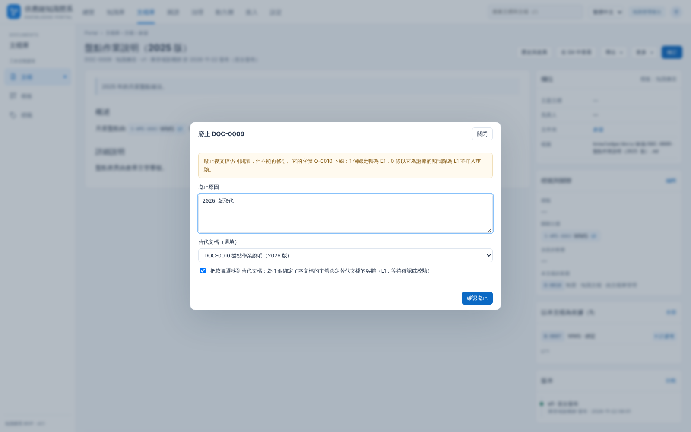

3. 點 **確認廢止**。**預期**
   - 提示「DOC-0009 已廢止；1 個綁定轉為 E1，0 條知識降為 L1；1 個主體改為以 DOC-0010 為依據」。
   - 打開 WMS（`#subject/S-WMS-0001`）：B-0007 變為 **E1**；新綁定 **B-0008** 指向 O-0011，L1，備註「文檔 DOC-0009 廢止，依據遷移到 DOC-0010」，等待負責人確認或用 ACT-0005 校驗。
   - 變更記錄是一次提交：「[文檔] 廢止 DOC-0009，由 DOC-0010 替代（客體 O-0010 下線），依據遷移到 DOC-0010（1 個主體）」。

> 廢止時沒有勾選遷移，之後也可以補做：已廢止文檔頂部的提示裡有 **把依據遷移到替代文檔** 按鈕（API：`POST /api/v1/docs/{id}/migrate-basis`）。已經遷移過的主體不會重複綁定。

### M10 全局搜索

在頂欄的搜索框（按 `/` 可以直接聚焦）輸入 `ATP` 並回車。

**預期**

- 頁面「搜索：ATP」分兩塊。
- **主體（1）**：S-INV-0012 可售庫存，「命中」欄顯示「別名 ATP」。
- **文檔（3）**：DOC-0001（命中 §計算公式，摘錄中高亮 ATP）、DOC-0007（標「生成的手冊」）、DOC-0006（草稿）。
- 摘錄是純文字：`[[ID]]` 已換成名稱。

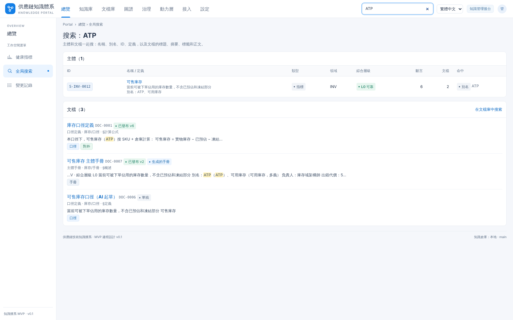

API：

```bash
api $CONS GET '/api/v1/search?q=ATP' | head -c 400; echo
```

**預期**：HTTP 200，`data.subjects[0].id` 為 `S-INV-0012`，`match.field` 為 `alias`；`data.resolved.canonical` 為 `["S-INV-0012"]`；`data.documents` 中有 DOC-0001 和 DOC-0007。消費者看不到草稿，所以沒有 DOC-0006。

### M11 導出 Markdown 壓縮包

1. **文檔庫 › 文檔**，點 **導出**，有兩項：**段級 JSONL（給 RAG）**（即 L7 的 JSONL）和 **Markdown 壓縮包**。點 **Markdown 壓縮包**，瀏覽器下載 `docs-日期.zip`。

   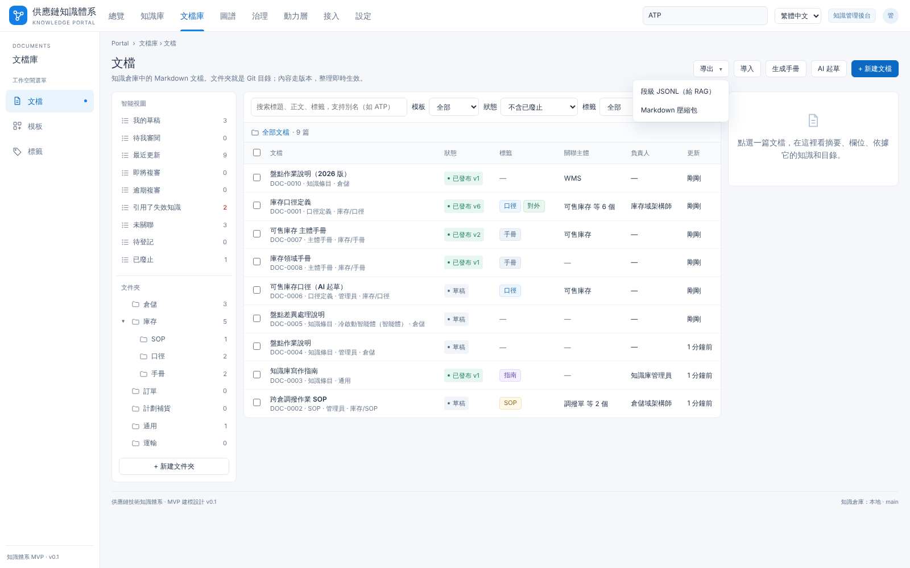

2. 也可以用 API：

   ```bash
   curl -s -D - -o docs.zip "$BASE/api/v1/docs/export?format=zip" -H "Authorization: Bearer $CONS" | grep -i x-doc-count
   unzip -l docs.zip
   ```

   **預期**：`X-Doc-Count: 5`。壓縮包裡是 `README.md` 和 5 篇已發布的文檔，按文件夾存放：
   - `倉儲/DOC-0010-盤點作業說明（2026 版）.md`
   - `庫存/口徑/DOC-0001-庫存口徑定義.md`
   - `庫存/手冊/DOC-0007-可售庫存 主體手冊.md`
   - `庫存/手冊/DOC-0008-庫存領域手冊.md`
   - `通用/DOC-0003-知識庫寫作指南.md`

   草稿和已廢止的 DOC-0009 不在裡面。
3. 打開 `README.md`：按文件夾列出每篇文檔的鏈接、版本和標籤。打開 DOC-0001：開頭是 front matter；正文中的 `[[S-INV-0012]]` 已換成「可售庫存（S-INV-0012）」，引用別的文檔會換成包內的相對鏈接。離開本系統也能直接閱讀。

---

## N. 主體管理

主體多了以後，查找、篩選和批量整理都在 **知識庫 › 主體** 的工作台裡完成；斷言、客體、關係和重驗隊列用同一套工作台。設計見 [主體管理交互設計](design/subject-management.md)。

> 本節可以在 B1（載入示例資料）、C1（發放金鑰）之後的任何時候做。下面的數字和截圖來自只做過 B1、C1 的環境；先做過其他章節時，N1、N5、N9 和 N12 中的總數會不同，以頁面為準。N2 導入的 8 個主體都帶標籤「盤點」，只看這些主體的步驟不受影響。

### N1 工作台與導航欄

1. 打開 **知識庫 › 主體**。左邊是導航欄：視圖、我的視圖、領域（帶層級構成小條）、層級、狀態、類型、負責人、標籤；中間是列表；右邊是當前行的預覽。
2. 點導航欄 **領域 › INV 庫存**：只看 INV，列表上方出現篩選條「領域 INV 庫存」。
3. 按住 Ctrl（Mac：⌘）點 **ORD 訂單**：加選，篩選條變成「領域 INV 庫存、ORD 訂單」。
4. 按住 Alt（Mac：⌥）點 **狀態 › 無斷言**：排除，篩選條出現紅色的「狀態 ≠ 無斷言」。
5. 按 `j`、`k` 上下移動，右邊的預覽跟著換。

**預期**

- 只做過 B1、C1 時是 5 個主體：S-INV-0007、S-INV-0010、S-INV-0011、S-INV-0012、S-INV-0014。
- 導航欄的每個數字都是「其他條件不變時點下去會剩幾個」。例如 ORD 旁是 0：ORD 中沒有「有斷言」的主體。
- 地址欄是 `#subjects?view=all&domain=INV%2CORD&state=%21no_assertion&focus=…`。點 **複製鏈接** 發給別人，打開是同一個結果。
- 按 `[` 收起或展開導航欄；按 `\` 把最左側的選單縮成圖標欄。

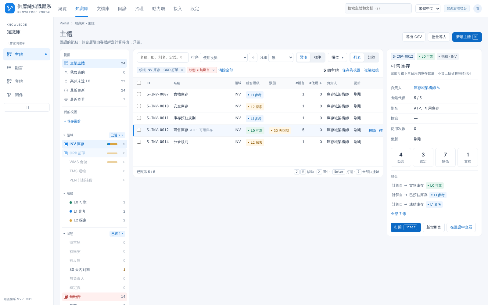

### N2 批量導入

1. 點 **批量導入**，**CSV 檔案** 選倉庫中的 `docs/samples/subjects-import.csv`。也可以從 Excel 複製表格，貼到 **或貼上表格**。
2. 點 **預覽**。

**預期**：顯示「將新增 8 個主體、2 個別名 · 跳過 1 行 · 錯誤 1 行」。第 10 行「庫存中心」**跳過**，說明「已有同名主體 S-INV-0001」；第 11 行「盤點單」**錯誤**，說明「與第 3 行重名」。行號和表格一致，表頭是第 1 行。

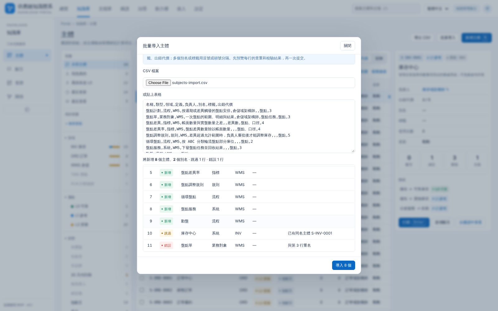

3. 點 **導入 8 個**。

**預期**：列表變成 32 個主體，多了 S-WMS-0006 至 S-WMS-0015 中的 8 個「盤點」主體；「盤點單」有別名「盤點任務」，「盤點差異」有別名「差異數」。**總覽 › 變更記錄** 中只多了一條提交「[批量] 導入主體 8 個（別名 2 個）」。

### N3 新增時查重

在主體列表按 `n`（或點 **新增主體**），名稱輸入 `盤點差`。

**預期**

- 名稱下方即時出現「可能重複：」，列出 S-WMS-0009 盤點差異、S-WMS-0011 盤點差異率（名稱相似），每條後面有 **改為新增「…」的別名**。
- 負責人預填你自己的名字，可以在 **設定 › 帳號 › 個人偏好** 改。在列表中篩選了領域或類型時，這兩項也會預填。
- 勾選 **連續新增** 後，保存時對話框不關閉，保留領域、類型和負責人，只清空名稱和定義。

按 Esc 關閉。

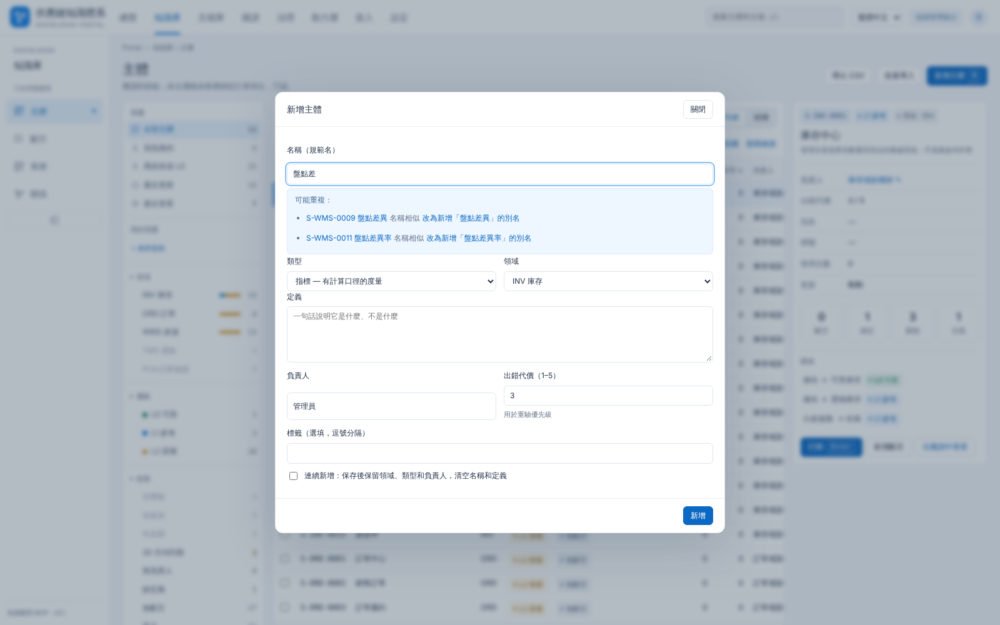

### N4 批量整理與撤銷

1. 在導航欄點 **標籤 › 盤點**，再點 **負責人 › （無負責人）**。**預期**：6 個主體。
2. 點一下列表，按 `Ctrl+A`（Mac：⌘A）全選，再按 `a`。也可以點底部藍色批量欄的 **改負責人**。
3. **新負責人** 填 `倉儲域架構師`。

**預期**：對話框下方即時列出計畫「將修改 6 個」和每個主體的「負責人：— → 倉儲域架構師」，以及提交說明「[批量] 負責人 → 倉儲域架構師（6 個主體）」。如果有主體本來就是這個值，會列在「跳過」裡並寫明原因。

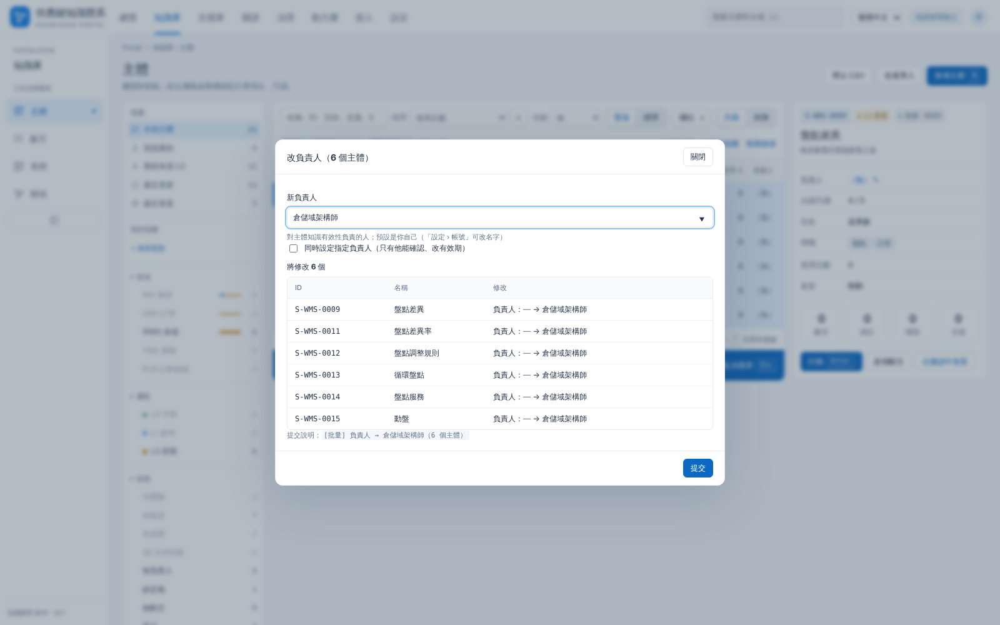

4. 點 **提交**。

**預期**

- 右下角提示「已修改 6 個主體」，帶 **撤銷** 按鈕，10 分鐘內有效。
- 列表變成 0 個，因為它們已經有負責人；空列表提示「去掉「負責人」後有 8 個」，點它就放寬條件。
- 列表底部顯示「最近一次批量：已修改 6 個 撤銷」。

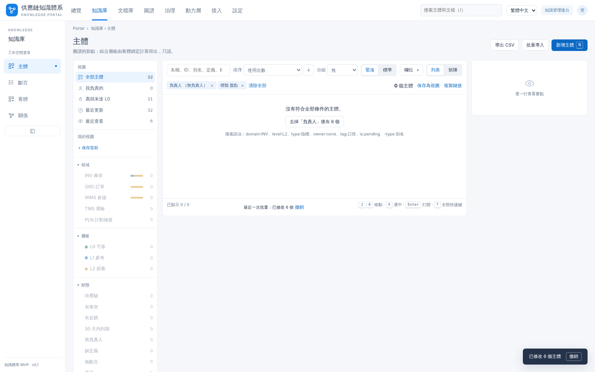

5. 打開 **總覽 › 變更記錄**，**顯示** 選 **只看批量**。**預期**：負責人那次批量後面有 **撤銷**；導入那次沒有，導入不能撤銷。

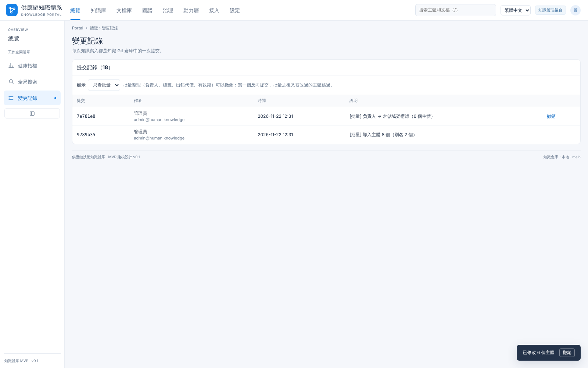

6. 點 **撤銷** 並確認。

**預期**：多了一條提交「[撤銷] [批量] 負責人 → 倉儲域架構師（6 個主體）」，原批量那一行改為「已撤銷（…）」。回到主體工作台，「盤點」中沒有負責人的又是 6 個。撤銷是寫一個反向提交，不改 Git 歷史；批量之後又被修改過的主體會跳過並說明（見 N12 和自動化測試）。

**標籤**（`t`）、**出錯代價**、**有效期**（在 **更多** 裡）用同樣的方式整理，也都能撤銷。有效期和指定負責人只有負責人能改。也可以把列表中的行拖到導航欄的某個負責人或標籤上。

### N5 矩陣

點工具列右邊的 **矩陣**，再點 **WMS 倉儲** 前面的 ▸ 展開。

**預期**

- 每行一個領域，各列是主體數、層級構成、L0 佔比、L0 / L1 / L2，以及待重驗、30 天內到期、無負責人、缺定義、無斷言；數字越大底色越深。
- WMS 展開後按類型分行，最後一行是 **合計**。
- 可以切換 **按類型**、**按負責人**，也可以 **導出 CSV**。

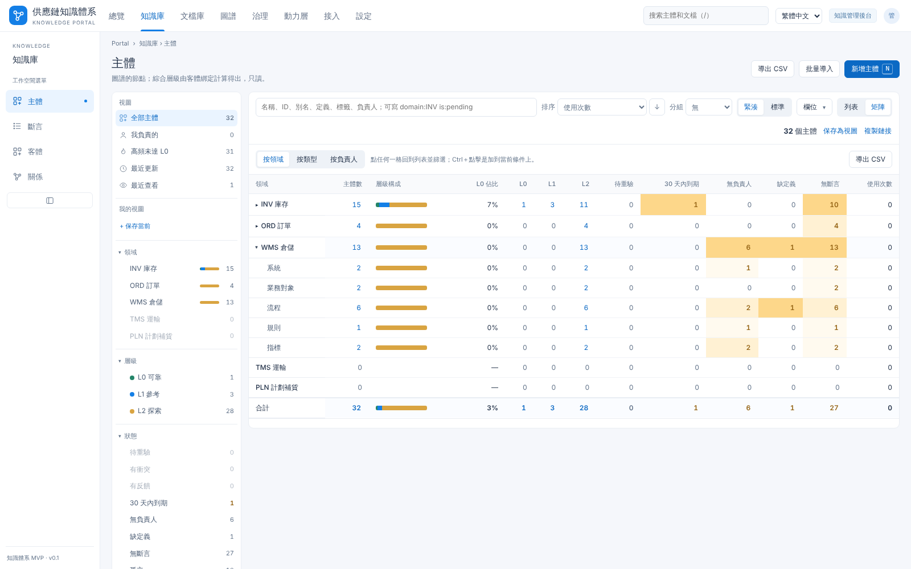

點 **WMS 倉儲** 行 **缺定義** 列的 `1`。**預期**：回到列表，條件是「領域 WMS、狀態 缺定義」，只有 S-WMS-0015 動盤。

### N6 我的視圖

1. 在導航欄點 **標籤 › 盤點**，點列表右上的 **保存為視圖**，名稱填 `盤點相關`，保存。
2. **預期**：導航欄 **我的視圖** 下出現「盤點相關」，點它就恢復這組條件（也記下欄位和密度）。後面的 ⋯ 可以重命名、上移、設為預設、用當前條件覆蓋、刪除。
3. 視圖存在服務端，按登入身份分開：登出後再登入，或換一個瀏覽器登入同一個帳號，視圖都還在。
4. **文檔庫 › 文檔** 的導航欄也有 **我的視圖**，用法相同。

### N7 主體頁：列表上下文

1. 在主體列表的導航欄點 **標籤 › 盤點**，**排序** 選 **名稱**，用 `j` 移到第二行「循環盤點」，按 Enter。
2. **預期**：主體頁上方有一條上下文條「‹ 返回列表 U · 標籤 盤點 · 第 2 / 8 個 ‹ K J ›」；下面是分區頁籤 **斷言、客體綁定、關係、文檔、一跳鄰域、歷史**，按數字鍵 `1`–`6` 直接跳過去。
3. 按 `j`：換到下一個主體「盤點服務」。按 `u`：回到列表，焦點停在剛才看的那一行。
4. 右上 **+ 新增**（`n`）可以新增斷言、綁定、關係、別名和文檔；**主體資訊** 中的定義、負責人、出錯代價和標籤可以直接點擊修改，Enter 保存，Esc 取消。

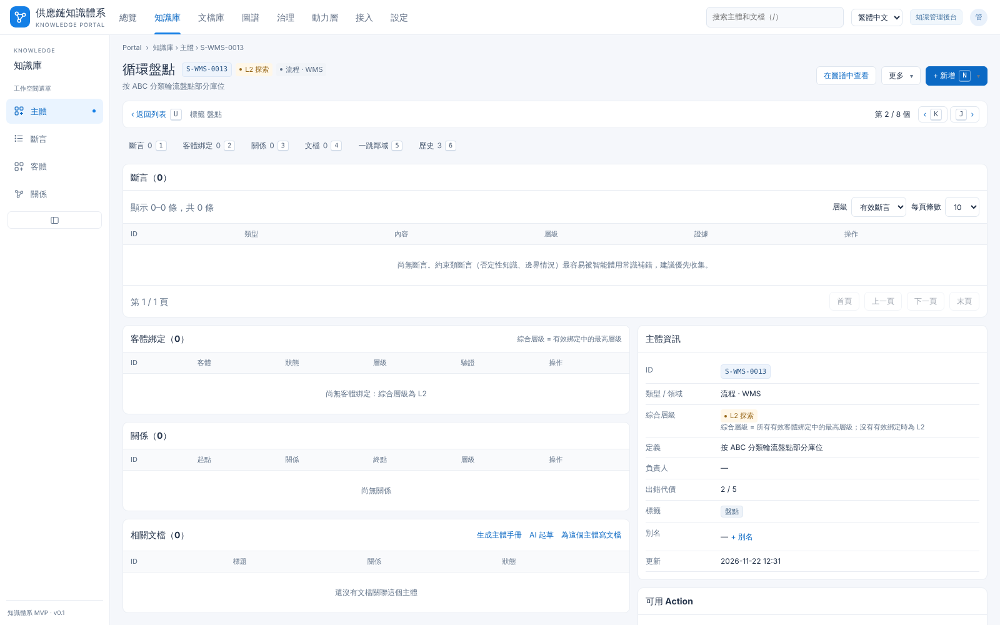

### N8 命令面板與快捷鍵

1. 按 `Ctrl+K`（Mac：⌘K），輸入 `盤點`。

   **預期**：分組列出 **主體**（8 個「盤點」主體）、「在主體工作台中查看全部 9 個」（含別名「盤點任務」）、**文檔** 和 **我的視圖**「盤點相關」。選中一個主體按 Tab，列出它的操作（打開、新增斷言、在圖譜中查看等）。以 `>` 開頭只找操作和頁面，以 `#` 開頭按 ID 跳轉。按 Esc 關閉。

   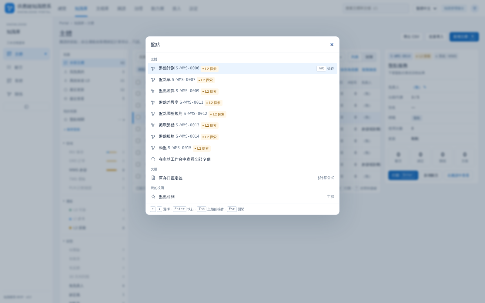

2. 按 `?`。**預期**：快捷鍵說明分「全後台」和「這個頁面」兩欄。按 `g` 再按字母可以前往頁面，例如 `g` `s` 主體、`g` `q` 重驗隊列。

   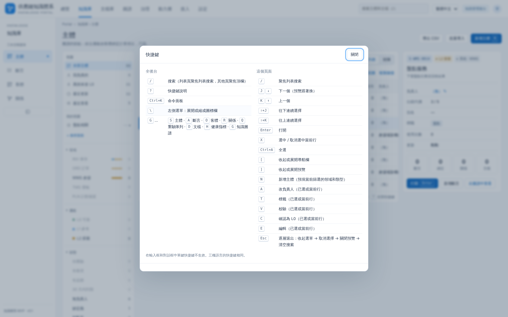

3. 在 **設定 › 帳號 › 個人偏好** 取消 **啟用單鍵快捷鍵** 並保存。**預期**：回到主體列表按 `j` 不再移動，`Ctrl+K` 仍然有效。驗完請改回來。

### N9 斷言、客體、關係與重驗隊列

1. 打開 **知識庫 › 斷言**，點視圖 **待確認（有證據的 L1）**。**預期**：5 條（只做過 B1、C1 時）；導航欄有層級、類型、待重驗原因、證據、主體領域等分組。
2. 先用滑鼠勾選第一行，再按 `j` 移到下一行，按 **空格** 勾選。**預期**：兩行都勾選，鍵盤焦點與高亮行一致，空格不捲動頁面，也不會誤改上一行。再次按空格或 `x` 只取消當前行；長按不會反覆切換。
3. 按 `Shift+j` / `Shift+k` 或 `Shift+↓` / `Shift+↑` 延伸選擇；按 `Esc` 取消全部選擇。搜索框內的空格正常輸入；對話框和按鈕上的空格仍按原本方式操作，不會改動背後的選擇。
4. 勾選兩條後，底部批量欄有 **校驗 V**、**確認為 L0 C** 和 **更多**（導出 CSV）。點 **確認為 L0**，對話框列出這兩條，逐條核對後一次確認；只有負責人能確認。這一步會把示例知識改成 L0，還要做 F 章節時請只看不提交。
5. **知識庫 › 客體**、**知識庫 › 關係** 和 **治理 › 重驗隊列** 是同一套工作台，只是導航欄的分組不同；`j` `k`、空格 / `x`、篩選條和保存視圖都一樣。按 `?` 可查看完整快捷鍵；關閉單鍵快捷鍵後，空格也不再切換列表選擇。
6. 有字段字典資料時，斷言列表預設 **原始 DDL 注釋優先**，結構化鍵以 `.ddl_comment` 結尾的原始字段注釋先顯示；選 **主體** 排序時，每個主體內也先列原始注釋。主體詳情的斷言區採同樣順序。明確選 **ID** 排序時仍按編碼排序，既有斷言編碼與審核狀態不變。
7. HTTP 證據在列表、右側預覽、斷言詳情與批量確認中顯示短標籤（RPA 建表結果為 **原始 DDL**），不再鋪滿長網址。點短標籤打開原始地址；點 **ⓘ** 查看完整來源；點 **⧉** 複製完整地址，包含查詢參數與錨點。純文字評審來源顯示 **來源說明**，完整原文仍可查看與複製。
8. 在 HTTP 部署上驗證複製：瀏覽器未提供 Clipboard API 時仍能複製，從列表及來源對話框各試一次。來源按鈕不改變行焦點或勾選狀態；新標籤頁使用原始來源系統的存取權限，網址不含 API 金鑰。新增 DDL 證據時應引用已核對的原始 HTTP 返回，本機 JSON 快照只作備份。

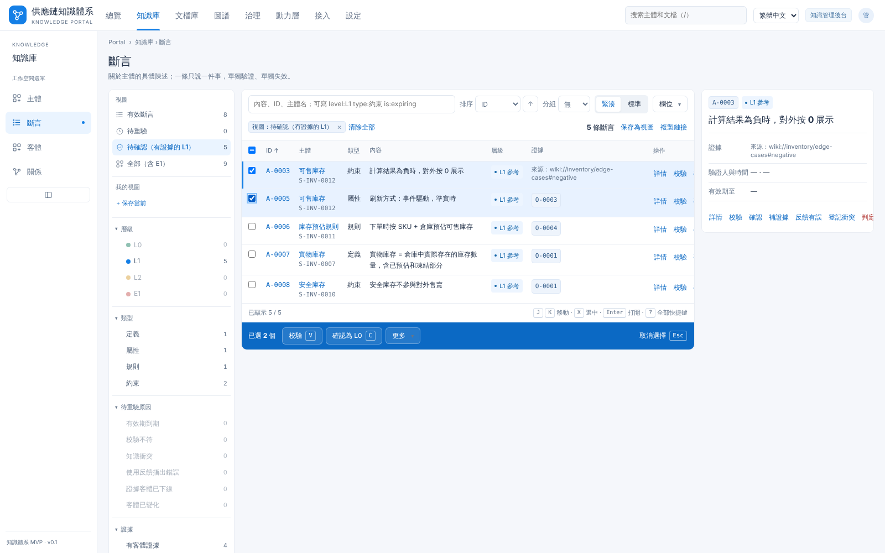

### N10 標籤共用

打開 **文檔庫 › 標籤**。

**預期**：每個標籤有 **文檔** 和 **主體** 兩列使用數，「盤點」的主體數是 8；點數字分別跳到文檔庫或主體工作台並篩選這個標籤。負責人重命名或合併標籤時，對話框寫明會改寫幾篇文檔和幾個主體，一次提交。

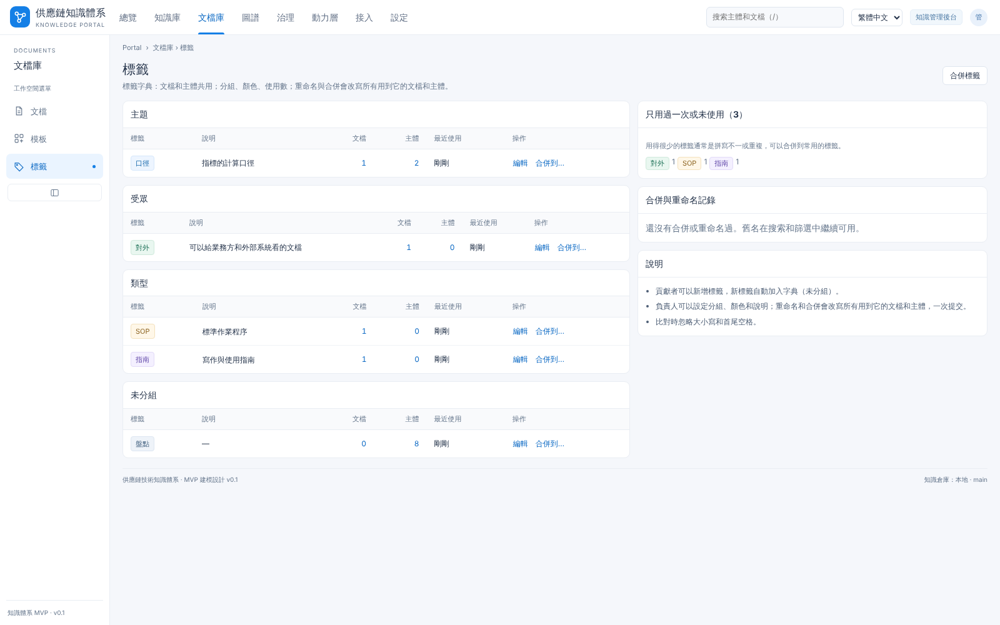

### N11 窄屏

把瀏覽器窗口逐步縮窄，回到主體工作台：

- 1280–1599 px：最左側選單自動縮成圖標欄，導航欄和預覽變窄。
- 1000–1279 px：預覽改為右側抽屜，按 `]` 打開或收起。
- 999 px 以下：導航欄收進 **篩選** 按鈕（左側抽屜），點抽屜外或按 Esc 收起。
- 700 px 以下（手機）：點一行直接打開主體頁。

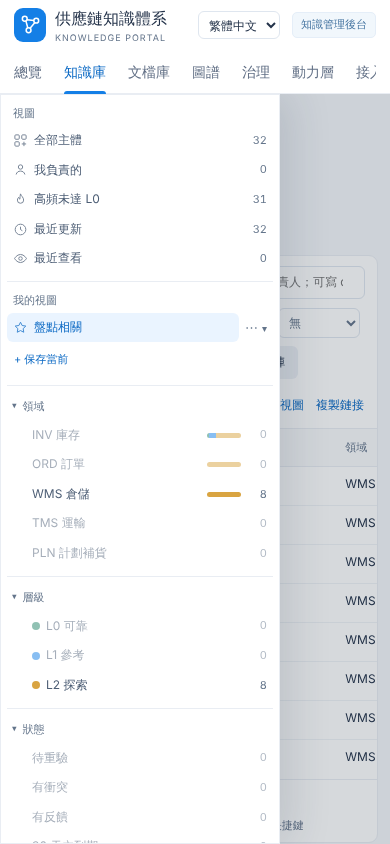

### N12 主體管理 API

沿用 C1 的 `api` 函數和金鑰。

```bash
api $CONS GET '/api/v1/subjects?view=all&domain=WMS&owner=none&sort=id&limit=3'
```

**預期**：HTTP 200；`data` 是 S-WMS-0009、S-WMS-0011、S-WMS-0012；`page` 是 `{"total":6,"offset":0,"limit":3}`。多個值用逗號分隔（`domain=INV,ORD`），前綴 `!` 表示排除（`state=!no_assertion`）；`offset` 和 `limit`（最大 1000）用來分頁。

```bash
api $CONS GET '/api/v1/subjects/facets?view=all&domain=WMS'
```

**預期**：只做過 B1、C1 和本節時，`data.total` 是 13；`data.groups.owner` 是 `{"倉儲域架構師":7,"none":6}`；`data.groups.state` 中 `no_owner` 是 6，`no_definition` 是 1。

先看計畫：把 WMS 中沒有負責人的主體出錯代價改為 4。

```bash
api $CONT POST /api/v1/subjects/batch '{"query":{"view":"all","domain":"WMS","owner":"none"},"set":{"errorCost":4},"dryRun":true}'
```

**預期**：HTTP 200，沒有 `commit`；`data.updated` 有 4 個；`data.skipped` 是 S-WMS-0009 和 S-WMS-0011，原因「已經是目標值，無需修改」；`data.message` 是「[批量] 出錯代價 → 4（4 個主體）」。

去掉 `"dryRun":true` 再執行一次。**預期**：HTTP 200，返回 `commit` 和 `"undoable":true`。用返回的 commit 撤銷：

```bash
api $CONT POST /api/v1/subjects/batch/undo '{"commit":"<上一步返回的 commit>"}'
```

**預期**：HTTP 200，`data.updated` 有 4 個，`data.message` 是「[撤銷] [批量] 出錯代價 → 4（4 個主體）」。同一個 commit 再撤銷一次：HTTP 409，`already_undone`。用 `$CONS` 調用批量接口：HTTP 403。

其他新接口（`/subjects/export`、`/subjects/similar`、`/subjects/import`、`/relations/batch`、`/validate-batch`、`/items/confirmable`、`/items/confirm-batch`）見 `GET /api/v1/openapi.json`；D1 的智能體教程也加了「新增前查重」和「批量整理」兩條。

---

## O. 授權金鑰確認斷言

讓智能體在用戶明確同意後，把已審閱的 L1 斷言確認為 L0。設計與完整錯誤碼見 [docs/api/assertion-confirm.md](api/assertion-confirm.md)。本節建立的主體、斷言都是虛構的驗收資料。沿用 C1 的 `api` 函數和金鑰。

### O1 授予權限

進入 **接入 › API 金鑰**，點 **發放金鑰**：名稱「審核助手」、類型「智能體」、角色「貢獻者」，勾選 **附加權限：允許確認斷言為 L0（assertions:confirm）**，發放後保存金鑰：

```bash
export CONF='kk_…審核助手的金鑰…'
```

**預期**：列表的「附加權限」欄顯示 `assertions:confirm` 和授予時間，類型、角色仍是「智能體」「貢獻者」。「冷啟動智能體」那一行的操作欄有 **授予確認權限**；「問答智能體」（消費者）、「庫存域架構師」（人）和管道金鑰沒有這個按鈕。發放對話框裡把類型改成「人」或角色改成「消費者」，勾選框隨即隱藏。

### O2 確認成功

先用冷啟動智能體建一個虛構主體和兩條附來源的斷言（都是 L1）：

```bash
api $CONT POST /api/v1/subjects '{"name":"驗收：授權確認示例","type":"規則","domain":"INV"}'
export SID='<上一步返回的 data.id>'
api $CONT POST /api/v1/subjects/$SID/assertions '{"type":"規則","content":"驗收示例斷言甲","evidence":{"sourceRef":"fictional://acceptance/O2"}}'
api $CONT POST /api/v1/subjects/$SID/assertions '{"type":"規則","content":"驗收示例斷言乙","evidence":{"sourceRef":"fictional://acceptance/O2"}}'
api $CONF GET "/api/v1/assertions?subjectId=$SID&level=L1"
```

**預期**：最後一步返回兩條斷言，每條帶 `reviewVersion`。記下兩條的 `id` 和 `reviewVersion`，先用沒有權限的冷啟動智能體試一次：

```bash
api $CONT POST /api/v1/assertions/confirm-batch '{"items":[{"id":"<A1>","version":"<V1>"},{"id":"<A2>","version":"<V2>"}],"note":"用戶已在對話中確認"}'
```

**預期**：HTTP 403，`forbidden`，訊息提到 `assertions:confirm`。把 `$CONT` 換成 `$CONF` 再執行。**預期**：HTTP 200；`data` 兩條都是 `"level":"L0"`、`"method":"delegated"`、`verifiedBy` 是審核助手的金鑰 ID；有 `commit`。

在後台打開其中一條斷言：**有效性** 顯示「授權確認（API 金鑰 agent-…）」；**層級歷史** 最上面一條是「L1 → L0 授權確認（API 金鑰 assertions:confirm）」，下面一行有金鑰 ID、`assertions:confirm`、審閱版本前 12 位和說明。**總覽 › 變更記錄** 最新一條的作者是「審核助手」，說明帶「授權金鑰 審核助手（agent-…，assertions:confirm）」。

### O3 拒絕的情況

用 `$CONF` 依次執行，每次都不改變任何層級：

| 操作 | 預期 |
| --- | --- |
| 同一個請求再送一次 | HTTP 409，`already_confirmed` |
| 新建一條斷言，記下版本後用 `$CONT` PATCH 改它的 `content`，再用舊版本確認 | HTTP 409，`stale_assertion`（重新讀取、重新審閱） |
| `POST /api/v1/items/<A>/confirm` 不帶 `version` | HTTP 400，`version_required` |
| 新建一條不帶 `evidence` 的斷言（L2），帶版本確認、不附 `evidence` | HTTP 409，`missing_evidence` |
| 確認一個綁定（`B-…`）或關係（`R-…`），例如示例資料的 B-0001 | HTTP 403，`scope_mismatch` |
| 一條 L1 斷言 + 一條已是 L0 的斷言放在同一批 | HTTP 409，L1 那條仍是 L1（不會部分成功） |
| `POST /api/v1/items/<A>/invalidate` | HTTP 403（其他負責人操作不受這項權限影響） |

最後確認 L2 也能一步到 L0：拿上表那條 L2 斷言的最新 `reviewVersion`，這次在該條中附上來源：

```bash
api $CONF POST /api/v1/assertions/confirm-batch '{"items":[{"id":"<L2 的 ID>","version":"<V>","evidence":{"sourceRef":"fictional://acceptance/O3"}}],"note":"用戶已確認"}'
```

**預期**：HTTP 200，`level` 為 L0。打開這條斷言：層級歷史最上面兩條是「L1 → L0 授權確認」和「L2 → L1 補充客體證據」，操作者都是審核助手的金鑰 ID。

### O4 收回權限

回到 **接入 › API 金鑰**，在審核助手那一行點 **收回確認權限** 並確認。**預期**：「附加權限」欄變成「—」；再用 `$CONF` 確認任意 L1 斷言返回 HTTP 403。用管理員密碼登入的後台確認斷言不受影響（第 F 節的流程照舊）。

---

## 驗收記錄表

| 編號 | 驗收項 | 預期結果 | 結果 |
| --- | --- | --- | --- |
| 1 | 自動化測試 | 全部通過（114 項；沒有 OpenSSH 時 3 項跳過） | ☐ |
| A1 | 啟動服務 | 打印服務地址、知識倉庫、教程地址 | ☐ |
| A2 | 登入保護 | 錯誤密碼被拒，正確密碼進入後台 | ☐ |
| B1 | 載入示例資料 | 26 個主體；重複載入被拒 | ☐ |
| B2 | 知識卡 | 可售庫存 L0；5 條斷言含 1 條 E1 與替代者 | ☐ |
| B3 | 健康指標 | 四項指標與層級分佈正確顯示 | ☐ |
| B4 | 變更記錄 | 每次寫入一個 Git 提交，作者為寫入者 | ☐ |
| B5 | 圖譜與其他頁面 | 圖譜可交互，各頁無報錯 | ☐ |
| C1 | API 金鑰 | 三種角色可發放；智能體不能當負責人 | ☐ |
| C2 | 6 個問答示例 | 已回答 ×4、需要消歧、知識庫未收錄 | ☐ |
| C3 | 問答 API | status 與引用正確；消歧後回答 | ☐ |
| C4 | 結構化知識端點 | 知識卡、上下文、圖譜、別名解析、取值 | ☐ |
| D1 | 教程 prompt API | 公開可取，含寫入規則與使用規約 | ☐ |
| D2 | 權限 | 401 / 401 / 403 / 403 | ☐ |
| D3 | 後台登入限制 | 智能體金鑰被拒；負責人可登入但無設定頁 | ☐ |
| E1 | 批量提交 | 一次提交；L0 請求降為 L1；無證據 L2 | ☐ |
| E2 | 批量回滾 | 422 並返回出錯序號；無殘留 | ☐ |
| F1 | 晉升路徑 | 沒有證據不能確認；補證據 L1；負責人確認 L0 | ☐ |
| F2 | 使用反饋 | L0 降 L1 並排入重驗 | ☐ |
| F3 | 衝突裁決 | 勝方 L0，敗方 E1 指向替代者 | ☐ |
| F4 | 校驗不符 | 配置值變化使 L0 降為 L1 | ☐ |
| F5 | 客體下線 | 綁定轉 E1，相關關係排入重驗 | ☐ |
| F6 | 治理頁面 | 重驗隊列排序、反饋、缺口、指標聯動 | ☐ |
| G1 | 重啟持久化 | 資料與金鑰都在 | ☐ |
| G2 | 機密隔離 | 知識倉庫中沒有密碼與金鑰 | ☐ |
| G3 | 遠端倉庫 | 測試連接、切換成功，GitHub 上可見知識檔案與提交 | ☐ |
| G4 | 雙向同步 | GitHub 上的修改同步回後台；API 寫入推送到 GitHub | ☐ |
| G5 | SSH 部署金鑰 | 測試連接通過；推送與回拉正常；取消寫入權限時報 `marked as read only` | ☐ |
| H | OpenRouter（可選） | 組織方式為 OpenRouter，引用經過校驗 | ☐ |
| I | 容器部署（可選） | 容器內可登入，資料存於卷 | ☐ |
| J1 | 一鍵安裝 | 測速列表、從最快來源下載並校驗、自動啟動並顯示地址與密碼 | ☐ |
| J2 | 服務管理 | `knowledge status / logs / restart / stop / start` 正常 | ☐ |
| J3 | 重複執行與升級 | 已是最新版本時不重啟；重裝後資料、密碼與設定保留 | ☐ |
| J4 | 離線安裝 | 本地發佈包校驗通過並啟動 | ☐ |
| J5 | CI 流水綫 | PR 檢查全綠；推送標籤自動發佈 5 個檔案；版本不一致時拒絕發佈 | ☐ |
| K1 | 後台切換語言 | 按瀏覽器語言預設；切換後整頁為所選語言並記住；知識內容保持原文 | ☐ |
| K2 | API 按語言返回 | 錯誤、教程、Schema、問答模板隨 `?lang` / `Accept-Language` 變化；錯誤碼與枚舉值不變 | ☐ |
| K3 | 倉庫內容不隨語言變 | 英文請求寫入的提交說明仍為繁體；字典檢查顯示「字典完整」 | ☐ |
| L1 | 文檔庫首頁與搜索 | 3 篇示例文檔、文件夾樹、智能視圖計數；搜索 ATP 解析為可售庫存 | ☐ |
| L2 | 閱讀文檔與客體 | 引用帶層級、12 條依據、版本 v3/v4；O-0001 由文檔庫管理、定位不變 | ☐ |
| L3 | 人新建並發布 | 模板骨架、體檢從有錯到通過；發布 v1 登記客體並綁定主體（L1） | ☐ |
| L4 | 編輯器與體檢 | SOP 草稿 1 個錯誤；補完後通過並發布 | ☐ |
| L5 | 修訂與保鮮 | 讀者仍看 v4；重大修訂後勾選的知識降 L1 並排入重驗 | ☐ |
| L6 | 歷史與差異 | 時間線與版本比較正確；可查看歷史版本 | ☐ |
| L7 | API 寫文檔 | 智能體建草稿、不能發布、提交審閱；人發布；段級搜索帶引用寫法 | ☐ |
| L8 | 整理 | 移動、文件夾重命名、標籤重命名與合併各一次提交，不改版本 | ☐ |
| L9 | 文檔在 Git 中 | 目錄結構與後台一致；Git 中的修改被識別並可確認為新版本 | ☐ |
| L10 | 廢止 | 客體下線、綁定轉 E1；預設列表不顯示 | ☐ |
| M1 | 導入 Word 和 PDF | 轉換保留標題、列表、表格、鏈接；圖片提醒；導入為草稿 DOC-0004、DOC-0005 | ☐ |
| M2 | AI 起草 | 只用 L0、L1 知識並附引用，L1 標「未經驗證」；別名換成主體；草稿標記 AI 起草，需人發布 | ☐ |
| M3 | 生成手冊 | 主體手冊、領域手冊直接發布且只讀；知識變化後提示落後，重新生成為 v2；智能體不能生成 | ☐ |
| M4 | 提取斷言 | 建議斷言 11 條；選中文字提取為 A-0011（L1，證據 O-0001，來源 DOC-0001§邊界情況 v4） | ☐ |
| M5 | 問答引用文檔 | 答案附文檔原文與 `〔DOC-0001§計算公式·v4〕`，與知識引用分開 | ☐ |
| M6 | 按章節預選 | 只改「示例」時 A-0011 不預選；發布後 6 條降 L1、12 條排入重驗 | ☐ |
| M7 | 四眼審閱 | 作者自己發布被拒（four_eyes_required）；另一位負責人發布 v6 | ☐ |
| M8 | 內置校驗 Action | P-0004、ACT-0005 不能修改；B-0001 校驗通過回到 L0 | ☐ |
| M9 | 廢止時遷移依據 | B-0007 轉 E1，新綁定 B-0008（L1）指向替代文檔的客體 O-0011，一次提交 | ☐ |
| M10 | 全局搜索 | ATP 命中主體（別名）和 3 篇文檔；摘錄為純文字 | ☐ |
| M11 | 導出 Markdown 壓縮包 | 5 篇已發布文檔按文件夾存放，README 索引，引用改為名稱與包內鏈接 | ☐ |
| N1 | 工作台與導航欄 | 單擊只看、Ctrl 加選、Alt 排除；計數聯動；鏈接可分享 | ☐ |
| N2 | 批量導入 | 新增 8 個、別名 2 個；同名跳過、表內重名報錯並寫明行號；一次提交 | ☐ |
| N3 | 新增時查重 | 輸入時列出相似主體，可改為新增別名；負責人預填 | ☐ |
| N4 | 批量整理與撤銷 | 提交前看計畫；一次提交；10 分鐘提示和變更記錄中都能撤銷 | ☐ |
| N5 | 矩陣 | 領域 × 層級與待處理，可展開類型；點格子回到列表並篩選 | ☐ |
| N6 | 我的視圖 | 保存後在導航欄出現；換瀏覽器仍在；文檔庫同樣可用 | ☐ |
| N7 | 列表上下文 | 「第 2 / 8 個」，`j` `k` 換主體，`u` 回列表並保留位置 | ☐ |
| N8 | 命令面板與快捷鍵 | Ctrl+K 找主體、文檔、視圖；`?` 說明；可關閉單鍵快捷鍵 | ☐ |
| N9 | 其他列表 | 斷言、客體、關係、重驗隊列用同一套工作台；批量確認為 L0 | ☐ |
| N10 | 標籤共用 | 標籤頁有主體數；重命名與合併同時改寫主體 | ☐ |
| N11 | 窄屏 | 圖標欄、預覽抽屜、篩選抽屜、手機點行打開 | ☐ |
| N12 | 主體管理 API | page.total、聯動計數、dryRun 計畫、提交與撤銷、重複撤銷 409、消費者 403 | ☐ |
| O1 | 授予權限 | 發放時勾選或在列表中授予；附加權限欄顯示 assertions:confirm | ☐ |
| O2 | 授權確認成功 | 無權限 403；授權金鑰 200、method delegated；層級歷史與提交記錄是金鑰身份 | ☐ |
| O3 | 拒絕的情況與 L2 | 已確認、版本過期、缺版本、沒有證據、綁定或關係、混合批量、判定失效都被拒，層級不變；L2 附來源後一步到 L0 | ☐ |
| O4 | 收回權限 | 收回後 403；負責人後台確認照舊 | ☐ |

---

## 常見問題

**想從頭再驗收一次？** 停止服務，刪除倉庫下的 `data/` 目錄（或你設定的 `DATA_DIR`），再啟動。注意這會刪掉本地設定和金鑰；遠端 Git 倉庫中的知識不受影響。

**ID 和教程裡的不一樣？** ID 按建立順序遞增。如果你多做或少做了某一步，後續的 ID 會錯開，以接口實際返回的 `id` 為準。

**curl 返回亂碼或 `invalid_json`？** 請在 Git Bash、macOS 或 Linux 終端中執行，確保終端是 UTF-8。也可以改用後台頁面完成同樣的操作。

**URL 裡帶中文時返回 400？** 查詢參數中的中文需要編碼，請像 E2 一樣用 `curl -G --data-urlencode`。

**測試連接失敗？** 確認 PAT 只選了目標倉庫且 Contents 為 Read and write、未過期；倉庫地址以 `.git` 結尾；公司網絡需要代理時，請為 git 配置代理。錯誤詳情會顯示在同步狀態的「錯誤」欄，權杖已自動遮罩。

**自動拉取沒生效？** 拉取間隔修改後需要重啟服務；也可以隨時點「立即同步」。

**PDF 導入提示沒有可以提取的文字？** 那是掃描件，只有圖片沒有文字層。請用帶文字層的 PDF，或先做文字識別（OCR）再導入。

**問答答案和截圖不完全一樣？** 實時取值來自示意管道，數值每次隨機；配置 OpenRouter 後答案措辭由模型生成，但引用的 ID 和層級應一致。

---

## 附錄：示例資料 ID 速查

| ID | 內容 |
| --- | --- |
| S-INV-0001 | 庫存中心（系統） |
| S-INV-0012 | 可售庫存（指標），示例的焦點主體 |
| S-INV-0013 | 實物可用庫存（指標） |
| S-INV-0016 / 0017 | 別名 ATP / 可用庫存（多義） |
| A-0001 | 可售庫存定義（L0） |
| A-0002 | 預佔 30 分鐘未支付自動釋放，`reserve.ttl = 30m`（L0，Action 校驗） |
| A-0003 | 計算結果為負時對外按 0 展示（L1） |
| A-0004 | 舊定義「不扣安全庫存」（E1，替代者 A-0001） |
| A-0005 | 刷新方式：事件驅動，準實時（L1） |
| O-0001 | 《庫存口徑定義》，由 DOC-0001 管理（定位仍是 `wiki://inventory/metrics/v3`） |
| O-0009 | 《知識庫寫作指南》，DOC-0003 發布時登記 |
| DOC-0001 | 庫存口徑定義（口徑定義，文件夾 庫存/口徑）：從 v3 接管 O-0001，v4 小修；12 條知識以它為依據 |
| DOC-0002 | 跨倉調撥作業 SOP（草稿，文件夾 庫存/SOP），「異常處理」一節待補 |
| DOC-0003 | 知識庫寫作指南（知識條目，文件夾 通用） |
| TPL-0001～0006 | 文檔模板：知識條目、設計文檔、SOP、口徑定義、SLA、評審記錄 |
| O-0005 / O-0006 | 上海一號倉 SH01 / 北京一號倉 BJ01 |
| O-0007 | 代碼模塊 inventory-center |
| ACT-0001～0003 | 校驗 Action：表字段存在、接口可調用、配置項取值 |
| ACT-0004 | 取值 Action：查詢可售庫存（SKU，倉庫） |
| P-0001～0003 | 示意管道：API 網關、業務數據庫元數據、配置中心 |
| P-0004、ACT-0005 | 文檔庫內置管道與「文檔已發布」校驗 Action（首次發布文檔時由系統建立，見 M8） |
