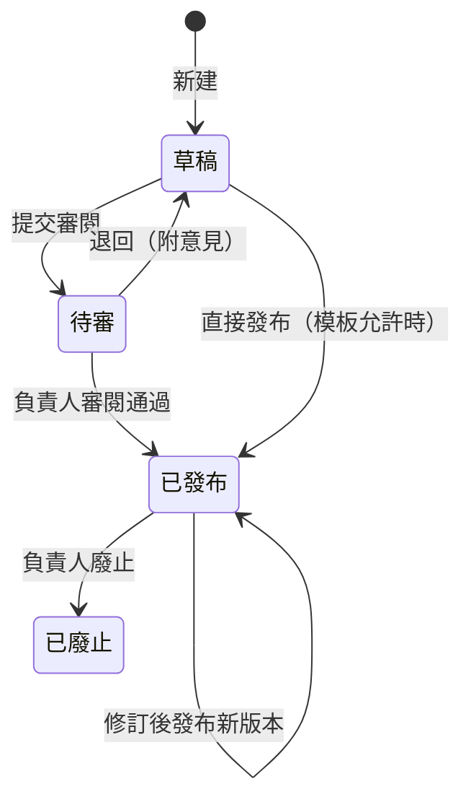
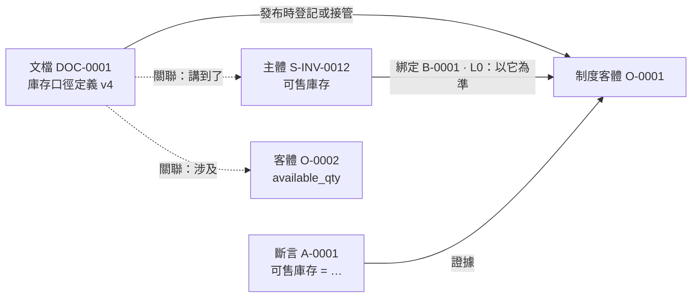
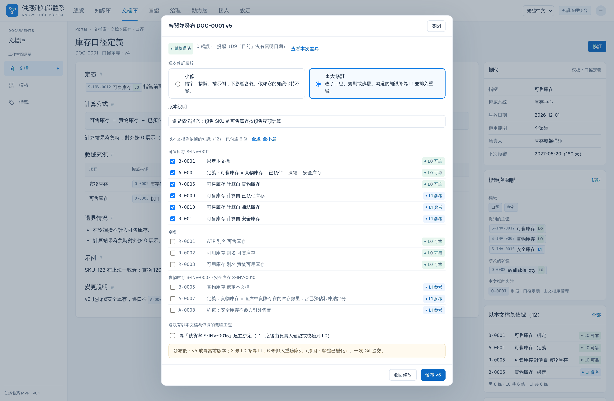
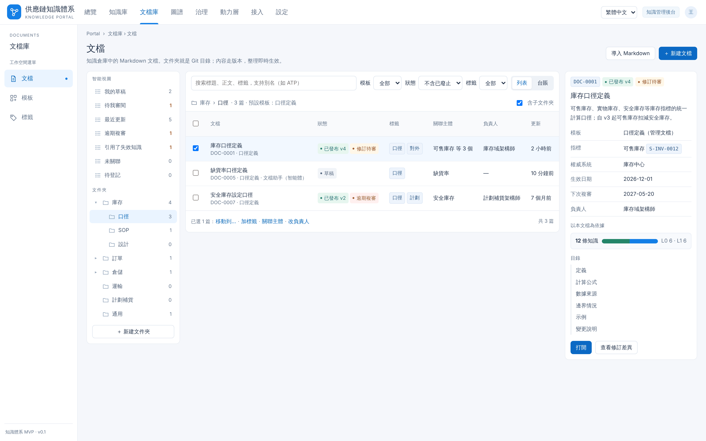
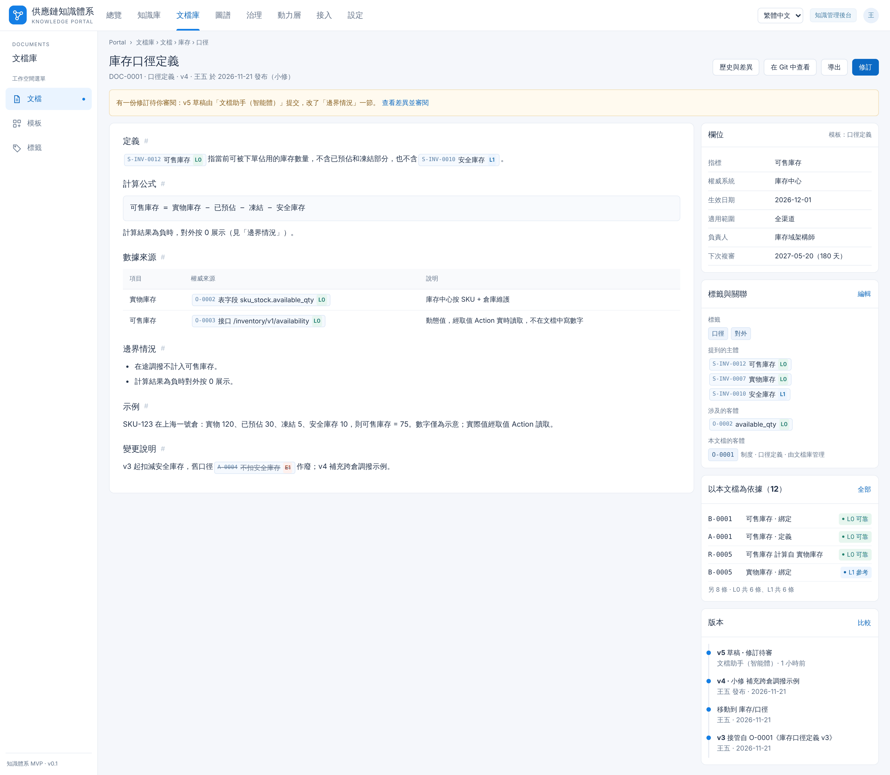

# 文檔庫：在知識倉庫中生產與管理文檔

設計稿 v1 · 2026-11-21 · **狀態：已評審，第二期已實作**（評審結論見 §20；驗收步驟見 [驗收教程 L 節](../acceptance-guide.md#l-文檔庫)、[M 節](../acceptance-guide.md#m-文檔庫第二期)；第二期的實作說明見 §21）

本文是「文檔庫管理」功能的設計方案。目標是讓本系統有自己的文檔管理能力：人和智能體（API）都能生成文檔、查看文檔；文檔存放在知識 Git 倉庫；文檔能綁定主體與客體；人能用文件夾、標籤等方式便捷、直觀地管理。評審結論是 §20 的 8 條推薦全部採用，按 §19 的第一期、第二期實作完成；第三期尚未開始。

核對所依據的版本：知識庫 `ali-sx-org-free/knowledge_setup` `main` @ `b46daf8`。文中的示例 ID（`S-INV-0012`、`O-0001`、`B-0001` 等）都取自「載入示例資料」後的真實資料；示意圖中的 `DOC-0005`、`DOC-0007` 是為了展示而虛構的。

## 0. 一頁摘要

- **文檔 = 知識倉庫裡的一個 Markdown 檔。** 放在 `knowledge/docs/` 下，開頭用 YAML 寫元數據（模板、狀態、版本、摘要、標籤、關聯的主體與客體）。後台的文件夾就是 Git 裡的目錄，在 GitHub 上看到的結構和後台一樣。
- **兩類文檔，一套機制。**「知識文檔」（知識條目、設計文檔）寫給人和智能體讀；「管理文檔」（SOP、口徑定義、SLA、評審記錄）有必填欄位、必填章節、審閱和定期複審。差別都寫在**模板**裡，內置 6 個。
- **文檔是客體，不是知識條目。** 文檔發布後自動登記為一個「制度」客體（現有模型裡的制度客體本來就是設計文檔、SOP、口徑定義這些）。主體綁定它、斷言用它作證據，沿用現有的有效性規則。文檔本身沒有 L0–L2 層級。
- **內容走版本，整理不走版本。** 改正文要經過草稿 → 發布，每次發布是一個版本，歷史從 Git 讀出；移動、加標籤、改關聯即時生效。
- **文檔變了，依賴它的知識跟著保鮮。** 發布新版本時列出以本文檔為依據的知識，發布者勾選受影響的條目，降為 L1 並排入重驗；文檔廢止時它的客體下線，沿用現有的級聯規則。
- **智能體寫草稿，人來發布。** 與「智能體不能晉升知識」一致。
- **知識庫友好。** 文檔體檢（12 條規則）在保存和發布時檢查摘要、章節、引用、術語、動態值、機密；API 按章節分段返回，也能導出為帶元數據的 JSONL，直接給其他 RAG 系統用。
- **分三期。** 第一期是文檔庫本體；第二期打通 AI 與知識（AI 起草、從文檔抽取斷言、從知識生成文檔、問答引用文檔原文）；第三期按需要做評論、通知、文件夾權限等。

---

## 第一部分：定位

### 1. 要解決的問題

現狀：

- 系統只管理結構化的知識條目（主體、斷言、關係、綁定）。設計文檔、SOP、口徑定義只能作為「制度」客體登記一個外部地址，例如示例資料中的 `O-0001《庫存口徑定義 v3》`（定位 `wiki://inventory/metrics/v3`）。內容在別處，系統看不到，也管不了它的版本。
- 文檔改版後，以它為證據的知識不會知道。示例資料中有 12 條知識以 `O-0001` 為依據，其中 6 條是 L0。文檔換了口徑，這些知識仍顯示「可靠」。
- 智能體能提交知識條目，但沒法提交一篇完整的說明文檔。

目標：

1. 人和 API 都能生成文檔：從模板新建、填寫、提交、審閱、發布。
2. 能查看：渲染閱讀、版本歷史與差異、按章節讀取。
3. 存放在知識 Git 倉庫：與知識同倉庫、同提交規則、同作者記錄。
4. 能綁定主體和客體，並且文檔的變化能傳導到依賴它的知識。
5. 人能便捷、直觀地管理：文件夾、標籤、搜索、台賬、批量操作，狀態一眼看清。

第一期不做的事和替代方案見 §18。

### 2. 與現有概念的關係

| 現有概念 | 與文檔的關係 |
| --- | --- |
| 客體（制度類） | 文檔發布後登記為制度客體，定位 `doc://DOC-0001`，客體種類由模板決定（設計文檔、SOP、口徑定義、SLA、評審記錄，另新增「知識文檔」）。已有的外部文檔客體可以被文檔「接管」 |
| 綁定 B- | 主體 → 文檔的客體，表示「這篇文檔是該主體的依據」。帶有效性，規則不變 |
| 斷言 A-、關係 R- | 可以用文檔的客體作證據（`evidence.objectIds`），並在 `sourceRef` 寫上章節，例如 `DOC-0001§計算公式 v4` |
| 主體、客體 | 文檔可以「關聯」主體和客體，表示「這篇文檔講到了它們」。關聯不帶有效性，只用於導航和檢索 |
| 有效性層級 | 文檔沒有層級。文檔是否可信看狀態（已發布、誰審閱）、版本和複審日期；層級屬於引用它的綁定、斷言和關係 |
| Git 提交 | 每次寫入一個提交，作者是操作的人或智能體，與知識寫入相同 |
| 角色 | 沿用 consumer / contributor / owner 與 human / agent / pipeline，不新增角色 |

一句話：**主體是「是什麼」，斷言是「關於它的一句話」，文檔是「完整的原文」，客體把文檔變成證據。**

### 3. 設計原則

這些原則也會寫在後台的空白頁提示和倉庫的 `docs/README.md` 裡，讓使用者一眼明白規則：

1. **所見即所存。** 一篇文檔是一個 `.md` 檔，後台的文件夾就是 Git 目錄。不打開後台，在 GitHub 上也能看懂。
2. **文件夾回答「放在哪」，標籤回答「是什麼」，關聯回答「講的是誰」。** 一篇文檔只在一個文件夾；標籤和關聯可以有多個。
3. **內容走版本，整理不走版本。** 改正文、改欄位要發布新版本；移動、加標籤、改關聯、改負責人即時生效。
4. **狀態只有四個：** 草稿、待審、已發布、已廢止。
5. **不刪除，只廢止。** 已發布的文檔廢止後保留，並指向替代者，與 E1 一樣。
6. **智能體寫草稿，人來發布。**
7. **每次寫入都可追溯。** 作者、時間、說明都在 Git 提交裡。

---

## 第二部分：設計

### 4. 存儲

#### 4.1 倉庫結構

```
knowledge/
  doc-templates/
    TPL-0001.yaml … TPL-0006.yaml     文檔模板（內置 6 個，負責人可增改）
  docs/
    README.md                         給在 Git 中瀏覽的人：目錄規則與檔案格式
    _tags.yaml                        標籤字典（分組、顏色、說明、合併記錄）
    _drafts/
      DOC-0002.md                     未發布的新文檔，或已發布文檔正在修訂的下一版
    _assets/
      DOC-0001/flow.png               文檔圖片
    庫存/
      _folder.yaml                    文件夾說明、預設模板、預設標籤、預設審閱人
      口徑/
        DOC-0001-庫存口徑定義.md       已發布的當前版本
      SOP/
        _folder.yaml
    通用/
      DOC-0003-知識庫寫作指南.md
```

- `_` 開頭的名稱和 `README.md` 是保留名，文件夾和文檔都不能用。
- 現有的 `KnowledgeStore.tx` 只按集合寫固定路徑。文檔的路徑是動態的，`tx` 增加 `t.writeRaw(路徑, 內容)` 和 `t.removeRaw(路徑)`。同一事務裡的移動（寫新路徑、刪舊路徑）在一次提交內完成，Git 會識別為重命名，`git log --follow` 能接上歷史。

#### 4.2 文檔檔案

```markdown
---
id: DOC-0001
title: 庫存口徑定義
template: TPL-0004              # 口徑定義
status: 已發布                   # 草稿 / 待審 / 已發布 / 已廢止
version: 4
summary: 可售庫存、實物庫存、安全庫存等庫存指標的統一計算口徑；自 v3 起可售庫存扣減安全庫存。
tags: [口徑, 對外]
owner: 庫存域架構師
ownerIds: [user-1a2b3c4d]
subjects: [S-INV-0012, S-INV-0007, S-INV-0010]   # 關聯主體：講到了誰
objects: [O-0002]                                # 關聯客體：涉及的表、接口等
related: [DOC-0003]                              # 相關文檔
objectId: O-0001                                 # 本文檔自己的制度客體（發布時登記或接管）
fields:                                          # 模板欄位
  metric: S-INV-0012
  ownerSystem: S-INV-0001
  effectiveFrom: 2026-12-01
  scope: 全渠道
review:                                          # 定期複審
  everyDays: 180
  nextAt: 2027-05-20
  lastAt: 2026-11-21T03:00:00Z
  lastBy: user-1a2b3c4d
change:                                          # 本版本的發布信息
  major: false
  note: 補充跨倉調撥示例
  publishedAt: 2026-11-21T03:00:00Z
  publishedBy: { kind: human, id: user-1a2b3c4d, name: 王五 }
  approvedBy: { kind: human, id: user-1a2b3c4d, name: 王五 }
createdAt: 2026-11-21T02:40:00Z
createdBy: { kind: human, id: user-1a2b3c4d, name: 王五 }
---

## 定義

[[S-INV-0012]] 指當前可被下單佔用的庫存數量，不含已預佔和凍結部分，也不含 [[S-INV-0010]]。

## 計算公式

可售庫存 = 實物庫存 − 已預佔 − 凍結 − 安全庫存

## 數據來源

- [[O-0002]]：`inventory.sku_stock.available_qty`
```

| 欄位 | 必填 | 說明 |
| --- | --- | --- |
| `id` | 是 | `DOC-` 加 4 位序號，建立後不變。站內鏈接、引用都用它，移動和改標題不影響 |
| `title` | 是 | 同一文件夾內不重名 |
| `template` | 是 | 模板 ID，決定欄位、章節、審閱與複審規則 |
| `status` | 是 | 見 §6 |
| `version` | 已發布時 | 每次發布加 1 |
| `summary` | 發布時 | 一兩句話，不超過 200 字。搜索結果、知識卡、智能體首先讀它 |
| `tags` | 否 | 見 §8.2 |
| `subjects`、`objects`、`related` | 否 | 關聯，見 §7 |
| `objectId` | 已發布時 | 本文檔的制度客體，見 §7.2 |
| `fields` | 按模板 | 結構化欄位，見 §5 |
| `review` | 按模板 | 定期複審，見 §6.4 |
| `change` | 已發布時 | 只記本版本。歷史版本的 `change` 從 Git 歷史中各版本的檔案讀出，不在檔案裡累積 |
| `folder` | 只在草稿 | 草稿放在 `_drafts/`，用它記目標文件夾。已發布文檔的位置**以目錄為準** |
| `replacedBy`、`obsoleteReason`、`obsoleteAt` | 已廢止時 | 見 §6.5 |

鍵名用英文、枚舉值用繁體原文，與現有 YAML 一致（例如主體的 `type: 指標`）。GitHub 會把 front matter 顯示成表格，在網頁上直接看也清楚。

#### 4.3 草稿與已發布分開存

| 檔案 | 內容 | 誰能讀到 |
| --- | --- | --- |
| `docs/<文件夾>/DOC-0001-<標題>.md` | 已發布的當前版本 | 所有角色，包括 consumer 和問答 |
| `docs/_drafts/DOC-0001.md` | 新文檔的草稿，或已發布文檔正在修訂的下一版 | contributor 以上 |

這樣分開的好處：

- 修訂期間，讀者和智能體看到的一直是已發布版本，不會讀到改了一半的內容。
- 已發布檔案的每個提交都是一次發布或整理動作，它的 `git log --follow` 就是版本歷史，不需要另外存版本表。
- 草稿檔的 Git 歷史就是修訂過程。

發布時在一個提交裡完成：用草稿覆蓋已發布檔（首次發布時移到目標文件夾）、刪除草稿、版本加 1。

保存草稿是一次提交。編輯器每 5 秒把未保存的內容存到瀏覽器本地，既不會因頻繁提交刷屏，也不怕誤關頁面。

#### 4.4 文件夾設定 `_folder.yaml`

```yaml
description: 庫存域的指標口徑
domain: INV                      # 選填：對應領域代碼
ownerIds: [user-1a2b3c4d]        # 選填：本文件夾文檔的預設審閱人（文檔自己的 ownerIds 優先）
defaultTemplate: TPL-0004
defaultTags: [口徑]
```

Git 不記錄空目錄，`_folder.yaml` 同時起佔位作用。沒有這個檔的目錄照常顯示，只是沒有說明和預設值。

#### 4.5 標籤字典 `_tags.yaml`

```yaml
口徑: { group: 主題, color: blue, description: 指標的計算口徑 }
對外: { group: 受眾, color: green, description: 可以提供給外部系統或客戶 }
智能體必讀: { group: 受眾, color: amber }
merged:
  計算口徑: 口徑                 # 合併記錄：舊名 → 新名。API 收到舊名時自動換成新名
```

#### 4.6 命名規則

- 文件夾名和文檔標題：不含 `/ \ : * ? " < > |`；不以 `.`、`_`、空格開頭，不以 `.`、空格結尾；最長 40 字；同一層不能只差大小寫（macOS、Windows 的檔案系統不分大小寫）。
- 文件夾最多 5 層，避免 Windows 路徑過長。
- 檔名 `DOC-0001-<標題>.md`，標題中的非法字元換成 `-`。改標題時在同一提交內重命名檔案。檔名只是為了在 Git 中好認，系統以 front matter 的 `id` 為準。

#### 4.7 附件

- 第一期只收圖片：PNG、JPEG、GIF、WebP（SVG 可以內嵌腳本，不收）。單張不超過 2 MB，每篇不超過 20 MB，存在 `_assets/<文檔 ID>/`，正文寫 `` 引用。
- Word、PDF、Excel 原檔不放進 Git：二進位檔會讓倉庫很快變大，也無法比對版本。需要時以外部鏈接引用；第二期做「導入並轉成 Markdown」。

#### 4.8 直接在 Git 中修改

服務會定期拉取並重新載入（現有行為），文檔也一樣：

| 在 Git 中做的事 | 系統的處理 |
| --- | --- |
| 修改已發布文檔的正文 | 照常載入。版本號沒變但正文變了時，歷史裡標為「在 Git 中直接修改」，負責人可以「確認為新版本」 |
| 在文件夾裡放入沒有 front matter 的 `.md` | 列在「待登記」視圖，點「登記」補上 front matter 並分配 ID（一次提交） |
| 移動、重命名檔案或目錄 | 按新位置載入，`id` 不變，鏈接不受影響 |
| 兩個檔案用同一個 `id`、front matter 格式錯誤 | 記入載入錯誤（沿用 `loadErrors`，總覽頁顯示），不影響其他文檔 |

### 5. 模板

#### 5.1 兩類文檔

| | 知識文檔 | 管理文檔 |
| --- | --- | --- |
| 寫給誰 | 人和智能體讀：解釋概念、說明設計、回答常見問題 | 要遵守、要追溯的受控文件 |
| 結構 | 推薦章節 | 必填欄位 + 必填章節 |
| 發布 | 多數由人類貢獻者直接發布 | 負責人審閱後發布 |
| 複審 | 可選 | 按週期複審 |
| 例子 | 知識條目、設計文檔 | SOP、口徑定義、SLA、評審記錄 |

兩類用同一套機制，差別只在模板的設定。

#### 5.2 模板定義 `knowledge/doc-templates/TPL-0004.yaml`

```yaml
id: TPL-0004
name: 口徑定義
purpose: 管理                    # 知識 / 管理（用於分組顯示）
description: 指標的統一計算口徑。發布後作為指標類主體的證據
objectKind: 口徑定義             # 發布時登記的制度客體種類
approval: owner                  # owner：負責人審閱後發布；contributor：人類貢獻者可直接發布
reviewEveryDays: 180             # 定期複審週期；不填表示不複審
immutable: false                 # true：發布後不能修訂，只能廢止並替代（評審記錄這類記錄）
defaultFolder: 通用
fields:
  - { key: metric, label: 指標, type: subject, subjectTypes: [指標], required: true, link: true }
  - { key: ownerSystem, label: 權威系統, type: subject, subjectTypes: [系統], link: true }
  - { key: effectiveFrom, label: 生效日期, type: date, required: true }
  - { key: scope, label: 適用範圍, type: enum, options: [全渠道, 線上, 線下] }
sections:
  - { heading: 定義, required: true, guidance: 一句話說明它是什麼、不是什麼, knowledge: 定義 }
  - { heading: 計算公式, required: true, guidance: 用已登記的指標名寫公式，涉及的指標用 [[S-…]] 引用, knowledge: 定義 }
  - { heading: 數據來源, required: true, guidance: 權威表、字段或接口，用 [[O-…]] 引用已登記的客體 }
  - { heading: 邊界情況, guidance: 負數、缺失、跨倉等特殊情況怎麼處理, knowledge: 約束 }
  - { heading: 示例 }
  - { heading: 變更說明, guidance: 與上一版相比改了什麼、從何時生效 }
```

- `link: true` 的主體、客體欄位，選中的值自動加入文檔的 `subjects`、`objects` 關聯。
- `knowledge` 是給第二期「抽取斷言」的提示：這一節的內容通常對應哪種斷言。
- 新建文檔時按 `sections` 生成正文骨架；`guidance` 寫成 `<!-- 提示：… -->`，預覽時不顯示，發布前體檢會提醒沒有替換的提示。

欄位類型：

| 類型 | 說明 |
| --- | --- |
| `text`、`longtext` | 單行、多行文字 |
| `number`、`date` | 數字；日期 `YYYY-MM-DD` |
| `enum`、`enums` | 單選、多選，`options` 列出選項 |
| `subject`、`subjects` | 選主體，可用 `subjectTypes` 限定類型 |
| `object`、`objects` | 選客體，可用 `objectCategories` 限定類別 |
| `doc` | 選另一篇文檔（例如評審記錄的評審對象） |
| `url` | 外部鏈接 |
| `person` | 人名（文字；MVP 沒有用戶目錄） |

#### 5.3 內置模板

服務啟動時，如果倉庫裡沒有 `doc-templates/`，就寫入以下 6 個模板（一次提交「初始化文檔模板」，與現有 `config.yaml` 的初始化方式相同）。負責人之後可以修改或新增。

| ID | 名稱 | 類別 | 發布 | 複審 | 客體種類 | 欄位（* 必填） | 章節（* 必填） |
| --- | --- | --- | --- | --- | --- | --- | --- |
| TPL-0001 | 知識條目 | 知識 | 貢獻者 | — | 知識文檔 | 主題主體 | 概述\*、詳細說明\*、示例、常見問題、相關知識 |
| TPL-0002 | 設計文檔 | 知識 | 負責人 | 365 天 | 設計文檔 | 涉及系統、狀態（提議 / 已採納 / 已實施） | 背景\*、目標與非目標\*、方案\*、數據與接口、風險與待決問題、決定記錄 |
| TPL-0003 | SOP | 管理 | 負責人 | 180 天 | SOP | 流程\*、執行角色\*、生效日期\* | 目的\*、適用範圍\*、角色與職責\*、前置條件、操作步驟\*、異常處理\*、記錄與表單 |
| TPL-0004 | 口徑定義 | 管理 | 負責人 | 180 天 | 口徑定義 | 指標\*、權威系統、生效日期\*、適用範圍 | 定義\*、計算公式\*、數據來源\*、邊界情況、示例、變更說明 |
| TPL-0005 | SLA | 管理 | 負責人 | 90 天 | SLA | 服務方\*、使用方\*、生效日期\*、到期日期 | 服務範圍\*、指標與目標值\*、計量方式\*、例外情況、升級與通報\* |
| TPL-0006 | 評審記錄 | 管理 | 貢獻者 | — | 評審記錄 | 評審對象\*、評審日期\*、參與人\*、結論\*（通過 / 有條件通過 / 不通過） | 評審內容\*、意見與討論、結論\*、待辦事項 |

評審記錄設為 `immutable: true`：記錄發布後不再修改，有誤時廢止並發一份新記錄。

`OBJECT_CATEGORIES.制度.kinds` 新增「知識文檔」。

#### 5.4 台賬：把管理文檔當表格看

在文件夾或搜索結果中按模板篩選後，可以切換為「台賬」視圖：每篇文檔一行，模板欄位就是列。例如 SOP 台賬的列是標題、流程、執行角色、生效日期、版本、下次複審、負責人。可以排序、篩選、導出 CSV。這是「結構化管理文檔」最直接的用處：所有 SOP 何時生效、誰負責、哪些逾期複審，一張表看完。

### 6. 生命週期與版本

#### 6.1 狀態



| 狀態 | 含義 | 誰能看到 |
| --- | --- | --- |
| 草稿 | 從未發布過，正在寫 | contributor 以上 |
| 待審 | 已提交，等負責人審閱 | contributor 以上 |
| 已發布 | 有當前版本 vN | 所有人 |
| 已廢止 | 不再有效，保留並指向替代者 | 所有人（預設不出現在搜索結果，可勾選「含已廢止」） |

已發布的文檔正在修訂時，狀態仍是「已發布」，另外顯示修訂狀態「修訂中」或「修訂待審」，例如「已發布 v4 · 修訂待審」。讀者看到的仍是 v4。

#### 6.2 操作與條件

| 操作 | 條件 | 結果 |
| --- | --- | --- |
| 新建 | contributor | `_drafts/` 下新增草稿，一次提交 |
| 保存草稿 | contributor；帶上次讀到的 `etag`，別人改過時返回 409 並給出差異 | 一次提交 |
| 開始修訂 | 已發布，模板不是 `immutable` | 第一次保存時從已發布版本複製出草稿 |
| 提交審閱 | 體檢沒有錯誤 | 狀態（或修訂狀態）→ 待審 |
| 退回 | 審閱人 | 回到草稿，記下意見 |
| 發布 | 見 §11；體檢沒有錯誤 | 版本加 1；首次發布時登記客體；選擇受影響的知識（§7.3） |
| 放棄修訂 | contributor | 刪除草稿，已發布版本不變 |
| 廢止 | 負責人 | 見 §6.5 |
| 確認複審 | 負責人 | 更新 `review.lastAt`、`nextAt`，不改版本 |
| 刪除 | 從未發布過的草稿：建立者本人或負責人。已發布文檔只有管理員能刪（Git 歷史仍保留） | 一次提交 |

#### 6.3 版本

- **版本號**：每次發布加 1，從 v1 開始（接管已有客體時可以指定起始版本，見 §7.2）。
- **小修與重大修訂**：發布時選擇。小修是錯字、措辭、補示例，不影響含義；重大修訂是改了口徑、規則、步驟。兩者的區別只在預設勾選哪些受影響的知識（§7.3），版本號都加 1。
- **版本歷史**：從已發布檔的 `git log --follow` 讀出。逐個提交讀出當時的 front matter，按 `version` 和 `change` 區分「發布 v3」「移動」「改標籤」等事件。不另存版本表。
- **看舊版本**：`git show <提交>:<路徑>`，後台可以打開任一版本閱讀。
- **差異**：任選兩個版本比較。先按章節列出新增、刪除、修改了哪些章節，再展開逐行差異；欄位的變化單獨列出。
- **修訂與已發布版本的差異**：審閱人打開待審的修訂，直接看到這次改了什麼。

#### 6.4 定期複審（文檔保鮮）

管理文檔需要定期確認仍然有效，與知識的有效期是同一個思路：

- 模板設 `reviewEveryDays`，發布時計算 `review.nextAt`。
- 到期前 14 天出現在「即將複審」視圖，過期後出現在「逾期複審」，健康指標頁顯示逾期數。
- 負責人打開文檔點「確認仍有效」，只更新複審日期（一次提交）；要改內容就走修訂。
- 逾期**不會**自動改動任何知識的層級，只提醒。依賴它的綁定和斷言有自己的有效期。

#### 6.5 廢止

1. 負責人點「廢止」，填原因，可選替代文檔（`replacedBy`）。
2. 頁面先列出影響：本文檔的客體將下線；綁定它的 N 條綁定將轉為 E1；以它為證據的 M 條斷言和關係將降為 L1 並排入重驗（沿用現有的 `takeObjectOffline`）。
3. 確認後一次提交完成：文檔狀態改為已廢止，保留在原文件夾，正文頂部顯示「已廢止，請看 DOC-0020」；客體下線並級聯。
4. 有替代文檔時，可以一鍵「把依據遷移到替代文檔」，為受影響的主體綁定替代文檔的客體（L1，等待確認）。這一步放在第二期。

### 7. 文檔與主體、客體

#### 7.1 三種聯繫



| 聯繫 | 寫在哪 | 含義 | 帶有效性 | 誰能改 |
| --- | --- | --- | --- | --- |
| 關聯主體 `subjects` | 文檔 front matter | 這篇文檔講到了這些主體 | 否 | contributor，即時生效 |
| 關聯客體 `objects` | 文檔 front matter | 這篇文檔涉及這些表、接口、配置 | 否 | contributor，即時生效 |
| 作為依據（綁定 B-） | 主體 YAML 的 `bindings` | 這篇文檔是該主體的正式依據 | 是（L0–E1） | 沿用綁定規則：提交最高 L1，校驗或負責人確認後到 L0 |

使用者只需要記住：**關聯是「提到了」，綁定是「以它為準」。** 後台主體頁的「相關文檔」把兩種分開顯示。

分開的原因：「提到」很常見，應該很便宜，隨手就能關聯；「以它為準」會影響知識的層級，必須走現有的有效性規則。

#### 7.2 文檔自己的客體

- **首次發布時自動登記**：名稱《標題》，類別制度，種類取模板的 `objectKind`，定位 `doc://DOC-0001`，說明取摘要，另記 `docId: DOC-0001`。客體 ID 寫回文檔的 `objectId`，與發布在同一提交。
- **接管已有客體**：如果已經有代表這篇文檔的外部客體（例如 `O-0001《庫存口徑定義 v3》`，定位 `wiki://…`），新建文檔時可以選「接管 O-0001」，並指定起始版本（例如 3）。接管只在客體上加 `docId`，**不改定位**，所以不會觸發現有的「定位變更 → 相關知識降 L1」；之後客體頁顯示「由文檔庫管理」並鏈接到文檔。
- **同步**：改文檔標題時同步客體名稱（不級聯）；文檔廢止時客體下線（級聯，見 §6.5）。直接修改這個客體的定位或狀態會被拒絕（409 `object_managed_by_doc`），提示到文檔上操作。
- **發布時順手綁定**：發布對話框列出「已關聯、但還沒有以本文檔為依據」的主體，可以勾選為它們建立綁定（L1，之後由負責人確認或校驗到 L0）。

#### 7.3 文檔變了，知識怎麼辦

發布新版本時，對話框列出「以本文檔為依據的知識」：綁定本文檔客體的綁定，以及證據含本文檔客體的斷言和關係（不含 E1）。

| 發布類型 | 預設勾選 | 被勾選的知識 |
| --- | --- | --- |
| 小修 | 都不勾 | — |
| 重大修訂 | 全部勾選，發布者取消與本次修改無關的條目 | L0 降為 L1，全部排入重驗隊列，原因「客體已變化」，備註「DOC-0001 v5 重大修訂：<說明>」 |

圖 3 審閱並發布（示意）：



以示例資料為例：`O-0001` 被接管為 `DOC-0001` 後，以它為依據的知識有 12 條，按主體分組顯示：

| 分組 | 條目 |
| --- | --- |
| 可售庫存 `S-INV-0012` | `B-0001` 綁定（L0）、`A-0001` 定義（L0）、`R-0005` 計算自實物庫存（L0）、`R-0009` 計算自已預佔庫存、`R-0010` 計算自凍結庫存、`R-0011` 計算自安全庫存（L1） |
| 別名 | `R-0001` ATP → 可售庫存、`R-0002` 可用庫存 → 可售庫存、`R-0003` 可用庫存 → 實物可用庫存（都是 L0） |
| 實物庫存、安全庫存 | `B-0005` 綁定、`A-0007` 定義、`A-0008` 約束（L1） |

v5 只改了可售庫存的邊界情況，發布者選重大修訂，取消別名和實物庫存、安全庫存的 6 條再發布：3 條 L0 降為 L1，6 條排入重驗。

降級與發布在同一提交裡完成，重驗隊列和健康指標立刻反映。這裡複用現有的 `demoteToL1(v, 'object_changed', …)`，不新增有效性規則。

#### 7.4 在文檔中引用知識

- 正文用 `[[S-INV-0012]]`、`[[A-0001]]`、`[[O-0002]]`、`[[DOC-0003]]`、`[[DOC-0003#計算公式]]` 引用。編輯器工具欄有「插入引用」，可以搜索選擇。
- 閱讀時渲染成小標籤，顯示名稱和**當前**層級（例如「可售庫存 L0」），點擊打開。被引用的知識之後變成 E1，標籤顯示刪除線並提示替代者。
- 「引用了失效知識」視圖列出所有含失效引用的已發布文檔，提醒作者修訂。這是反方向的保鮮：知識變了，文檔也會知道。

#### 7.5 頁面與知識卡的變化

- **主體頁**新增「相關文檔」面板，分「以它為依據」（綁定，帶層級）和「提到它」（關聯）兩組；有按鈕「為這個主體寫文檔」，預填關聯和領域對應的文件夾。
- **客體頁**新增「相關文檔」；文檔的客體顯示「由文檔庫管理 · 打開 DOC-0001」。
- **知識卡** `GET /subjects/:id` 增加 `documents`：`[{ id, title, template, status, version, summary, relation: binding | link, bindingId?, level? }]`。智能體拿到知識卡時就知道有哪些原文可讀。

### 8. 文件夾、標籤與視圖

#### 8.1 文件夾

- 樹狀，最多 5 層。一篇文檔只在一個文件夾。
- 操作：新建、重命名、移動（拖曳或「移動到…」）、刪除（只限空文件夾）。重命名或移動文件夾時，裡面所有文檔一起移動，一次提交，提交說明寫明篇數。
- 第一次打開文檔庫時，按領域代碼建議一套初始結構（庫存、訂單、倉儲、運輸、計劃補貨、通用），可以跳過或修改。
- 文件夾可以設預設模板、預設標籤、預設審閱人（`_folder.yaml`）。在「庫存/口徑」下新建文檔時，預選口徑定義模板和「口徑」標籤。

#### 8.2 標籤

- 輸入時自動補全已有標籤；貢獻者可以新增標籤，新標籤自動加入字典（未分組）。
- 負責人在「標籤」頁管理分組（例如主題、受眾、系統）、顏色、說明。**重命名**和**合併**會改寫所有用到它的文檔，一次提交；合併記錄保存在 `merged`，舊名繼續可用。
- 標籤頁顯示每個標籤的文檔數和最近使用時間，並列出只用過一次的標籤，方便清理。
- 比對時忽略大小寫和首尾空格。

#### 8.3 智能視圖

智能視圖不是文件夾，是保存好的篩選條件，放在文件夾樹上方，並顯示數量：

| 視圖 | 條件 |
| --- | --- |
| 我的草稿 | 我建立或最後修改、未發布或修訂中 |
| 待我審閱 | 待審，且我是審閱人（文檔或文件夾的負責人；都沒指定時所有負責人） |
| 最近更新 | 最近 14 天發布或修改 |
| 即將複審、逾期複審 | §6.4 |
| 引用了失效知識 | §7.4 |
| 未關聯 | 沒有關聯任何主體或客體 |
| 待登記 | Git 中沒有 front matter 的 `.md`（§4.8） |
| 已廢止 | 已廢止的文檔 |

使用者也可以把當前搜索條件存為自己的視圖（存在瀏覽器本地）。

#### 8.4 批量操作

在列表中多選後可以：移動到文件夾、加或去標籤、關聯主體、改負責人。一次操作一次提交。

### 9. 生成文檔

#### 9.1 人

1. **從模板新建**：選模板（按知識、管理分組，每個模板有一句說明），填標題和欄位，正文骨架按章節生成。
2. **從主體頁新建**：「為這個主體寫文檔」，預填關聯主體和文件夾。
3. **導入 Markdown**：貼上或上傳 `.md`、`.txt`，選模板後，體檢指出缺哪些章節。
4. **複製為新文檔**：照著一份已有的 SOP 寫另一份。

#### 9.2 API（智能體）

智能體用 contributor 金鑰：

1. `GET /api/v1/doc-templates` 看有哪些模板；`POST /api/v1/doc-templates/TPL-0004/render` 取得正文骨架和欄位說明。
2. `POST /api/v1/docs` 建立草稿，可以一次帶齊正文。回應帶 `problems`（體檢結果）。
3. 按體檢結果修改：`PUT /api/v1/docs/DOC-0005/draft`。
4. `POST /api/v1/docs/DOC-0005/submit` 提交審閱，等人發布。

```json
POST /api/v1/docs
{
  "template": "TPL-0004",
  "title": "缺貨率口徑定義",
  "folder": "庫存/口徑",
  "summary": "缺貨率的計算口徑：可售庫存為 0 的 SKU 佔在售 SKU 的比例。",
  "fields": { "metric": "S-INV-0015", "ownerSystem": "S-INV-0001", "effectiveFrom": "2026-12-01" },
  "tags": ["口徑"],
  "body": "## 定義\n\n[[S-INV-0015]] ……\n\n## 計算公式\n\n缺貨率 = 可售庫存為 0 的 SKU 數 ÷ 在售 SKU 數\n\n## 數據來源\n\n- [[O-0002]]\n"
}
```

```json
201
{
  "data": { "id": "DOC-0005", "status": "草稿", "etag": "9c1e…", "path": "docs/_drafts/DOC-0005.md", "folder": "庫存/口徑" },
  "commit": "a1b2c3d",
  "problems": [
    { "rule": "D7", "level": "info", "message": "正文提到「可售庫存」（S-INV-0012），尚未關聯", "section": "計算公式" }
  ]
}
```

- 智能體調用發布返回 403 `agent_cannot_publish`。
- `/batch` 增加 `doc.create`、`doc.link` 兩個 op：冷啟動時可以在同一個事務裡提交客體、主體、斷言和文檔，用 `$ref` 互相引用。
- 智能體教程（`GET /prompt`）新增「文檔」一章：什麼時候寫斷言、什麼時候寫文檔（一句話能說清、要單獨驗證的寫斷言；需要背景、步驟、上下文的寫文檔），寫作規範（§9.3），以及上面的流程。

#### 9.3 知識庫友好：寫作規範與文檔體檢

「知識庫友好」具體是指：智能體和檢索系統能準確找到、切分、引用，人也讀得懂。下列規則在保存時和發布前自動檢查，結果顯示在編輯器右側，API 回應帶 `problems`。

| 規則 | 檢查 | 級別 |
| --- | --- | --- |
| D1 標題 | 同文件夾不重名；標題過於籠統（「說明」「文檔」「新建文檔」） | 錯誤 / 提醒 |
| D2 摘要 | 發布時必須有摘要，不超過 200 字 | 錯誤（發布時） |
| D3 章節 | 正文用 `##`、`###` 分章節，不用 `#`（標題已是一級）；單節超過 2,000 字建議拆分，因為檢索按章節切分 | 提醒 |
| D4 模板 | 必填欄位、必填章節齊全；欄位格式正確（日期、選項、主體類型） | 錯誤（格式在保存時，缺項在發布時） |
| D5 提示 | 模板的 `<!-- 提示 -->` 沒有替換，且該章節沒有內容 | 錯誤（發布時） |
| D6 引用 | `[[ID]]` 和站內鏈接指向的條目存在；引用了 E1 知識 | 錯誤 / 提醒 |
| D7 術語 | 正文出現已登記的主體名稱或別名但沒有關聯（建議關聯）；用了多義別名（建議寫規範名） | 建議 / 提醒 |
| D8 動態值 | 「還有」「當前」「實時」等詞旁寫了具體數字。動態值應寫取值方式，不寫數字，與「動態值不存儲」一致 | 提醒 |
| D9 時間 | 「最近」「目前」「上週」「今年」沒有寫明日期 | 建議 |
| D10 機密 | 疑似金鑰、權杖、密碼、私鑰、帶密碼的連接字串 | **錯誤，拒絕保存** |
| D11 關聯 | 沒有關聯任何主體或客體 | 提醒 |
| D12 負責人 | 管理文檔沒有負責人 | 錯誤（發布時） |

- 錯誤阻止提交審閱和發布（D10 阻止保存）；提醒和建議不阻止。
- D7 用現有的 `resolveTerms` 做最長匹配，D8 復用 `ask.js` 的動態值詞表。
- 示例資料附一篇《知識庫寫作指南》（`DOC-0003`），用人讀得懂的方式解釋這些規則。

#### 9.4 第二期：AI 與知識的雙向生成

| 功能 | 說明 |
| --- | --- |
| AI 起草 | 選模板、寫一段要求、選幾個主體；經 OpenRouter 按模板生成草稿，內容只取這些主體 L0、L1 的知識並附引用。結果是草稿，標記「AI 起草」，必須由人發布 |
| 從文檔抽取斷言 | 選中一段文字點「提取為斷言」，或讓 AI 按章節的 `knowledge` 提示批量建議；生成 L1 斷言，證據為文檔客體，`sourceRef: DOC-0001§計算公式 v4` |
| 從知識生成文檔 | 把一個主體或一個領域的知識卡渲染成可讀的「主體手冊」，標記為生成文檔、正文只讀，可以隨時重新生成 |
| 問答引用文檔 | `/ask` 在結構化知識之外，取相關文檔章節作補充原文，引用格式 `〔DOC-0001§計算公式·v4〕`，與斷言的引用分開標註 |
| 按章節預選受影響的知識 | 發布時根據改動的章節和斷言的 `sourceRef`，預選真正受影響的條目 |
| 導入 Word、PDF | 轉成 Markdown 後進入草稿 |
| 文檔客體的內置校驗 | 內置一個校驗 Action：文檔已發布即「客體存在」，讓綁定能經校驗升到 L0 |

### 10. 查看與搜索

#### 10.1 文檔庫頁面

圖 1 文檔庫（示意）：



三欄：

- **左**：智能視圖和文件夾樹，帶數量，可展開收起，可拖曳文檔到文件夾。
- **中**：列表。每行顯示標題、文檔 ID 與模板、狀態與版本、標籤、關聯主體、負責人、更新時間；可切換為台賬（§5.4）。上方是搜索框和篩選（模板、狀態、標籤），選中多篇後出現批量操作。
- **右**：選中文檔的預覽：摘要、欄位、以它為依據的知識數量與層級分佈、目錄；點「打開」進入文檔頁。

#### 10.2 文檔頁

圖 2 文檔頁（示意）：



- **頂部**：麵包屑（文件夾路徑）、標題、文檔 ID、模板、版本與發布人；操作有歷史與差異、在 Git 中查看（遠端是 GitHub 時直接鏈接到檔案）、導出、修訂。有待審修訂時顯示提示條。
- **正文**：渲染後的 Markdown。章節有錨點，可以複製鏈接 `#doc/DOC-0001/計算公式`；引用渲染為帶當前層級的標籤，E1 顯示刪除線。
- **右側**：欄位、標籤與關聯、本文檔的客體、以本文檔為依據的知識、版本時間線、下次複審日期。
- **導出**：下載 `.md`；打印版 HTML，用瀏覽器打印成 PDF。

#### 10.3 編輯器

- 左右分欄：Markdown 原文和即時預覽，可以只看一邊。上方是模板欄位表單。
- 工具欄：標題、粗體、列表、表格、代碼、鏈接、插入引用（搜索主體、斷言、客體、文檔）、插入圖片（也可以直接貼上截圖）。
- 右側即時顯示體檢結果，點一條跳到對應位置。
- `Ctrl/⌘ + S` 保存草稿；有未保存內容時離開頁面會提示；瀏覽器本地自動暫存。
- 別人或 Git 中已改過同一份草稿時，保存返回衝突，顯示對方的改動，選「以我的為準」或「合併後再保存」。

#### 10.4 搜索

- **範圍**：標題、摘要、標籤、欄位值、章節標題、正文，權重依次降低。
- **分詞**：中文按單字和雙字詞匹配（與問答相同），英文按單詞。
- **術語解析**：查詢中的別名先解析為規範主體（現有 `resolveTerms`），關聯了該主體的文檔加權。搜「ATP 口徑」能找到《庫存口徑定義》；多義別名列出候選。
- **篩選**：文件夾（含子文件夾）、模板、狀態、標籤（全部包含或任一包含）、負責人、關聯主體、關聯客體、更新時間。
- **結果**：每篇顯示最匹配的章節摘錄並高亮，點擊直接跳到該章節。
- 預設只搜已發布；contributor 可以勾選「含草稿」，任何人可以勾選「含已廢止」。

#### 10.5 給智能體和其他知識庫

- `GET /docs/{id}/sections`：按 `##`、`###` 切分，每段帶 `anchor`、標題路徑、正文、字數、段內引用的 ID 和文檔版本。智能體按段讀取，引用寫 `〔DOC-0001§計算公式·v4〕`。
- `GET /doc-sections?q=`：段級搜索，智能體不用整篇下載。
- `GET /docs/export?format=jsonl&folder=&tags=`：每行一段，帶文檔 ID、標題、版本、文件夾、標籤、關聯主體、錨點、正文和後台鏈接，可以直接導入其他 RAG 系統。

### 11. 權限

沿用現有的角色和身份類型，不新增角色。

| 操作 | consumer | contributor · 智能體或管道 | contributor · 人 | owner（人） | 管理員 |
| --- | --- | --- | --- | --- | --- |
| 讀已發布和已廢止的文檔、搜索、分段、導出 | ✓ | ✓ | ✓ | ✓ | ✓ |
| 讀草稿與修訂、版本差異 | — | ✓ | ✓ | ✓ | ✓ |
| 新建和編輯草稿、提交審閱、放棄自己的草稿 | — | ✓ | ✓ | ✓ | ✓ |
| 加標籤、改關聯 | — | ✓ | ✓ | ✓ | ✓ |
| 移動文檔、新建和重命名文件夾 | — | — | ✓ | ✓ | ✓ |
| 發布（模板 `approval: contributor`） | — | — | ✓ | ✓ | ✓ |
| 審閱並發布、退回（模板 `approval: owner`） | — | — | — | ✓ ¹ | ✓ |
| 廢止、確認複審、改負責人 | — | — | — | ✓ ¹ | ✓ |
| 管理模板和標籤字典、刪除空文件夾 | — | — | — | ✓ | ✓ |
| 刪除已發布的文檔 | — | — | — | — | ✓ |

¹ 文檔或所在文件夾指定了 `ownerIds` 時，必須是其中之一（與主體的 `ownerIds` 規則相同）。

其他：

- **自己審自己**：負責人可以發布自己寫的文檔，歷史裡記為「作者發布」。需要四眼原則時，第二期在模板上加 `requireOtherApprover: true`。
- **沒有文件夾級的讀權限。** 知識倉庫是一個整體，能讀倉庫就能讀全部文檔，與 README「MVP 不做細粒度權限」一致。不該公開的內容不要放進知識倉庫。
- **機密**：D10 拒絕保存疑似機密的內容；附件只收圖片。
- **防 XSS**：正文中的 HTML 一律轉義，只認 Markdown；鏈接只允許 `http`、`https`、`mailto` 和站內鏈接；圖片只顯示本倉庫的附件，外部圖片顯示為鏈接（也避免閱讀時向外部發請求）。
- **審計**：所有寫入都是 Git 提交，作者是操作的身份。

### 12. API

全部在 `/api/v1` 下，回應格式不變：`{ data, commit?, warnings?, problems? }`。

| 方法 | 路徑 | 角色 | 用途 |
| --- | --- | --- | --- |
| GET | `/docs?q=&folder=&tags=&template=&status=&subjectId=&objectId=&owner=&view=&limit=&cursor=` | consumer | 搜索、列表；`view` 是智能視圖名 |
| GET | `/doc-sections?q=&…` | consumer | 段級搜索 |
| GET | `/docs/{id}?version=&draft=1&format=json\|md` | consumer（草稿要 contributor） | 讀文檔，預設當前已發布版本 |
| GET | `/docs/{id}/sections` | consumer | 按章節分段 |
| GET | `/docs/{id}/history` | consumer | 版本與整理事件 |
| GET | `/docs/{id}/diff?from=3&to=4`、`?to=draft` | contributor | 版本差異（按章節 + 逐行） |
| GET | `/docs/{id}/impact` | consumer | 以本文檔為依據的知識 |
| GET | `/docs/export?format=jsonl&…` | consumer | 段級 JSONL 導出 |
| POST | `/docs` | contributor | 新建草稿；可帶 `takeOverObjectId` 接管已有客體 |
| PUT | `/docs/{id}/draft` | contributor | 保存草稿（整篇），帶 `etag`；已發布文檔第一次保存即開始修訂 |
| DELETE | `/docs/{id}/draft` | contributor | 放棄草稿或修訂 |
| PATCH | `/docs/{id}` | contributor | 整理：`tags`、`subjects`、`objects`、`related`；`folder`（移動，限人）；`ownerIds`（限負責人） |
| POST | `/docs/{id}/submit` | contributor | 提交審閱 |
| POST | `/docs/{id}/publish` | 見 §11 | 發布或審閱通過：`{ major, note, affect: [條目 ID], bindSubjects: [主體 ID] }` |
| POST | `/docs/{id}/reject` | owner | 退回 `{ note }` |
| POST | `/docs/{id}/obsolete` | owner | 廢止 `{ reason, replacedBy? }` |
| POST | `/docs/{id}/review` | owner | 確認複審 |
| POST | `/docs/{id}/assets` | contributor | 上傳圖片（請求體是圖片本身，`Content-Type: image/*`） |
| GET | `/docs/{id}/assets/{name}` | consumer | 讀圖片 |
| POST | `/docs/lint` | contributor | 只體檢、不保存 |
| POST | `/docs/register` | contributor（人） | 登記 Git 中沒有 front matter 的檔案 |
| GET | `/doc-folders` | consumer | 文件夾樹與數量 |
| POST、PATCH、DELETE | `/doc-folders` | contributor（人）；刪除要 owner | 新建；重命名或移動 `{ path, newPath }`；刪除空文件夾 |
| GET | `/doc-tags` | consumer | 標籤字典與使用數 |
| PUT | `/doc-tags/{name}` | owner | 分組、顏色、說明、重命名 |
| POST | `/doc-tags/merge` | owner | 合併 `{ from: [...], to }` |
| GET | `/doc-templates`、`/doc-templates/{id}` | consumer | 模板 |
| POST | `/doc-templates/{id}/render` | contributor | 按欄位生成正文骨架 |
| POST、PUT | `/doc-templates`、`/doc-templates/{id}` | owner | 新增、修改模板 |

新增錯誤碼：

| 錯誤碼 | 狀態 | 含義 |
| --- | --- | --- |
| `agent_cannot_publish` | 403 | 智能體或管道不能發布、審閱、廢止 |
| `approval_required` | 403 | 此模板要由負責人審閱發布 |
| `lint_failed` | 422 | 體檢有錯誤，`problems` 列出 |
| `secret_detected` | 422 | 內容疑似含機密，拒絕保存 |
| `draft_conflict` | 409 | 草稿已被別人修改，回應帶當前內容 |
| `immutable_doc` | 409 | 此模板的文檔發布後不能修訂 |
| `doc_obsolete` | 409 | 已廢止的文檔不能修改 |
| `duplicate_title` | 409 | 同一文件夾已有同名文檔 |
| `invalid_folder` | 400 | 文件夾名不符合 §4.6 |
| `folder_not_empty` | 409 | 只能刪除空文件夾 |
| `object_managed_by_doc` | 409 | 這個客體由文檔庫管理，請在文檔上操作 |
| `asset_too_large`、`unsupported_media_type` | 413、415 | 附件太大或類型不支持 |

### 13. 後台頁面

頂欄新增一級選單「文檔庫 DOCUMENTS」，放在「知識庫」之後：

| 二級頁面 | 內容 |
| --- | --- |
| 文檔 | §10.1 的三欄頁面；文檔頁、編輯器、版本與差異都從這裡進入 |
| 模板 | 模板列表（按知識、管理分組）和使用數；負責人可以編輯欄位、章節、審閱與複審設定，並預覽生成的骨架 |
| 標籤 | 標籤字典、分組、使用數、重命名與合併 |

其他頁面的變化：

| 頁面 | 變化 |
| --- | --- |
| 健康指標 | 新增「文檔」面板：已發布、待審、逾期複審、引用了失效知識、待登記的數量，點擊進入對應視圖 |
| 主體頁 | 「相關文檔」面板（以它為依據 / 提到它），「為這個主體寫文檔」 |
| 客體頁 | 「相關文檔」；文檔的客體顯示「由文檔庫管理」 |
| 重驗隊列 | 來自文檔修訂的條目，備註鏈接到文檔的版本差異 |
| 變更記錄 | 文檔的提交以 `[文檔]` 開頭，可以篩選 |

提交說明（繁體原文，與現有規則一致，後台按語言翻譯顯示）：

```
[文檔] 新建草稿 DOC-0005《缺貨率口徑定義》
[文檔] 保存草稿 DOC-0005
[文檔] 提交審閱 DOC-0005
[文檔] 發布 DOC-0001 v5（重大修訂，3 條知識降為 L1，6 條排入重驗）：預售 SKU 的可售庫存按預售配額計算
[文檔] 移動 DOC-0003 → 通用/指南
[文檔] 標籤 DOC-0001：+對外 −草案
[文檔] 重命名文件夾 庫存/設計 → 庫存/設計文檔（14 篇）
[文檔] 合併標籤 計算口徑 → 口徑（9 篇）
[文檔] 廢止 DOC-0002，由 DOC-0006 替代（客體 O-0012 下線）
```

### 14. 多語言

- 後台文字經 `t()`、服務端訊息經 `tr()`，補齊簡體與英文字典，`npm run i18n:check` 覆蓋新增文字。
- 狀態（草稿、待審、已發布、已廢止）和模板類別（知識、管理）是 API 的值，任何語言下都用繁體原文，`/schema` 給出 `label`。
- 內置模板的名稱、欄位名、章節名在倉庫裡是繁體。生成骨架時按請求語言給出章節名；體檢比對必填章節時，三種語言的寫法都算數（內置模板自帶譯名作為別名）。
- 文檔內容按原文保存，不翻譯。

### 15. 規模與性能

| 項目 | 設計上限 | 超出時 |
| --- | --- | --- |
| 文檔數 | 2,000 篇 | 仍可用；更多時第三期改用 SQLite 全文索引 |
| 單篇正文 | 1 MB（超過 50,000 字提醒拆分） | 拒絕保存 |
| 圖片 | 單張 2 MB、每篇 20 MB | 拒絕上傳 |
| 版本歷史 | 每篇顯示最近 100 個提交 | 更早的在 Git 中查看 |

- 啟動和拉取後掃描 `docs/**/*.md`，把 front matter 和正文載入記憶體並建立搜索索引，與知識的「Git + 記憶體索引」相同。2,000 篇、平均 10 KB，約 20 MB 記憶體。
- 版本歷史和差異按需調用 `git log`、`git show`，不常駐記憶體。
- JSON 請求體上限仍是 4 MB；圖片上傳走單獨的路由，按附件上限限制。

### 16. 程式改動清單（第一期）

| 位置 | 改動 |
| --- | --- |
| `src/store/model.js` | `DOC_STATUS`、`DOC_PURPOSE`、欄位類型；`ID_PREFIX` 加 `doc: 'DOC'`、`template: 'TPL'`，`kindOfId` 認得 `DOC-`、`TPL-`；制度客體種類加「知識文檔」 |
| `src/store/docs.js`（新） | 文檔庫：掃描與 front matter 解析、序列化、記憶體索引、文件夾與標籤操作、狀態轉換、發布（登記客體、受影響知識降級）、廢止 |
| `src/store/doc-templates.js`（新） | 模板校驗、內置模板、骨架生成、欄位校驗 |
| `src/services/doc-lint.js`（新） | 體檢 D1–D12 |
| `src/services/doc-search.js`（新） | 分詞、加權、術語解析、段級結果 |
| `src/services/doc-history.js`（新） | 從 Git 歷史讀版本、按章節和逐行的差異 |
| `src/store/store.js` | `tx` 支持 `writeRaw`、`removeRaw`；`init` 寫入內置模板和 `docs/README.md`；`card` 增加 `documents`；`health` 增加文檔指標；保護由文檔管理的客體；`/batch` 增加 `doc.create`、`doc.link` |
| `src/git/repo.js` | `log` 在 `--follow` 時返回每個提交當時的路徑 |
| `src/api/docs.js`（新） | §12 的路由，掛在 `/api/v1` 下 |
| `src/api/openapi.js`、`src/services/prompt.js` | OpenAPI、`/schema`，以及智能體教程的「文檔」一章 |
| `web/assets/markdown.js`（新） | 安全的 Markdown 渲染：錨點、鏈接、圖片、表格、引用標籤。前後端共用（服務端生成打印版時也用它） |
| `web/assets/docs.js`（新） | 文檔庫三欄頁、文檔頁、編輯器、版本差異、模板頁、標籤頁 |
| `web/assets/app.js`、`app.css` | 選單；主體頁和客體頁的「相關文檔」；健康指標的文檔面板 |
| `src/i18n/locales/*`、`web/assets/locales/*` | 新增文字的簡體、英文 |
| `src/seed/inventory.js` | 示例資料：初始文件夾；`DOC-0001` 接管 `O-0001`（從 v3 起算）；一份 SOP 草稿 `DOC-0002`；《知識庫寫作指南》`DOC-0003` |
| `test/docs.test.js`（新） | §17 的用例 |
| `README.md`、`docs/acceptance-guide.md` | 新增「文檔庫」一節和驗收章節 |

不動：知識條目的有效性和層級規則、現有 API 的行為、Git 持久化方式。不新增 npm 依賴（front matter 用現有的 `yaml` 解析，Markdown 渲染和差異算法自寫，與現有「無建置步驟、無 CDN」一致）。

### 17. 測試與驗收

自動化測試：

| 用例 | 期望 |
| --- | --- |
| 從模板新建、保存、提交、發布 | 每步一次提交；發布後檔案移到目標文件夾，`version: 1`，登記了制度客體並寫回 `objectId` |
| 修訂期間讀取 | consumer 讀到的一直是已發布版本；contributor 用 `draft=1` 讀到修訂 |
| 重大修訂 | 勾選的知識 L0 → L1 並排入重驗，未勾選的不變；與發布同一提交 |
| 小修 | 知識不變 |
| 版本歷史和差異 | 從 Git 讀出 v1–v3；移動、改標籤列為整理事件；差異按章節正確 |
| 移動文檔、重命名文件夾 | 一次提交；`git log --follow` 接上歷史；`[[DOC-…]]` 鏈接仍有效 |
| 標籤重命名、合併 | 所有文檔改寫，一次提交；用舊名查詢仍能命中 |
| 草稿衝突 | 用舊 `etag` 保存返回 409 `draft_conflict` |
| 權限 | 智能體發布返回 403 `agent_cannot_publish`；人類貢獻者發布 `approval: owner` 的模板返回 403；文檔指定了 `ownerIds` 時其他負責人返回 403 |
| 體檢 | 每條規則至少一個正例和一個反例；疑似金鑰拒絕保存 |
| 接管客體 | 接管 `O-0001` 不改定位、不觸發降級；之後直接修改該客體的定位返回 409 |
| 廢止 | 客體下線，綁定轉 E1，證據條目降 L1；文檔指向替代者 |
| 在 Git 中直接修改 | 拉取後重新索引；沒有 front matter 的檔案出現在「待登記」；重複 ID 記入載入錯誤 |
| 搜索 | 別名「ATP」找到關聯了可售庫存的文檔；段級結果帶錨點 |
| 不可變模板 | 評審記錄發布後修訂返回 409 `immutable_doc` |
| 多語言 | 錯誤和體檢訊息有三種語言；提交說明保持繁體 |
| XSS | 正文中的 `<script>`、`javascript:` 鏈接和外部圖片都不會執行或加載 |

人工驗收（基於示例資料）：

1. 載入示例資料，打開「文檔庫」：看到初始文件夾和 3 篇示例文檔；在 Git 倉庫中看到相同的目錄結構。
2. 打開 `DOC-0001《庫存口徑定義》`：右側「以本文檔為依據」顯示 12 條知識；`O-0001` 的客體頁顯示「由文檔庫管理」。
3. 修訂 `DOC-0001`：修訂期間已發布版本不變；提交審閱後，負責人在差異中看到改動，選重大修訂，取消別名和實物庫存、安全庫存的 6 條後發布；重驗隊列出現被勾選的 6 條。
4. 用智能體金鑰經 API 建一份口徑定義草稿：體檢提示缺少章節；補齊後提交審閱；智能體嘗試發布被拒。
5. 移動文檔、重命名文件夾、合併標籤：Git 中各只有一次提交，歷史連續。
6. 切換為 SOP 台賬，按下次複審日期排序，導出 CSV。
7. 搜「ATP 口徑」：找到 `DOC-0001`，點擊跳到「計算公式」章節。
8. 切換為英文和簡體，頁面文字正常。

### 18. 第一期不做的事

| 不做 | 原因 | 替代 |
| --- | --- | --- |
| 所見即所得編輯器 | 在不用構建步驟和 CDN 的前提下，做好富文本編輯的成本高；Markdown 也是 Git 和智能體最友好的格式 | Markdown + 即時預覽 + 工具欄 + 貼圖；第三期再評估 |
| 多人實時協作 | 需要長連接和合併算法 | 樂觀鎖（`etag`），衝突時顯示差異 |
| 文件夾級讀權限 | 知識倉庫整體可讀，系統裡隱藏不等於真正保密 | 機密內容不放進知識倉庫；D10 檢測 |
| Word、PDF 原檔 | 倉庫膨脹，不能比對 | 外部鏈接；第二期導入並轉成 Markdown |
| 與外部文檔系統同步（Confluence、飛書等） | 範圍大，雙向同步容易衝突 | 第三期按需要做單向導入 |

### 19. 分期

| 期 | 內容 |
| --- | --- |
| 第一期：文檔庫本體 | 存儲與檔案格式；6 個內置模板和模板管理；人和 API 新建、編輯、提交、審閱、發布、廢止；版本歷史與差異；文件夾、標籤、智能視圖、批量操作、台賬與 CSV；關聯主體與客體、自動登記和接管客體、修訂影響知識、引用渲染；搜索、分段讀取、JSONL 導出；文檔體檢 D1–D12；權限；智能體教程與 OpenAPI；後台頁面；多語言；示例資料、測試、驗收教程 |
| 第二期：與知識和 AI 打通 | §9.4 全部；廢止時遷移依據；四眼審閱；後台全局搜索（主體和文檔一起搜）；導出 Markdown 壓縮包 |
| 第三期：按需要 | 評論與 @、訂閱與通知、文件夾級權限、所見即所得編輯器、外部文檔系統單向導入、SQLite 全文索引 |

### 20. 評審結論

2026-11-21 評審結論：**按推薦開工第一期**，下表 8 條全部採用「推薦」一列。

| # | 問題 | 採用（推薦） | 未採用的做法 |
| --- | --- | --- | --- |
| 1 | 文件夾怎麼存 | 文件夾就是 Git 目錄，GitHub 上看到的與後台一致 | 所有文檔平放在 `docs/`，文件夾只是一個欄位。移動不產生重命名，但在 Git 裡不好找 |
| 2 | 草稿存哪裡 | 也進 Git（`docs/_drafts/`），可追溯，不怕伺服器資料丟失 | 只存服務本地的 `DATA_DIR`。Git 歷史更乾淨，但草稿不在倉庫裡 |
| 3 | 發布時是否自動登記制度客體 | 是。文檔因此能作為主體的依據和斷言的證據 | 不自動，需要時手動登記 |
| 4 | 文檔修訂如何影響知識 | 發布者勾選；重大修訂預設全選 | 重大修訂一律全部降級；或一律不動，只提醒 |
| 5 | 誰能發布 | 按模板：知識條目、評審記錄由人類貢獻者直接發布，其餘要負責人審閱 | 所有文檔都要負責人審閱 |
| 6 | 編輯器 | 第一期用 Markdown + 即時預覽 + 工具欄 | 第一期就做所見即所得，工期明顯增加 |
| 7 | AI 起草放在哪一期 | 第二期，先把文檔庫本體做穩 | 放進第一期 |
| 8 | 示例資料 | 把 `O-0001《庫存口徑定義 v3》` 接管為 `DOC-0001`，再加一份 SOP 草稿和《知識庫寫作指南》 | 示例資料不含文檔 |

實作時在設計之外做的細化（行為以實作和自動化測試為準）：

- 標題中檔名不允許的字元（`/ \ : * ? " < > |` 等）只在檔名裡替換，標題本身不變。
- 可選章節只剩模板提示時，體檢給「提醒」而不是「錯誤」，不擋發布；必填章節仍是錯誤。
- 「待登記」的檔案（Git 中新增、沒有 front matter 的 `.md`）登記後成為草稿，走正常的審閱和發布。
- 同一個文檔 ID 出現在多個檔案時，以檔名以該 ID 開頭的那份為準，另一份記入載入錯誤，不會互相覆蓋。
- Git 中直接修改已發布檔案時，正文、摘要或欄位任一變化都會被識別為「在 Git 中直接修改」，由負責人確認為新版本。
- 「與上一版比較」比較的是時間線上的上一個已發布版本，而不是版本號減一（接管的文檔從 v3 起算，沒有 v2）。
- 由文檔庫管理的客體不能直接改狀態（`PATCH /objects/:id` 返回 409 `object_managed_by_doc`），要下線就廢止文檔。
- 「在 Git 中查看」支持 GitHub、GitLab 的 HTTPS 與 SSH 遠端（含只開放 443 端口時的 `ssh.github.com`、`altssh.gitlab.com`）；其他遠端顯示檔案在倉庫中的路徑。

### 21. 第二期實作說明

第二期按 §19 實作了 §9.4 全部、廢止時遷移依據、四眼審閱、後台全局搜索和 Markdown 壓縮包導出。與設計相比的細化如下。

| 項目 | 實作 |
| --- | --- |
| 導入 Word、PDF | `POST /docs/convert` 只轉換，`POST /docs/import` 轉換後建立草稿；請求體是檔案本身，最大 20 MB。.docx 讀 `word/document.xml`，保留標題、列表、表格、粗體、斜體、鏈接；PDF 讀文字層，按字號和位置還原標題與列表。圖片不導入，給出提醒。舊版 .doc、加密 PDF、掃描件拒絕並說明原因。ZIP 讀寫和 PDF 解析都是自帶的，沒有新增依賴 |
| AI 起草 | `POST /docs/ai-draft`，1–10 個主體，別名換成規範主體，多義別名要求直接選規範主體。只取 L0、L1 知識。配置了 OpenRouter 時由模型按模板章節寫作，知識庫裡不存在的 `[[ID]]` 會被刪除並提醒；沒有配置或模型失敗時按章節的 `knowledge` 提示和標題填入知識（定義章節放主體定義和文字定義，公式章節放含運算符的定義），沒有對應章節的知識放在「其他相關知識（請歸位或刪除）」一節。草稿的 `aiDraft` 記錄組織方式、模型、起草要求和主體，發布時寫進版本說明 |
| 從知識生成文檔 | 新增生成類模板 TPL-0007「主體手冊」（`generator`），不能用來新建或起草。`POST /docs/generate` 生成主體手冊或領域手冊，放在領域文件夾下的「手冊」，直接發布；正文只讀；`generated.hash` 記錄生成時的知識指紋，知識變化後顯示「已落後」，`POST /docs/{id}/regenerate` 在有變化時產生新版本。手冊不登記客體，不能作為證據，不能從中提取斷言，問答也不引用它。智能體和管道不能生成 |
| 從文檔抽取斷言 | `POST /docs/{id}/extract-suggestions` 按句式規則（`compose=llm` 用模型）給建議，`text` 只分析選中的一段；`POST /docs/{id}/extract` 寫入，一次 1–50 條，證據是文檔客體，`sourceRef` 為「DOC-0001§章節 vN」，最高 L1；同一主體已有相同內容的斷言時跳過 |
| 問答引用文檔原文 | `/ask` 的 `documents` 最多 3 條：只取已發布、非生成的文檔，按章節打分，關聯了命中主體的優先；與 `citations` 分開，沒有層級；模型組織答案時只能把它當補充 |
| 按章節預選 | `GET /docs/{id}/impact` 比較修訂草稿與已發布版本的章節，返回 `changedSections`；知識的 `sourceRef` 指向沒改的章節時 `suggested` 為 false，沒有 `sourceRef` 的一律預選 |
| 四眼審閱 | 模板 `requireOtherApprover: true`；修訂草稿記錄 `editors`，發布時發布人在其中則拒絕（`four_eyes_required`），版本說明記錄 `authors` |
| 文檔客體內置校驗 Action | 首次發布文檔時建立管道 P-…「文檔庫（內置）」（類型 `docs`）和校驗 Action「文檔已發布」（`check.mode: exists`），並掛到文檔客體上；請求地址形如 `docs://P-0004/docs/O-0001`，文檔已發布為存在，廢止後返回不存在。兩者不能手動新增或修改 |
| 廢止時遷移依據 | 廢止時 `replacedBy` + `migrate: true`，或事後 `POST /docs/{id}/migrate-basis`；為綁定了舊文檔客體的主體綁定替代文檔的客體（L1），與廢止是同一次提交；已遷移過的不重複 |
| 全局搜索 | `GET /search?q=`：主體按名稱、ID、術語解析、別名、標籤、定義打分，文檔沿用文檔庫搜索；後台頂欄搜索框，按 `/` 聚焦 |
| Markdown 壓縮包 | `GET /docs/export?format=zip`：已發布的文檔按文件夾存放，附 `README.md` 索引和 `_assets/` 圖片；`[[DOC-…]]` 改為包內相對鏈接，主體和客體改為「名稱（ID）」 |
