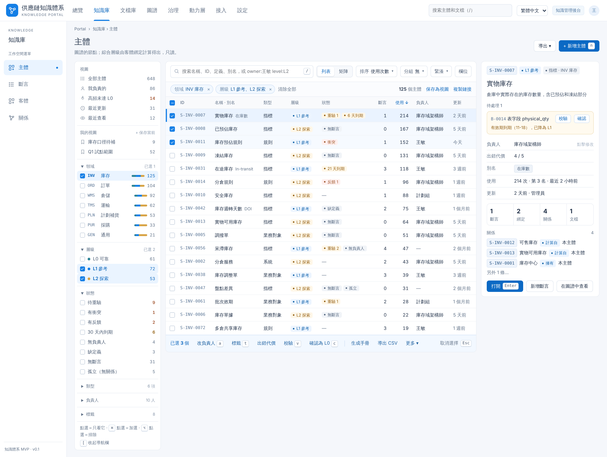
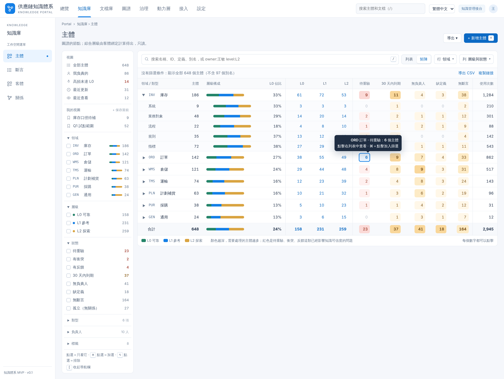
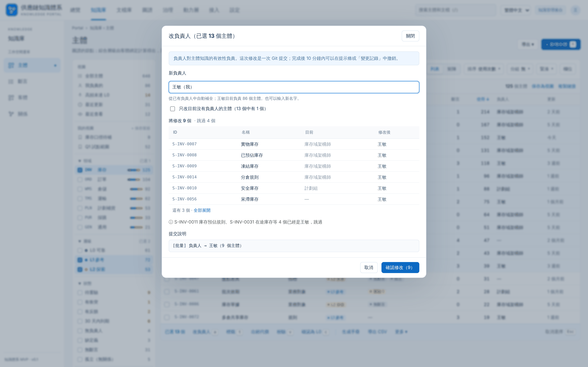
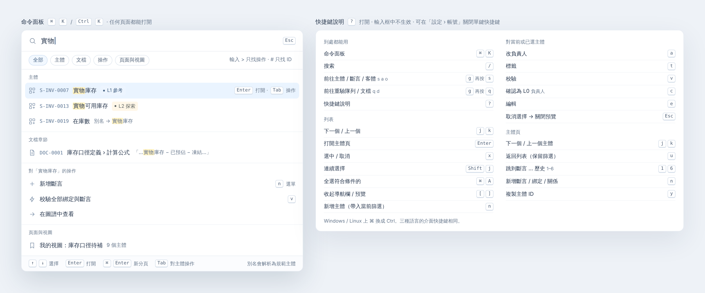
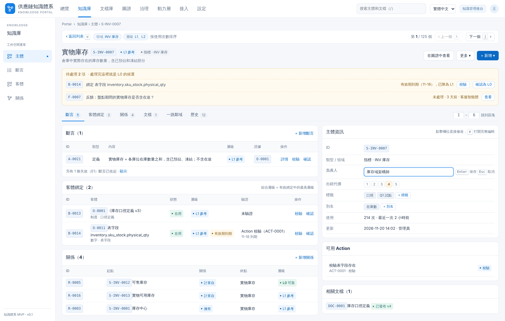

# 主體管理：讓大量主體好找、好看、好批量處理

設計稿 v1 · 2026-11-22 · **狀態：已評審，§17 全部按推薦；第一期和第二期已一起實作**（與設計不同的地方見 §18）

本文是後台「主體管理」的交互設計。起因是主體變多以後，管理困難、交互效率低：要找一類主體得反覆開下拉框，看一個主體要整頁跳轉再返回，改一批主體要一個一個改。你舉的例子是在左側選單和主體列表之間留出一塊導航空間，把領域和狀態平鋪開來，點一下就能篩選。本文以這個想法為核心，把導航、篩選與搜索、預覽、批量操作、鍵盤、視圖、主體頁一起設計成一套。評審通過後按 §16 分期實作，需要你確認的事集中在 §17。

核對所依據的版本：知識庫 `ali-sx-org-free/knowledge_setup` `main` @ `6b8bb19`。示意圖中的數字是虛構的「7 個領域、648 個主體」規模，用來展示主體多時的樣子；主體名稱盡量取自示例資料（可售庫存、實物庫存、庫存預佔規則等），`PUR 採購`、`GEN 通用` 兩個領域和 `S-INV-0031` 之類的 ID 是為了展示而虛構的。

## 0. 一頁摘要

- **主體頁改成「工作台」：選單 | 導航欄 | 列表 | 預覽。** 與文檔庫的三欄頁面同一個樣子、同一套操作，學一次兩處都會用。
- **導航欄把篩選平鋪出來，每一項都帶數量。** 視圖、領域、層級、狀態、類型、負責人、標籤，點一下就篩選，不用開下拉框；數量是「在其他已選條件下，點下去會剩幾個」。
- **「狀態」由現有數據算出。** 待重驗、有衝突、有反饋、30 天內到期、無負責人、缺定義、無斷言、孤立，不新增存儲欄位，知識倉庫不用改。
- **矩陣一眼看全局。** 領域 × 層級與狀態一張表，哪個領域 L2 多、哪裡待重驗堆積一目了然，點任何一格直接進入對應的主體列表。
- **不離開列表就能看和處理。** 右側預覽顯示主體的要點和待處理事項，可以直接校驗、確認、改負責人；`j` / `k` 換下一個。
- **一批一次提交。** 多選後改負責人、標籤、出錯代價、有效期，校驗、確認為 L0、生成手冊、導出 CSV；提交前預覽，提交後 10 分鐘內可撤銷。
- **鍵盤和滑鼠一樣快。** 列表、主體頁都有快捷鍵，`?` 顯示說明；第二期加命令面板 `⌘K`。
- **篩選寫進網址。** 返回、刷新、分享鏈接都回到同一個畫面；常用的篩選存成「我的視圖」。
- **主體頁帶著列表上下文。** 頂部顯示「第 7 / 125 個」和上一個、下一個；待處理事項置頂；區塊導航；負責人、出錯代價、標籤可以直接點擊修改。
- **順手修兩個問題。** 主體超過 500 個時列表會被靜默截斷；搜索時每按一個鍵都要對每個主體掃一遍全部關係找別名。
- **分兩期。** 第一期做主體工作台；第二期把同一套用到斷言、客體、關係、重驗隊列，並加命令面板和批量導入。

---

## 第一部分：問題

### 1. 現狀

主體一覽（`#subjects`）是一個面板：一個搜索框、三個下拉篩選（類型、領域、綜合層級）和一張表。每行兩行高，顯示 ID、名稱與定義、類型、領域、綜合層級、斷言數、待重驗數、使用次數、負責人。點名稱進入主體頁。主體頁有 6 個頂部按鈕、左側 4 個區塊（斷言、客體綁定、關係、相關文檔）和右側 4 個面板。

| # | 問題 | 現狀（已核對代碼） | 影響 |
| --- | --- | --- | --- |
| 1 | 看不到分佈 | 篩選是下拉框，打開前不知道每個領域、每個層級有多少 | 回答「庫存域還有多少主體不是 L0」要選三次下拉、讀兩次數再相加 |
| 2 | 一次只能選一個值 | 每個下拉單選 | 不能看「INV 和 ORD」、「L1 或 L2」 |
| 3 | 沒有狀態篩選 | 待重驗只是一列數字；缺負責人、缺定義、無斷言、即將到期都無法篩選 | 找「要處理的主體」只能逐行看，或去重驗隊列（按條目而非主體） |
| 4 | 不能按負責人找 | 沒有負責人篩選，搜索也不搜負責人欄位 | 交接時找不出某人負責的主體 |
| 5 | 篩選不進網址 | 只有搜索詞 `q` 會從網址讀入；改類型、領域、層級不寫回網址 | 點進主體再返回，篩選全部丟失；不能把篩選結果發給同事 |
| 6 | 看一個就要跳一次頁 | 沒有預覽；主體頁沒有「下一個」 | 逐個處理 20 個主體 = 40 次頁面切換，外加 20 次重新篩選 |
| 7 | 沒有多選和批量 | 主體一覽沒有勾選框（斷言頁已有「批量審批」） | 改 30 個主體的負責人要開 30 次對話框、產生 30 個提交 |
| 8 | 列表會被截斷 | `GET /subjects` 預設 `limit=500`，後台沒有傳 `limit` | 第 501 個以後的主體在列表中消失，數量顯示「500 個主體」，沒有任何提示 |
| 9 | 不能排序、不能分組 | 固定按 ID 排序 | 想先看「被問得最多的」「最近改過的」都做不到 |
| 10 | 行太高 | 每行顯示定義，約 50 px | 1000 px 高的螢幕一屏約 14 個主體 |
| 11 | 別名佔行 | 別名和規範主體各佔一行 | 示例資料中 26 行有 2 行是別名；主體多時更多 |
| 12 | 鍵盤只有 `/` | 只能聚焦全局搜索 | 高頻操作全靠滑鼠 |
| 13 | 儀表盤不能下鑽 | 「待重驗數」「L0 覆蓋率」等卡片和層級分佈條都不能點 | 看到問題後還要自己去列表重建篩選條件 |
| 14 | 搜索會隨規模變慢 | 有搜索詞時，對每個主體調用 `aliasesOf`，每次掃描全部關係 | 主體 × 關係，5,000 × 20,000 時每按一個鍵約一億次比較 |

另外兩點不是問題，但影響設計：

- 主體模型已有 `tags`（API 可寫，`PATCH /subjects/:id` 支持），只是後台沒有顯示和編輯入口。
- 主體有兩個「負責人」：`owner` 是顯示用的名字，`ownerIds` 是指定負責人的金鑰 ID（決定誰能確認、改有效期）。後台編輯框只有前者。

### 2. 目標

#### 2.1 三個典型任務，前後對比

| 任務 | 現在 | 之後 |
| --- | --- | --- |
| 看庫存域還有多少主體不是 L0 | 領域選 INV，層級選 L1 讀數，再選 L2 讀數，相加 | 導航欄點「INV」，層級組直接顯示 L0 / L1 / L2 各多少；或看矩陣那一行 |
| 某人離職，把他負責的 86 個主體轉給別人 | 沒有負責人篩選，只能逐行找；86 次「打開 → 編輯 → 改 → 保存」，86 個提交 | 負責人組點他 → `⌘A` → `a` → 輸入新負責人 → 確認。1 個提交，可撤銷 |
| 每週處理待重驗的主體 | 去重驗隊列（按條目），點主體 → 處理 → 返回 → 隊列重新載入 | 狀態組點「待重驗」→ 預覽欄直接校驗或確認 → `j` 下一個 |

#### 2.2 設計原則

1. **數量先行。** 任何可以點的篩選項，先告訴你點下去有幾個。
2. **一次點擊。** 常用篩選一次點擊完成，不開下拉框、不按「搜索」。
3. **不離開列表。** 看、改、處理待辦都在列表旁完成；需要整頁時再打開，打開了也能直接去下一個。
4. **一批一次提交。** 批量操作是一次 Git 提交，提交前預覽，提交後可撤銷，與現有「每次寫入一個提交」一致。
5. **狀態在網址裡。** 返回、刷新、分享鏈接都回到同一個畫面。
6. **鍵盤和滑鼠一樣快。** 每個高頻操作都有快捷鍵，並且能從界面上看到。
7. **和文檔庫同一套。** 同樣的欄位置、同樣的點選規則、同樣的快捷鍵；做好後文檔庫也換成同一個組件。
8. **不改知識模型。** 第一期只讀取已有數據、開放已有的 `tags` 欄位，知識倉庫的檔案格式不變。

#### 2.3 規模目標

| 項目 | 目標 |
| --- | --- |
| 主體數 | 5,000 個（含別名），10 個領域 |
| 篩選、計數一次請求 | 服務端 100 ms 以內（記憶體索引，見 §15.3） |
| 列表滾動 | 只渲染可見的行，5,000 行也流暢 |
| 一次批量 | 最多 500 個主體（一個提交）；更多時提示縮小範圍或分批 |

---

## 第二部分：設計

### 3. 佈局：主體工作台

圖 1 主體工作台（示意；已選「INV 庫存」和「L1、L2」，按使用次數排序，選中 3 個，預覽「實物庫存」）：



從左到右四欄：

| 欄 | 寬度 | 內容 |
| --- | --- | --- |
| 左側選單 | 176 px，可縮成 56 px 圖標欄 | 不變：主體、斷言、客體、關係之間切換 |
| 導航欄 | 228 px，`[` 收起 | 視圖、我的視圖、領域、層級、狀態、類型、負責人、標籤（§4） |
| 列表 | 其餘寬度 | 搜索、篩選條、表格、批量操作條（§5、§8） |
| 預覽 | 312 px，`]` 關閉 | 當前主體的要點、待處理事項和常用操作（§6） |

導航欄和預覽都固定在視窗內、各自滾動，列表滾到哪裡它們都在。

螢幕不夠寬時依次讓出空間：

| 視窗寬度 | 佈局 |
| --- | --- |
| 1600 px 以上 | 四欄全部顯示 |
| 1280–1599 px | 左側選單自動縮成圖標欄（懸停顯示名稱），其餘不變 |
| 1000–1279 px | 預覽改為從右側滑出的抽屜，蓋在列表上；`]` 或 `Esc` 關閉 |
| 700–999 px | 導航欄收進列表上方的「篩選」按鈕，點開是左側抽屜 |
| 700 px 以下 | 單欄：「篩選」按鈕 + 列表；點主體直接進主體頁，與現有手機佈局一致 |

左側選單縮成圖標欄是全後台的改動，所有頁面都能用，狀態記在瀏覽器裡。

### 4. 導航欄

這就是你舉例的那塊空間。它回答兩個問題：**有哪些、各有多少**，以及**點一下只看它**。

#### 4.1 分組

由上到下：

| 分組 | 內容 | 說明 |
| --- | --- | --- |
| 視圖 | 全部主體、我負責的、高頻未達 L0、最近更新、最近查看 | 起點：點一下會**替換**全部篩選條件（§10.2） |
| 我的視圖 | 你保存的篩選，可排序、重命名、刪除；「+ 保存當前」 | 同上，點一下替換全部條件 |
| 領域 | 每個領域一行：代碼、名稱、層級構成小條形、數量；可展開看該領域下各類型 | 篩選：與其他分組**疊加** |
| 層級 | L0 可靠、L1 參考、L2 探索，帶顏色點 | 綜合層級（由綁定算出，只讀） |
| 狀態 | 待重驗、有衝突、有反饋、30 天內到期、無負責人、缺定義、無斷言、孤立（§4.2） | 需要處理的數字用紅色或琥珀色 |
| 類型 | 系統、業務對象、流程、規則、指標、別名 | 預設收起 |
| 負責人 | 按主體數排列的前 8 人、「無負責人」、「另外 N 人…」（點開可搜索） | 預設收起 |
| 標籤 | 主體標籤（見 §17 第 5 條） | 預設收起 |

「視圖」和其他分組的分工：**視圖是起點，分組是細化**。點「我負責的」得到一個新的起點，再點「INV」「待重驗」在這個起點上縮小範圍。這樣不會出現「點了一個視圖，又和之前的條件混在一起」的困惑。

領域行的小條形是該領域全部主體的 L0 / L1 / L2 構成，不隨篩選變化，用來一眼比較各領域的成熟度；旁邊的數字隨篩選變化（§4.4）。

#### 4.2 「狀態」怎麼定義

主體沒有一個存儲的「狀態」欄位。後台說的狀態由兩部分組成：

- **層級**：綜合層級 L0 / L1 / L2，已有，由有效綁定中的最高層級算出。
- **狀態標記**：從主體自己和它下面的條目算出，一個主體可以同時有多個。

| 狀態標記 | 條件 | 顏色 |
| --- | --- | --- |
| 待重驗 | 有條目（斷言、綁定、關係）處於待重驗（`validity.pending`） | 紅 |
| 有衝突 | 有條目在未裁決的衝突中 | 紅 |
| 有反饋 | 有指向本主體或其條目的未處理反饋 | 紅 |
| 30 天內到期 | 有 L0 條目將在 30 天內到期（`validity.expiresAt`） | 琥珀 |
| 無負責人 | `owner` 為空 | 灰 |
| 缺定義 | `definition` 為空 | 灰 |
| 無斷言 | 沒有非 E1 的斷言 | 灰 |
| 孤立 | 除別名外沒有任何非 E1 的關係 | 灰 |
| 多義別名 | 別名指向多個規範主體（只在「類型：別名」下出現） | 琥珀 |

紅色表示已經影響知識可信度、應該先處理；琥珀色表示快要出問題；灰色是資料不完整。列表的「狀態」欄用同樣的文字標記（不只靠顏色），例如「重驗 2」「6 天到期」「無斷言」。

#### 4.3 點選規則

| 操作 | 作用 |
| --- | --- |
| 單擊 | 只看這一項（同組內替換）。再單擊一次取消 |
| `⌘` / `Ctrl` + 單擊，或點左側的勾選框 | 加選。同一組內是「或」，例如 INV 或 ORD |
| `⌥` / `Alt` + 單擊 | 排除，例如「類型 ≠ 別名」。篩選條上顯示為紅色的「≠」標籤 |
| 點分組標題右側的「已選 N」 | 清除這一組 |

不同分組之間是「且」：領域 INV 且 層級 L1 或 L2 且 狀態 待重驗。

懸停在一項上時顯示提示，例如「INV 庫存：125 個主體（L0 61 · L1 72 · L2 53）」。

#### 4.4 數量怎麼算

每個數字都是「保持其他分組的條件不變，點下去會剩幾個」。例如已選「層級：L1、L2」時，領域組顯示的是各領域中 L1 和 L2 主體的數量；層級組顯示的是在已選領域下 L0、L1、L2 各有多少（不受層級自己的條件影響，所以你能看到沒選的 L0 有 61 個）。

數量為 0 的項變淡但保留在原位，不跳動、不消失。

視圖的數量是視圖本身的數量，不受當前篩選影響。

#### 4.5 記憶

各分組的展開或收起、導航欄是否收起，記在瀏覽器裡。導航欄底部固定顯示點選規則的提示和 `[` 收起。

### 5. 列表

#### 5.1 搜索

- 搜索框在列表頂部，`/` 聚焦（在主體頁面以外仍是頂欄的全局搜索，與現在一致）。
- 範圍：ID、名稱、別名、定義、標籤、負責人。別名先解析為規範主體（沿用 `resolveTerms`），搜「ATP」得到「可售庫存」，並在行上標出「經別名 ATP」。
- 輸入即篩選（200 ms 防抖），結果中的命中文字高亮。
- **簡單語法**，給習慣鍵盤的人用。輸入後按空格就變成篩選條上的標籤，和在導航欄點選完全等價：

| 寫法 | 等於 |
| --- | --- |
| `domain:INV`、`領域:INV` | 領域 INV |
| `level:L2` | 層級 L2 |
| `type:指標` | 類型 指標 |
| `owner:王敏`、`owner:none` | 負責人 王敏、無負責人 |
| `tag:口徑` | 標籤 口徑 |
| `is:pending`、`is:conflict`、`is:expiring`、`is:orphan` | 狀態 待重驗、有衝突、30 天內到期、孤立 |
| `-type:別名` | 排除 類型 別名 |

語法是可選的：不知道語法的人永遠可以用導航欄。

#### 5.2 篩選條

搜索框下方一行，顯示目前生效的每個條件（例如「領域 INV 庫存 ×」「層級 L1 參考、L2 探索 ×」）、「清除全部」，右側是結果數、「保存為視圖」、「複製鏈接」。

#### 5.3 欄位、排序、分組、密度

| 控件 | 選項 |
| --- | --- |
| 排序 | 使用次數、優先級（使用次數 × 出錯代價，與重驗隊列相同）、最近更新、ID、名稱、層級、待重驗數；點表頭也能排序 |
| 分組 | 無、領域、類型、負責人、層級；組標題顯示數量，可摺疊 |
| 密度 | 緊湊（一行 35 px，定義放在預覽和懸停提示裡）、標準（兩行，顯示定義，等於現在） |
| 欄位 | 勾選和拖曳排序：ID、名稱、類型、領域、層級、狀態、斷言數、綁定數、關係數、待重驗數、使用次數、出錯代價、負責人、標籤、更新時間、最近到期日 |

預設：緊湊、按使用次數排序、不分組，欄位如圖 1。同樣的螢幕，緊湊模式一屏約 20 個主體，現在約 14 個。

#### 5.4 行的操作

| 操作 | 作用 |
| --- | --- |
| 單擊行 | 設為當前行（左側藍條），預覽跟著換 |
| 單擊名稱、雙擊行、`Enter` | 打開主體頁 |
| `⌘` / `Ctrl` + 單擊名稱 | 新分頁打開 |
| 勾選框、`x` | 選中（用於批量，§8）。「當前行」和「已選」是兩回事，與郵件客戶端一樣 |
| 懸停 | 行尾出現「校驗」「確認」「編輯」三個小按鈕 |
| 點負責人或出錯代價的格子 | 直接修改，`Enter` 保存、`Esc` 取消；一次一個提交 |

#### 5.5 載入

- 往下滾動自動載入下一批（每批 100 個），只渲染可見的行；表頭固定，底部顯示「已顯示 100 / 486」。
- 結果數始終是準確的總數。修正問題 8：不再靜默截斷。

#### 5.6 別名

預設不給別名單獨一行，而是把別名名稱以淡色小字掛在規範主體名稱後面（圖 1 中「實物庫存　在庫數」）。要管理別名時點「類型：別名」，別名就以行的形式列出，並可用「多義別名」篩選。搜索別名時照樣能找到規範主體。

#### 5.7 沒有結果時

說明是哪些條件組合導致為 0，並給出「去掉『層級：L0』後有 12 個」這樣的一鍵放寬按鈕。

### 6. 預覽

選中一行後，右側顯示（圖 1 右欄）：

1. **頭部**：ID、綜合層級、類型與領域、名稱、定義。
2. **待處理**：這個主體所有待重驗、衝突、反饋的條目，每條一行，帶原因和就地操作（校驗、確認為 L0、查看）。沒有待處理時不顯示。
3. **要點**：負責人（點擊修改）、出錯代價、別名、使用次數與排名、更新時間和作者。
4. **數量**：斷言、綁定、關係、相關文檔各幾條，點擊跳到主體頁對應區塊。
5. **關係**：前 3 條，點擊另一端的主體會在預覽中切換到它（不離開列表）。
6. **操作**：打開（`Enter`）、新增斷言、在圖譜中查看。

預覽的內容來自現有的 `GET /subjects/:id`（知識卡），不需要新接口；切換時先顯示列表行上已有的資料，知識卡回來後補全，不會閃白。

### 7. 矩陣：領域 × 層級與狀態

列表右上角的「列表 | 矩陣」切換到矩陣。這是「把領域和狀態平鋪開來」的完整版：一張表看完所有領域的情況。

圖 2 矩陣（示意；INV 展開到類型，滑鼠停在「ORD · 待重驗」上）：



- **行**：領域，可展開到類型。也可以切換為按類型、按負責人。
- **列**：主體數、層級構成條、L0 佔比、L0、L1、L2、待重驗、30 天內到期、無負責人、缺定義、無斷言、使用次數。
- **顏色**：問題欄的格子顏色隨數量加深；待重驗用紅色，其他用琥珀色。正常的數字是藍色鏈接。
- **點擊任何一格**：切回列表，篩選條件設為那一行與那一列，例如「領域 ORD、狀態 待重驗」。`⌘` + 點擊是把它加到當前條件上。
- 導航欄的條件同樣作用於矩陣，例如先點「負責人：王敏」，矩陣只統計王敏負責的主體。
- 可以「導出 CSV」，週會時直接貼進報告。

「L0 佔比」是該行中 L0 主體的比例，和健康指標裡的「L0 覆蓋率」（只看高頻主體）不同，兩者用不同的名字避免混淆。

### 8. 批量操作

#### 8.1 選擇

- 勾選框、`x`；`Shift` + 點擊選連續的一段，`Shift` + `j` / `k` 往下或往上延伸。
- `⌘A` 或表頭勾選框選中已載入的行，並出現提示「已選本頁 100 個。選擇全部 486 個符合條件的主體」，點後選中全部結果（不受載入了多少的限制）。
- 選中後，列表底部出現藍色的批量操作條（圖 1 底部），顯示已選數量和可用操作；`Esc` 取消選擇。
- 換篩選條件時保留已選的主體，操作條上顯示「其中 3 個不在當前結果中」。

#### 8.2 可用操作

| 操作 | 誰能用 | 做什麼 |
| --- | --- | --- |
| 改負責人 `a` | 貢獻者 | 改 `owner`；負責人另可勾選「同時設為指定負責人」（`ownerIds`，只有他能確認、改有效期） |
| 標籤 `t` | 貢獻者 | 加、去標籤，可同時多個；自動補全已有標籤 |
| 出錯代價 | 貢獻者 | 設為 1–5（決定重驗優先級） |
| 有效期 | 負責人 | 設定或清除主體級有效期覆蓋（`expiryDays`） |
| 校驗 `v` | 貢獻者 | 對所選主體的全部可校驗條目執行 Action 校驗；RPA 校驗照現有方式異步執行，進度在「執行記錄」 |
| 確認為 L0 `c` | 負責人 | 列出所選主體下全部「有證據的 L1」條目，逐條勾選後一次確認（沿用斷言頁「批量審批」的審閱方式，擴展到綁定和關係） |
| 生成手冊 | 人類貢獻者 | 每個主體一篇主體手冊（沿用 `POST /docs/generate`） |
| AI 起草 | 人類貢獻者 | 以所選主體（1–10 個）起草文檔（沿用 `POST /docs/ai-draft`） |
| 導出 CSV | 所有人 | 按當前欄位導出所選主體 |

不提供批量刪除：刪除只用於清理錯誤錄入，仍然一個一個做，並且只有管理員能做。

主體的類型和領域不能修改（領域代碼在 ID 裡），批量操作裡也沒有這兩項。

#### 8.3 流程：預覽、提交、撤銷

圖 3 批量修改負責人（示意；在圖 1 的列表中選了 13 個）：



1. 選操作後打開對話框，填寫新值。
2. 對話框列出**將修改**的主體（目前值 → 修改後）和**跳過**的主體及原因，例如「已經是王敏」「別名不設負責人」「你不是 S-INV-0012 的指定負責人」。
3. 顯示自動生成的提交說明，例如 `[批量] 負責人 → 王敏（9 個主體）`。
4. 確認後一次提交。提示條顯示「已修改 9 個主體 · 撤銷」，10 分鐘內可以點。

提交說明（繁體原文，後台按語言翻譯顯示，與現有規則一致）：

```
[批量] 負責人 → 王敏（9 個主體）
[批量] 標籤 +口徑 −草案（23 個主體）
[批量] 出錯代價 → 5（6 個主體）
[批量] 確認為 L0：14 條（斷言 9、綁定 4、關係 1，涉及 6 個主體）
[撤銷] [批量] 負責人 → 王敏（9 個主體）
```

#### 8.4 撤銷的規則

- 只限「整理類」操作：負責人、標籤、出錯代價、有效期。校驗和確認有自己的規則（到期降級、判定失效），不提供撤銷。
- 撤銷是寫一個反向提交，把這些主體的這些欄位改回原值；不改 Git 歷史。
- 某個主體在批量之後又被改過同一欄位時，這個主體跳過並說明，其他照常撤銷。
- 提示條上的「撤銷」保留 10 分鐘；之後在「變更記錄」中的這次提交旁邊也有「撤銷」，條件相同。

### 9. 鍵盤與命令面板

圖 5 命令面板與快捷鍵說明（示意；命令面板在第二期）：



#### 9.1 快捷鍵

| 範圍 | 鍵 | 作用 |
| --- | --- | --- |
| 全後台 | `/` | 搜索（列表頁聚焦列表搜索，其他頁聚焦頂欄） |
| | `?` | 快捷鍵說明 |
| | `g` 再按 `s` / `a` / `o` / `r` / `q` / `d` / `h` | 前往主體、斷言、客體、關係、重驗隊列、文檔、健康指標 |
| | `⌘K` / `Ctrl+K` | 命令面板（第二期） |
| 列表 | `j` / `k`，或 `↓` / `↑` | 下一個 / 上一個（預覽跟著換） |
| | `Enter` | 打開主體頁 |
| | `x` | 選中 / 取消選中當前行 |
| | `Shift` + `j` / `k` | 連續選擇 |
| | `⌘A` / `Ctrl+A` | 全選 |
| | `[` / `]` | 收起或展開導航欄 / 預覽 |
| | `n` | 新增主體（預填當前篩選的領域和類型） |
| 當前行或已選 | `a` 負責人、`t` 標籤、`v` 校驗、`c` 確認為 L0、`e` 編輯 | 已選多個時作用於全部已選，否則作用於當前行 |
| | `Esc` | 逐層退出：取消選擇 → 關閉預覽 → 清空搜索 |
| 主體頁 | `j` / `k` | 列表中的下一個 / 上一個主體 |
| | `u` | 返回列表（保留篩選和位置） |
| | `1`–`6` | 跳到斷言、綁定、關係、文檔、一跳鄰域、歷史 |
| | `n` | 新增（斷言、綁定、關係、文檔的選單） |
| | `y` | 複製主體 ID（寫文檔引用 `[[S-INV-0007]]` 時用） |

規則：

- 在輸入框、對話框中單鍵快捷鍵不生效。
- 「設定 › 帳號」可以關閉單鍵快捷鍵（只保留帶 `⌘` / `Ctrl` 的），以免誤觸或與讀屏軟件衝突。
- 主要按鈕旁直接標出快捷鍵（例如「+ 新增主體 `n`」「打開 `Enter`」），列表底部常駐一行提示，學起來不用背。
- 三種語言的快捷鍵相同。

#### 9.2 命令面板（第二期）

任何頁面按 `⌘K` 打開，一個輸入框找所有東西：

- **主體**：名稱、ID、別名（別名解析為規範主體），帶層級。
- **文檔章節**：沿用全局搜索的段級結果。
- **操作**：對選中的主體「新增斷言」「校驗」「在圖譜中查看」；以及「新增主體」「執行到期檢查」「切換語言」等全局操作。
- **頁面與視圖**：後台頁面、內置視圖和我的視圖。
- 輸入為空時顯示最近查看的主體和最近用過的操作。`>` 開頭只找操作，`#` 開頭只找 ID。`Tab` 對選中的主體展開操作。

命令面板和頂欄全局搜索用同一個接口（`GET /api/v1/search`），頂欄搜索保留。

### 10. 視圖與網址

#### 10.1 網址

篩選、排序、分組、模式和當前主體都寫進網址，例如：

```
#subjects?domain=INV,ORD&level=L1,L2&state=pending&type=!別名&sort=-usage&focus=S-INV-0007
#subjects?mode=matrix&rows=domain&owner=王敏
```

- 每次改條件用 `replaceState` 更新網址（不增加瀏覽器歷史），打開主體頁再返回時恢復條件、滾動位置和當前行。
- 「複製鏈接」複製的就是這個網址，同事打開看到的是同一個結果（按他的權限）。
- 舊網址 `#subjects?q=` 照常可用。

#### 10.2 內置視圖

| 視圖 | 條件 |
| --- | --- |
| 全部主體 | 不含別名 |
| 我負責的 | 指定負責人（`ownerIds`）包含我的金鑰，或「負責人」名字等於我的帳號名稱 |
| 高頻未達 L0 | 健康指標「L0 覆蓋率」所統計的高頻主體中，沒有 L0 知識的那些（就是覆蓋率的分子以外的部分） |
| 最近更新 | 14 天內有寫入 |
| 最近查看 | 我最近打開或預覽過的 30 個主體（記在瀏覽器裡） |

管理員登入時帳號名稱是「管理員」，可以在「設定 › 帳號」填寫自己用作負責人的名字，「我負責的」和批量改負責人的預設值都用它。

#### 10.3 我的視圖

- 「保存為視圖」記下網址中的全部條件，再加上欄位、密度、排序。可以命名、排序、重命名、刪除。
- 可以把一個視圖設為「進入主體頁時的預設視圖」。
- 存放位置見 §17 第 4 條。

### 11. 主體頁

圖 4 主體頁（示意；從圖 1 的列表打開「實物庫存」，正在修改負責人）：



| 改動 | 說明 |
| --- | --- |
| 列表上下文條 | 從列表進來時，頂部顯示「‹ 返回列表」、當時的篩選標籤、「第 1 / 125 個」和上一個、下一個（`k` / `j`）。直接打開鏈接時不顯示 |
| 標題行 | 名稱旁直接顯示 ID、綜合層級、類型與領域 |
| 按鈕整理 | 6 個按鈕收為 3 個：「在圖譜中查看」「更多 ▾」（編輯、刪除）、「+ 新增 ▾」（斷言、綁定客體、關係、為這個主體寫文檔） |
| 待處理條 | 有待重驗、衝突、反饋時，在頂部列出，每條帶就地操作；處理完自動消失 |
| 區塊導航 | 斷言、客體綁定、關係、文檔、一跳鄰域、歷史，帶數量；捲動時固定在頂部，`1`–`6` 跳轉 |
| 行內編輯 | 主體資訊中的負責人、出錯代價、標籤、別名、定義可以直接點擊修改，`Enter` 保存、`Esc` 取消；`e` 打開完整的編輯對話框 |
| E1 收起 | 失效的斷言預設收起為一行「另有 1 條失效（E1）斷言 · 顯示」，避免干擾 |

處理完一個主體按 `j` 直接到下一個，不用回列表。

### 12. 新增主體：少錄重複

主體多了以後，重複錄入是管理困難的主要來源之一（同一個東西兩個名字、兩個 ID）。

- **預填**：從列表新增時，領域、類型按當前篩選預選；負責人預填「我」。
- **查重**：輸入名稱時即時顯示同名、相似名稱和別名命中，例如「已有『可售庫存』S-INV-0012；『可用庫存』是它的別名。要新增別名嗎？」，可以一鍵改為新增別名。
- **連續新增**：「保存並繼續」保留領域、類型、負責人，清空名稱和定義，游標回到名稱。
- **批量導入**（第二期）：貼上表格或上傳 CSV（名稱、類型、領域、定義、負責人、別名、標籤），預覽每行的查重和校驗結果，一次提交。

### 13. 與其他頁面的聯動

| 頁面 | 變化 |
| --- | --- |
| 健康指標 | 四張指標卡可點：L0 覆蓋率 → 「高頻未達 L0」；待重驗數 → 狀態「待重驗」。層級分佈條的每一段可點。新增一個縮小版的「領域 × 層級」矩陣面板，點格子進入工作台 |
| 全局搜索 | 主體結果底部加「在主體工作台中查看全部 N 個」，帶上搜索詞 |
| 重驗隊列 | 每條的主體名稱可點，打開時帶上「狀態：待重驗」的列表上下文，處理完 `j` 到下一個 |
| 圖譜 | 第二期：工作台「更多 ▾ › 在圖譜中顯示這些主體」 |
| 文檔庫 | 第二期換成同一個工作台組件，行為不變（智能視圖、文件夾樹沿用），快捷鍵統一 |
| 變更記錄 | 批量提交以 `[批量]` 開頭，可以篩選；整理類批量旁有「撤銷」 |

### 14. 推廣到其他列表（第二期）

同一個工作台組件，換一組分組就能用在其他列表：

| 列表 | 導航欄分組 |
| --- | --- |
| 斷言 | 層級（含 E1）、類型、待重驗原因、證據（有客體 / 只有來源 / 無）、所屬主體的領域、30 天內到期 |
| 客體 | 類別、種類、狀態（在用 / 下線）、有無 Action、被綁定數（0 / 1 個以上） |
| 關係 | 類型、層級、起點領域、終點領域、待重驗 |
| 重驗隊列 | 原因、領域、負責人、條目種類 |
| 文檔 | 沿用現有的智能視圖和文件夾樹 |

---

## 第三部分：實作

### 15. API 與程式

#### 15.1 API

| 接口 | 變化 |
| --- | --- |
| `GET /api/v1/subjects` | `domain`、`type`、`level` 可以逗號分隔多個值，`!` 開頭表示排除；新增 `state`（`pending`、`conflict`、`feedback`、`expiring`、`no_owner`、`no_definition`、`no_assertion`、`isolated`、`ambiguous`）、`owner`（`none` 表示無負責人）、`ownerId`、`tag`、`mine=1`、`updatedSince`、`sort`、`offset`、`limit`（最大 1000）。每行增加 `flags`、`tags`、`aliases`、`relations`、`nextExpiry`。回應增加 `page: { total, offset, limit }`。不帶新參數時結果不變，只是超出 `limit` 時能從 `page.total` 知道還有多少 |
| `GET /api/v1/subjects/facets` | 參數同上；返回各分組每個值的聯動數量和總數。`pivot=domain\|type\|owner` 返回矩陣 |
| `POST /api/v1/subjects/batch` | `{ ids, set: { owner, ownerIds, errorCost, expiryDays }, addTags, removeTags }`，一次提交；返回每個主體的結果（`updated` 或 `skipped` 與原因）和提交雜湊。也可以傳 `query`（與 `GET /subjects` 相同的條件）代替 `ids`，用於「選擇全部符合條件的」 |
| `POST /api/v1/subjects/batch/undo` | `{ commit }`：寫反向提交（§8.4） |
| `POST /api/v1/validate-batch` | `{ subjectIds }`：校驗這些主體的全部可校驗條目；權限與單條校驗相同（貢獻者） |
| `POST /api/v1/items/confirm-batch` | 批量確認擴展到綁定和關係；舊的 `/assertions/confirm-batch` 保留 |
| `GET /api/v1/subjects/export?format=csv` | 參數同列表，另加 `columns` |
| `GET /api/v1/subjects/similar?name=` | 新增主體時查重 |
| `GET` / `PUT /admin/api/views` | 我的視圖（若 §17 第 4 條選擇存在服務端） |

智能體教程（`/prompt`）和 OpenAPI 補上新參數；智能體也能用 `state=pending&mine=1` 找自己負責的待處理主體。

知識倉庫的檔案格式不變。主體標籤沿用已有的 `tags` 欄位。

#### 15.2 前端

| 位置 | 改動 |
| --- | --- |
| `web/assets/workspace.js`（新） | 列表工作台組件：導航欄、篩選條、表格（虛擬滾動、排序、分組、欄位）、選擇與批量操作條、預覽欄位置、網址狀態。主體頁先用，第二期給其他列表和文檔庫 |
| `web/assets/keys.js`（新） | 快捷鍵註冊與分發、`?` 說明、輸入框中停用、設定中關閉單鍵快捷鍵 |
| `web/assets/app.js` | `PAGES.subjects` 改用工作台；主體頁加上下文條、待處理條、區塊導航、行內編輯；健康指標卡片可點和矩陣面板 |
| `web/assets/core.js` | 左側選單可縮成圖標欄 |
| `web/assets/app.css` | 新組件樣式，沿用現有設計變數，不引入新主色 |
| `web/assets/locales/` | 簡體、英文譯文；`npm run i18n:check` |

#### 15.3 性能

- 主體的狀態標記在載入和每次寫入後隨索引一起更新，不在請求時重算。
- 別名改為索引（規範主體 → 別名列表），搜索不再每次掃描全部關係（問題 14）。
- 聯動計數一次遍歷完成：每個主體先判斷是否滿足「除某一組以外的全部條件」，再累加到那一組。5,000 個主體、7 個分組約 3.5 萬次判斷。
- 列表每批 100 行，前端只渲染可見的約 40 行。

#### 15.4 多語言與無障礙

- 新文字經 `t()`；領域名稱、類型、層級等枚舉照現有規則經 `tv()` 翻譯，API 值仍是繁體原文。
- 搜索語法的鍵（`domain:`、`level:`）在三種語言下相同，另外接受中文寫法（`領域:`）。
- 導航欄是 `<nav aria-label="篩選">`，每一項是帶 `aria-pressed` 的按鈕，讀屏讀作「INV 庫存，125 個，已選」。
- 表格用一個可聚焦的網格（方向鍵移動），已選的行有 `aria-selected`。
- 狀態不只靠顏色：每個標記都有文字。
- 單鍵快捷鍵可關閉（§9.1）。

#### 15.5 測試與驗收

- 單元測試：每個篩選條件與組合、排除、聯動計數、排序與分頁、`page.total`、500 個以上主體不截斷；批量的跳過規則、權限、一次提交、撤銷與「之後又被改過」的情況。
- API 測試：新參數、`facets`、`batch`、`undo`、`validate-batch`、`items/confirm-batch`、CSV 導出。
- 性能測試：生成 5,000 個主體，列表加計數在 100 ms 以內。
- 驗收教程新增一節，覆蓋圖 1–4 的操作，附截圖。

### 16. 分期

| 期 | 內容 |
| --- | --- |
| 第一期：主體工作台 | 導航欄（視圖、我的視圖、領域、層級、狀態、類型、負責人、標籤）、聯動計數、點選規則；列表的搜索與語法、篩選條、排序、分組、密度、欄位、自動載入、別名掛在規範主體下；預覽；矩陣；批量（負責人、標籤、出錯代價、有效期、校驗、確認為 L0、生成手冊、AI 起草、導出 CSV）與撤銷；網址狀態、內置視圖、我的視圖；快捷鍵與 `?` 說明；主體頁改進（§11）；新增主體的預填、查重、連續新增；健康指標可點與矩陣面板；左側選單可縮；修正 500 截斷和別名搜索；API、OpenAPI、智能體教程、三語、測試、驗收教程 |
| 第二期：推廣與進階 | 命令面板 `⌘K`；斷言、客體、關係、重驗隊列使用同一工作台；文檔庫換成同一組件；批量導入（貼上表格、CSV）；拖曳主體到負責人或標籤；在圖譜中顯示篩選結果；批量新增關係 |

第一期不做的事：

- **修改主體的領域或類型。** 領域代碼在 ID 裡，類型不可改是現有規則（新建主體並把舊的轉 E1）。需要時另行設計「遷移助手」。
- **批量刪除。** 刪除只用於清理錯誤錄入，保持一個一個做。
- **主體的「停用」狀態。** 例如系統下線後的主體。這需要改知識模型；目前用綁定轉 E1、別名指向替代者來表達。若你需要，可以單獨設計。
- **團隊共享視圖、實時多人協作提示、自訂欄位。**

### 17. 需要你確認的事

每條都給了推薦。回覆「按推薦」即可開始第一期，也可以逐條改。

> **評審結果（2026-11-22）**：七條全部按推薦，第一期和第二期一起做。

| # | 問題 | 推薦 | 另一種做法 |
| --- | --- | --- | --- |
| 1 | 導航欄放哪裡 | 獨立一欄，放在左側選單和列表之間（就是你舉例的位置），`[` 可收起；螢幕不夠寬時左側選單先縮成圖標欄 | 放進左側選單「主體」下面：不加欄，但選單很長，其他頁面也不一致；或只在列表上方放篩選條：省空間，但看不到分佈 |
| 2 | 點擊篩選項的行為 | 單擊＝只看這一項；`⌘` / `Ctrl` + 單擊＝加選；`⌥` / `Alt` + 單擊＝排除 | 單擊就是勾選（多選）：連續選多個更快，但「只看庫存」要先取消其他 |
| 3 | 數量怎麼算 | 聯動：在其他已選條件下，點下去會剩幾個 | 固定總數：好理解，但點下去可能是 0 |
| 4 | 我的視圖存在哪裡 | 服務本地 `DATA_DIR`，按登入身份分開，換瀏覽器也在；文檔庫的自訂視圖一起遷過去 | 瀏覽器本地（和文檔庫現在一樣，最省事，換電腦就沒了）；或存進知識倉庫（全團隊共享、有歷史，但界面設定混進了知識） |
| 5 | 主體標籤 | 開放到界面（模型已有 `tags`），和文檔共用一份標籤字典（沿用 `docs/_tags.yaml`），標籤頁同時顯示文檔數和主體數，重命名、合併時一併改寫主體 | 不做標籤，只靠領域、類型、負責人；或主體用一份獨立的標籤字典 |
| 6 | 批量整理能否撤銷 | 能：寫反向提交，限負責人、標籤、出錯代價、有效期，且這些主體之後沒再被改過（§8.4） | 不提供撤銷，需要時在 Git 中 revert |
| 7 | 分期 | 第一期只做主體（含矩陣、主體頁改進、健康指標聯動）；第二期把同一套用到其他列表並加命令面板 | 一次做完所有列表：一致性更早到位，但第一期明顯變長 |

### 18. 實作說明

按 §17 的推薦實作，第一期和第二期一起交付。驗收步驟見 [驗收教程 N 章節](../acceptance-guide.md#n-主體管理)，自動化測試見 `test/subject-management.test.js`。與上文不同或需要說明的地方：

- **文檔庫沒有換成同一個列表組件。** 文檔庫原本就有文件夾樹、智能視圖和預覽，這次只把「我的視圖」改為存在服務端（與主體共用同一套存儲），並加上 `/`、`j`、`k`、Enter、`n` 快捷鍵。換成同一組件留待之後，需要時再做。
- **列表用自動載入代替虛擬滾動。** 每次載入 100 行，滾到底自動載入下一批；5000 個主體時篩選、排序和計數都在 100 ms 以內（性能測試覆蓋）。
- **導入的行號。** 預覽和查重提示（「與第 n 行重名」）用表格中的行號，表頭是第 1 行；API 調用方可以在每行帶 `line` 指定行號，不帶時按 `rows` 的順序從 1 數。
- **命令面板中按 Esc 直接關閉**，不先清空輸入框。
